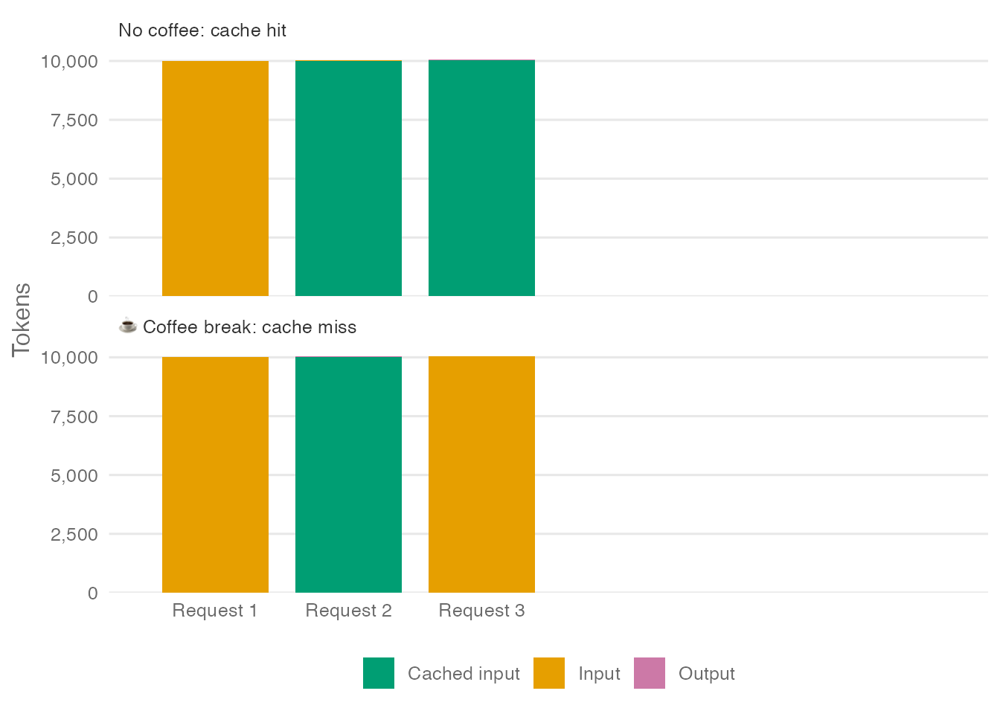
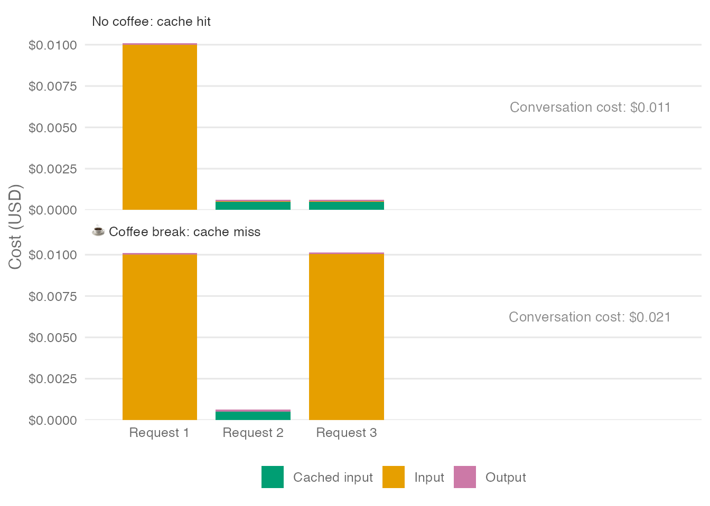
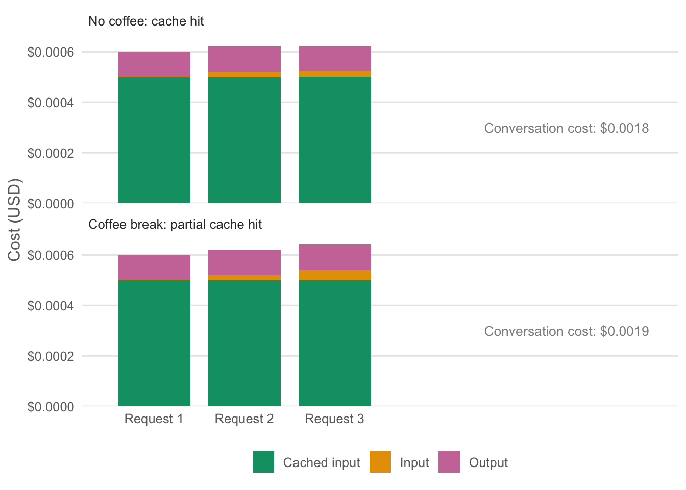
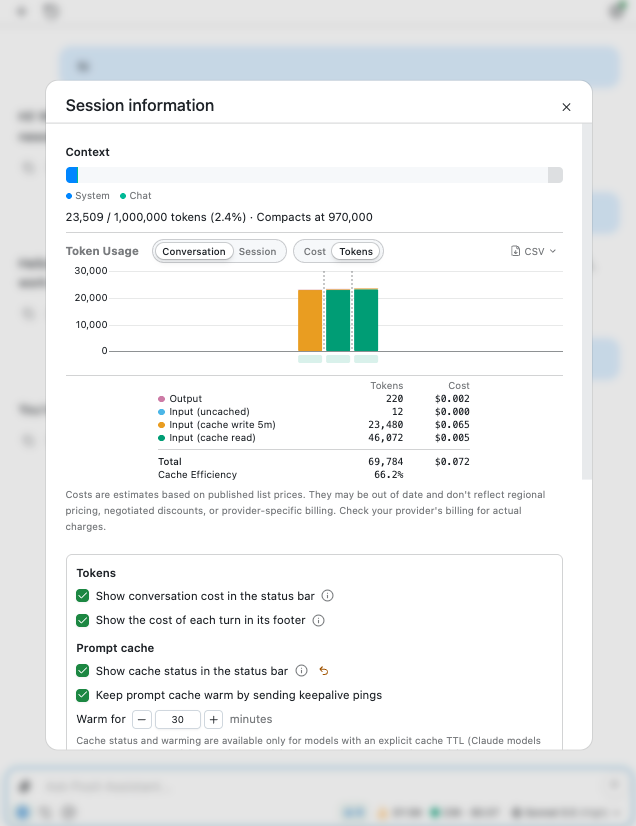
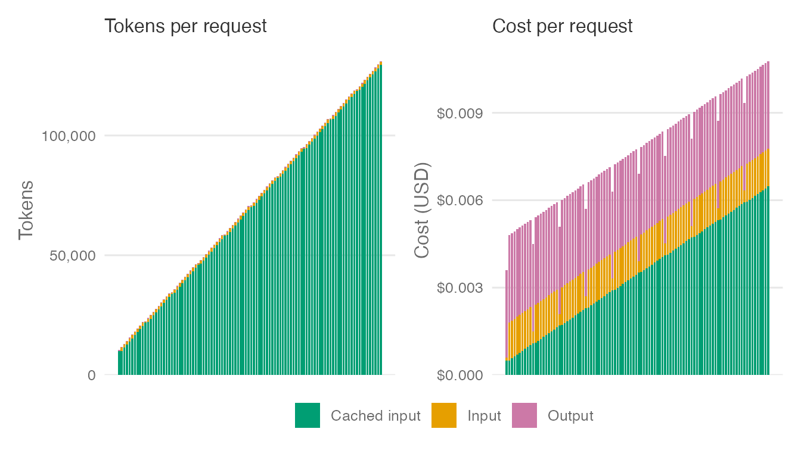

<link href="index_files/libs/htmltools-fill-0.5.9/fill.css" rel="stylesheet" />

<link href="index_files/libs/crosstalk-1.2.2/css/crosstalk.min.css" rel="stylesheet" />

<link href="index_files/libs/plotly-htmlwidgets-css-2.25.2/plotly-htmlwidgets.css" rel="stylesheet" />

How about a little riddle?

> You're using your favorite AI agent. The agent responds to you. If you respond right now, your next request will cost a fraction of a cent. If you go and make a coffee before responding, the same request will cost about a cent, roughly 16 times as much. How could that be?

## Token types

To understand what's going on, we need to take a step back. In the economics of LLMs, there are three kinds of tokens: *input tokens*, *output tokens*, and *cached input tokens*.

The first time you send a message to start a conversation, the system prompt (an "invisible" message provided by the agent that tells it how to behave) and your user prompt count as input tokens. They form the "input" that the model responds to. This response consumes output tokens.

To make this more concrete, let's walk through a hypothetical conversation with an agent. First, you say "Hi" to the agent. The agent's system prompt is made up of 10,000 tokens and "Hi" counts as one token, so sending that request consumes 10,001 *input* tokens. The model then responds with, "Hi! How can I help you today?," consuming something like ten *output* tokens.

Now, you're ready to send another message to the agent.[^1] This time, the numbers are going to shift around a bit. You ask the agent, "When was ggplot2 released?". Assuming the cache is still warm, the 10,001 tokens sent as input on the first request can now count as *cached input tokens*. A cached input token is an input token that the model provider has already processed and stored, so it can reuse that work instead of doing it again.

There are also new input tokens: the model's previous 10-token reply, which is being sent back as input for the first time, and your second question ("When was ggplot2 released?"), which we'll count as another 10 tokens. That makes 20 new input tokens. The model answers the question in a sentence, resulting in another 10 output tokens.

So, by request:

### Cached input tokens are much cheaper

It's great news that most of this second turn is composed of cached input tokens. Why? Because cached input tokens are *much less expensive* than uncached input tokens. Output tokens often cost several times as much as input tokens, and uncached input tokens can cost 10--20 times as much as cached input tokens. For our example, we'll use ratios of 10× and 20×, respectively.[^2] At those ratios, output tokens cost 200× as much as cached input tokens.

## Cache hits and misses

Now, let's revisit the question we kicked off this post with. The agent has just told us when ggplot2 was released. Before sending your next message, you can go and make a coffee if you want, but your next message will cost much more if you do. Why?

We've already seen that cached input tokens cost far less than normal input tokens. The kicker is that you don't always hit the cache. The cache is essentially the provider storing your already-processed tokens, which takes up space, so they only keep it "warm" for a certain amount of time. After that time, they discard it to make room for other users' conversations, and even tokens previously sent to the model are treated as new, "unseen" ones and billed accordingly.

While you've stepped away from your computer to make a coffee, your cache might grow "cold" when your provider discards it. If that happens, the next request you send will miss the cache, and all the tokens that would otherwise be billed as cached input tokens will instead be billed as normal input tokens.

So, the chart above could look one of two ways, depending on whether your third message is a cache hit or not:

Such large discrepancies in price-per-token mean that charts showing only the token counts of a given request might lead to poor intuitions about the cost of conversations. Here's the same chart, but the y-axis has been switched from number of tokens to cost of tokens:

## So can I ever take a break again?

This all might seem pretty stressful. Does this mean you can never take a coffee break again?! Do agents really need our attention this desperately? In practice, many mediating factors mean that cache misses aren't usually so bad. However, that doesn't mean you can ignore token caching if you're using coding agents in an intensive way. The cost of ignoring cache concerns entirely adds up really fast.

But there are a couple of considerations that should make you feel better about taking that break.

### Cache hits can be partial

Our opening example treated the cache status of the previously submitted input as all-or-nothing: either the next request reused all of it, or none of it. In practice, a request may constitute a partial cache hit, reusing a cached beginning (called a *prefix*) often made up of the system prompt and tool definitions, even if your messages are not cached.

For example, suppose our 10,000-token system prompt is already cached when the conversation starts and stays cached throughout. After a coffee break, the third request can still reuse that cached beginning, even if it has to process the later conversation history again:

<figure>

<figcaption aria-hidden="true">Hypothetical costs with the system prompt cached throughout. After the coffee break, request 3 reuses the system prompt but not the later conversation history.</figcaption>
</figure>

If that happens, the coffee break costs less than a complete cache miss would.

### How long does the cache stay warm?

In our example, the time it takes to make a coffee was enough to cause a cache miss. In reality, you might have longer, depending on the agent.

Some model providers provide explicit cache *time-to-live*, or TTL. A cache TTL means that, if you submit a compatible prompt within a specified window, its matching cached prefix is eligible for cached input pricing. For example, OpenAI offers a 30-minute cache TTL on GPT-5.6 and later models. By paying slightly more for cache writes the first time around (1.25x the ordinary input-token rate), you can pay the cached input price for matching, eligible prefixes when you submit another message (whether in Codex or [Posit Assistant](https://assistant.posit.co/)) in the next 30 minutes.

In Claude Code, requests billed per token default to a 5-minute cache TTL, with a more expensive 60-minute option. The main conversation defaults to 60 minutes when using a Claude subscription's included usage.

Not all providers offer a defined cache-retention window, so how long you can wait before a cache miss isn't always predictable.[^3]

So, in reality, you often have longer than the time it takes to make a coffee, but this depends on the provider.

### Posit Assistant helps keep your cache warm

More good news: if you're using [Posit Assistant](https://assistant.posit.co/), you'll probably have more time to devote to making an elaborate coffee without missing the cache. This is because Posit Assistant has a feature called *cache keepalive* that helps keep the cache warm. Cache keepalive is enabled by default for supported models. By default, it can send pings for up to 30 minutes after a real model request to keep the cache warm.

With Anthropic models, Posit Assistant uses a 5-minute cache TTL by default. Most requests from Posit Assistant (many of them tool results rather than user messages) are submitted much more quickly than 5 minutes after the most recent response; it thus doesn't make much sense to pay the premium for a 60-minute cache TTL. That said, even with a 5-minute cache TTL, we can help our users avoid a cache miss by sending lightweight requests under the hood about every 4 minutes and 30 seconds, capping output at 1 token. These "pings" refresh the cache but still have a cost, so the feature has to be tuned correctly to save the user money. We've found that sending a few of these pings for active sessions reliably reduces costs, at least among Posit Assistant's developers.

## How to keep costs down

There are also actions you as the user can take (besides never leaving your agents alone, which we don't recommend) to manage your cache.

### Understand what your conversation costs

You don't have to guess whether your requests are hitting the cache. The available information varies by agent, but the key number to look for is *cache reads*: input tokens whose processing the provider reused.

#### Posit Assistant

In Posit Assistant, you can see conversation information by clicking the token counter next to the model picker.

Hover over a bar in the token/cost usage chart to inspect an individual request.

<figure>

<figcaption aria-hidden="true">Posit Assistant’s session-information panel breaks down token usage and estimated costs by token type.</figcaption>
</figure>

#### Claude Code

In recent versions of Claude Code, you can see cache statistics by running [`/usage`](https://code.claude.com/docs/en/costs).

#### Other agents

For any agent, you can also use tools like [AgentsView](https://agentsview.io), which reports token usage and costs across many coding agents, or inspect your transcripts directly to learn more about your token and cache usage. For Claude Code, transcripts are written to `~/.claude/projects/` by default. For Codex, it's `~/.codex/sessions/`. You can ask a coding agent to take a look at these transcripts to get a more detailed view of your conversations.

### Know which changes can disrupt cache reuse

Other changes besides just time can disrupt cache reuse. One change you might encounter is switching models in the middle of the conversation, which will result in a cache miss. The conversation cache does not transfer from one model to another. For some models, this is also the case for switching from one thinking level to another. For example, switching from Opus 5 (low) to Opus 5 (high). Some newer model releases support switching thinking levels without breaking the cache, though.

### Manage conversation length

Our earlier example, where the system prompt was about ten thousand tokens while the user and agent messages were on the order of tens of tokens, was a bit contrived. In reality, agentic conversations can grow quite large quite quickly. It's not uncommon to see conversations where, for each short message (say, ~100 tokens) a user sends, there are 10 rounds of back-and-forth where the model calls tools and receives a response. In this case, if the typical tool call takes 300 output tokens, and the typical tool result takes 1000 input tokens, the full conversation length will be about 131,000 tokens after 10 user messages. Here's what each of those 100 requests looks like in tokens and in cost, assuming every one of them hits the cache:

Because every request resends the entire conversation so far, each request is bigger than the one before it. In tokens, that rereading dominates: almost every bar is cached input. In dollars, caching keeps the rereading cheap, so output and new input, which cost about the same every time, make up a much larger share of each request. At our illustrative prices, the last request costs only about 3 times as much as the first.

Long conversations raise the stakes of a cache miss, though, because a miss means paying full price for all of that history. If you take a coffee break before the last request and miss the cache, that one message costs about \$0.13 instead of \$0.01, roughly 12 times as much.

To keep token costs down, you might keep an eye out for good "stopping moments" in the conversation. If you come across one, start a new conversation or clear the current conversation history (`/clear` in most coding agents). If you want to retain a summary of your work, compact the conversation instead (`/compact` in most coding agents).

We recommend starting new conversations or compacting when switching from one task to another, such as when you're finished planning a feature and want to start implementing it. You should also probably find a stopping place once the conversation length exceeds 200,000 tokens or so (for models that support longer conversations). With this in mind, Posit Assistant has a small circle beside the conversation length that is green for shorter conversations, yellow for mid-length, and red for very long ones. Once you see a yellow circle, look for a natural stopping point.

## Unfortunately, you do need to care about caching

It can be tempting to ignore caching and carry on conversations with your agents at your preferred pace, not theirs. But these costs can really add up. The plots in this post deal in cents, but over a month, the difference between paying attention to caching and ignoring it can amount to tens or hundreds of dollars (or more) depending on how heavily you use these tools. That's probably especially worth keeping in mind if you're paying for tokens yourself. Understanding how your agent handles caching can help you avoid paying more than you need to for tokens.

[^1]: LLMs are stateless. They don't remember earlier requests on their own. Each new request therefore typically provides the entire conversation history as input, including earlier model replies.

[^2]: The cost charts in this post use illustrative prices with these ratios: \$10 per million output tokens, \$1 per million input tokens, and \$0.05 per million cached input tokens. Actual prices vary by model.

[^3]: For OpenAI models before GPT-5.6, cache retention is best-effort rather than guaranteed. In-memory caches typically last 5--10 minutes of inactivity and may last up to an hour. Some of these models support extended retention, also without a guaranteed lifetime. See OpenAI's prompt-caching guide: https://developers.openai.com/api/docs/guides/prompt-caching.
