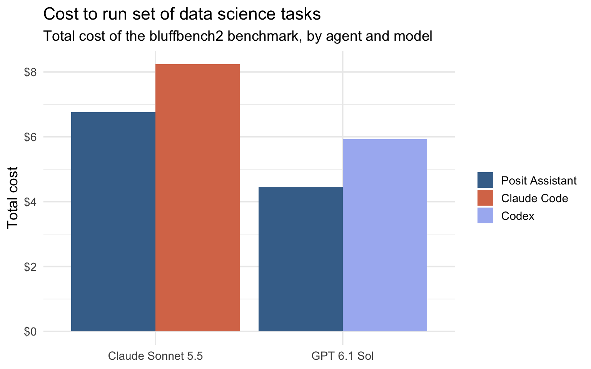
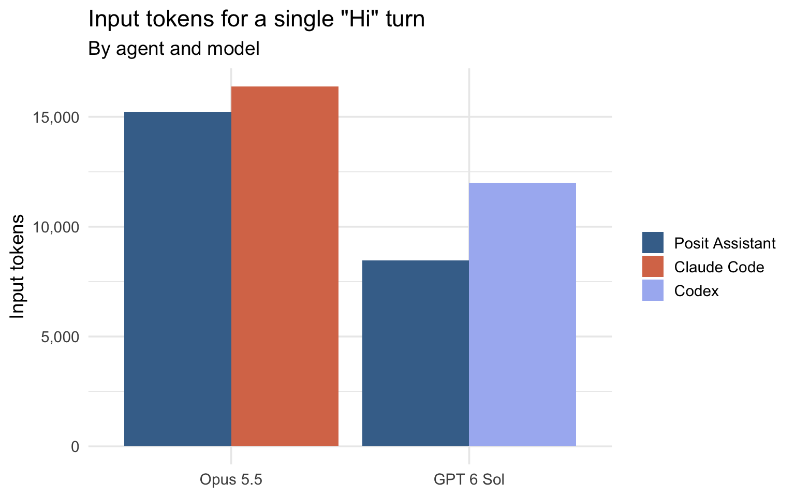
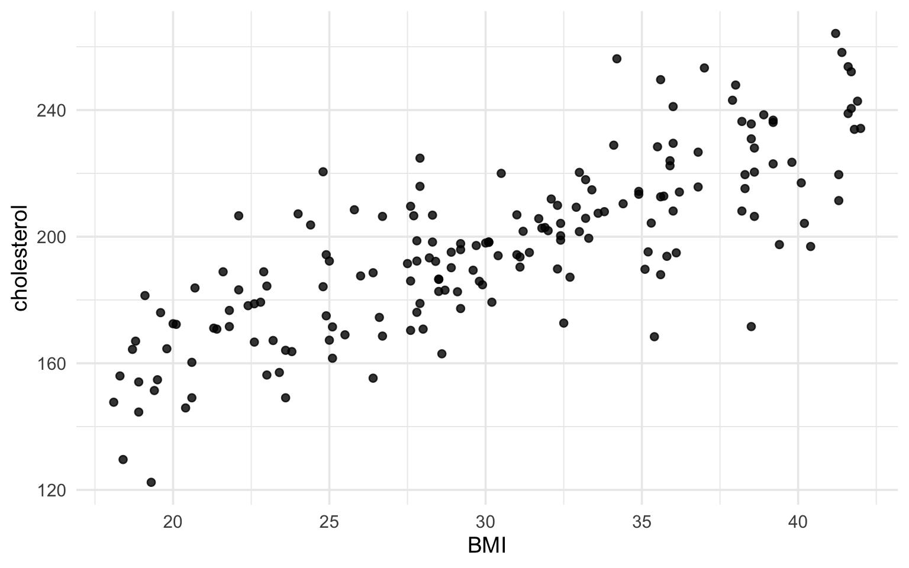

<div class="callout callout-note" role="note" aria-label="Note">
<div class="callout-header">
<span class="callout-title">LLM costs series</span>
</div>
<div class="callout-body">

This is the second post in our series on LLM costs. In the [previous post](https://opensource.posit.co/blog/2026-10-23_ai-newsletter/), we explained why you (unfortunately) need to care about token caching.

</div>
</div>

LLM tokens are expensive, especially if you use coding agents daily. We've heard from users at organizations with tight AI budgets, from academics paying out of pocket, and from many others caught off guard by how fast costs add up. In [last week's post](https://opensource.posit.co/blog/2026-10-23_ai-newsletter/) in our series on LLM costs, we talked about why you (unfortunately) do need to worry about token caching. Now, we have some good news!

[Posit Assistant](https://assistant.posit.co/) is designed to make your token budget go further. To see how it compares with other coding agents, we evaluated cost and performance on [bluffbench2](https://posit-dev.github.io/bluffbench2/), a benchmark that measures how well coding agents notice subtle data quality issues while carrying out exploratory data analysis.

On a set of data science tasks, Posit Assistant was 18% cheaper than Claude Code and 25% cheaper than Codex. Posit Assistant and Claude Code performed the tasks similarly well, while transitioning from Codex to Posit Assistant increased scores on the set of tasks by 44%. **Posit Assistant is a cost-efficient alternative to leading coding agents.**



## How we measured cost efficiency

We evaluated Posit Assistant, Claude Code, and Codex on Posit's benchmark [bluffbench2](https://posit-dev.github.io/bluffbench2/), which measures how well coding agents notice subtle data quality issues during exploratory data analysis. Posit Assistant never scores worse on this eval than the other harnesses, and is strictly cheaper:

<div id="znpmmtdlcf" style="padding-left:0px;padding-right:0px;padding-top:10px;padding-bottom:10px;overflow-x:auto;overflow-y:auto;width:auto;height:auto;">
<style>#znpmmtdlcf table {
  font-family: system-ui, 'Segoe UI', Roboto, Helvetica, Arial, sans-serif, 'Apple Color Emoji', 'Segoe UI Emoji', 'Segoe UI Symbol', 'Noto Color Emoji';
  -webkit-font-smoothing: antialiased;
  -moz-osx-font-smoothing: grayscale;
}
#znpmmtdlcf thead, #znpmmtdlcf tbody, #znpmmtdlcf tfoot, #znpmmtdlcf tr, #znpmmtdlcf td, #znpmmtdlcf th {
  border-style: none;
}
#znpmmtdlcf p {
  margin: 0;
  padding: 0;
}
#znpmmtdlcf .gt_table {
  display: table;
  border-collapse: collapse;
  line-height: normal;
  margin-left: auto;
  margin-right: auto;
  color: #333333;
  font-size: 16px;
  font-weight: normal;
  font-style: normal;
  background-color: #FFFFFF;
  width: 100%;
  border-top-style: none;
  border-top-width: 2px;
  border-top-color: #A8A8A8;
  border-right-style: none;
  border-right-width: 2px;
  border-right-color: #D3D3D3;
  border-bottom-style: solid;
  border-bottom-width: 2px;
  border-bottom-color: #A8A8A8;
  border-left-style: none;
  border-left-width: 2px;
  border-left-color: #D3D3D3;
}
#znpmmtdlcf .gt_caption {
  padding-top: 4px;
  padding-bottom: 4px;
}
#znpmmtdlcf .gt_title {
  color: #333333;
  font-size: 125%;
  font-weight: initial;
  padding-top: 4px;
  padding-bottom: 4px;
  padding-left: 5px;
  padding-right: 5px;
  border-bottom-color: #FFFFFF;
  border-bottom-width: 0;
}
#znpmmtdlcf .gt_subtitle {
  color: #333333;
  font-size: 85%;
  font-weight: initial;
  padding-top: 3px;
  padding-bottom: 5px;
  padding-left: 5px;
  padding-right: 5px;
  border-top-color: #FFFFFF;
  border-top-width: 0;
}
#znpmmtdlcf .gt_heading {
  background-color: #FFFFFF;
  text-align: center;
  border-bottom-color: #FFFFFF;
  border-left-style: none;
  border-left-width: 1px;
  border-left-color: #D3D3D3;
  border-right-style: none;
  border-right-width: 1px;
  border-right-color: #D3D3D3;
}
#znpmmtdlcf .gt_bottom_border {
  border-bottom-style: solid;
  border-bottom-width: 2px;
  border-bottom-color: #D3D3D3;
}
#znpmmtdlcf .gt_col_headings {
  border-top-style: solid;
  border-top-width: 2px;
  border-top-color: #D3D3D3;
  border-bottom-style: solid;
  border-bottom-width: 2px;
  border-bottom-color: #D3D3D3;
  border-left-style: none;
  border-left-width: 1px;
  border-left-color: #D3D3D3;
  border-right-style: none;
  border-right-width: 1px;
  border-right-color: #D3D3D3;
}
#znpmmtdlcf .gt_col_heading {
  color: #333333;
  background-color: #FFFFFF;
  font-size: 100%;
  font-weight: normal;
  text-transform: inherit;
  border-left-style: none;
  border-left-width: 1px;
  border-left-color: #D3D3D3;
  border-right-style: none;
  border-right-width: 1px;
  border-right-color: #D3D3D3;
  vertical-align: bottom;
  padding-top: 5px;
  padding-bottom: 6px;
  padding-left: 5px;
  padding-right: 5px;
  overflow-x: hidden;
}
#znpmmtdlcf .gt_column_spanner_outer {
  color: #333333;
  background-color: #FFFFFF;
  font-size: 100%;
  font-weight: normal;
  text-transform: inherit;
  padding-top: 0;
  padding-bottom: 0;
  padding-left: 4px;
  padding-right: 4px;
}
#znpmmtdlcf .gt_column_spanner_outer:first-child {
  padding-left: 0;
}
#znpmmtdlcf .gt_column_spanner_outer:last-child {
  padding-right: 0;
}
#znpmmtdlcf .gt_column_spanner {
  border-bottom-style: solid;
  border-bottom-width: 2px;
  border-bottom-color: #D3D3D3;
  vertical-align: bottom;
  padding-top: 5px;
  padding-bottom: 5px;
  overflow-x: hidden;
  display: inline-block;
  width: 100%;
}
#znpmmtdlcf .gt_spanner_row {
  border-bottom-style: hidden;
}
#znpmmtdlcf .gt_group_heading {
  padding-top: 8px;
  padding-bottom: 8px;
  padding-left: 5px;
  padding-right: 5px;
  color: #333333;
  background-color: #FFFFFF;
  font-size: 100%;
  font-weight: initial;
  text-transform: inherit;
  border-top-style: solid;
  border-top-width: 2px;
  border-top-color: #D3D3D3;
  border-bottom-style: solid;
  border-bottom-width: 2px;
  border-bottom-color: #D3D3D3;
  border-left-style: none;
  border-left-width: 1px;
  border-left-color: #D3D3D3;
  border-right-style: none;
  border-right-width: 1px;
  border-right-color: #D3D3D3;
  vertical-align: middle;
  text-align: left;
}
#znpmmtdlcf .gt_empty_group_heading {
  padding: 0.5px;
  color: #333333;
  background-color: #FFFFFF;
  font-size: 100%;
  font-weight: initial;
  border-top-style: solid;
  border-top-width: 2px;
  border-top-color: #D3D3D3;
  border-bottom-style: solid;
  border-bottom-width: 2px;
  border-bottom-color: #D3D3D3;
  vertical-align: middle;
}
#znpmmtdlcf .gt_from_md > :first-child {
  margin-top: 0;
}
#znpmmtdlcf .gt_from_md > :last-child {
  margin-bottom: 0;
}
#znpmmtdlcf .gt_row {
  padding-top: 8px;
  padding-bottom: 8px;
  padding-left: 5px;
  padding-right: 5px;
  margin: 10px;
  border-top-style: solid;
  border-top-width: 1px;
  border-top-color: #D3D3D3;
  border-left-style: none;
  border-left-width: 1px;
  border-left-color: #D3D3D3;
  border-right-style: none;
  border-right-width: 1px;
  border-right-color: #D3D3D3;
  vertical-align: middle;
  overflow-x: hidden;
}
#znpmmtdlcf .gt_stub {
  color: #333333;
  background-color: #FFFFFF;
  font-size: 100%;
  font-weight: initial;
  text-transform: inherit;
  border-right-style: none;
  border-right-width: 2px;
  border-right-color: #D3D3D3;
  padding-left: 5px;
  padding-right: 5px;
}
#znpmmtdlcf .gt_stub_row_group {
  color: #333333;
  background-color: #FFFFFF;
  font-size: 100%;
  font-weight: initial;
  text-transform: inherit;
  border-right-style: solid;
  border-right-width: 2px;
  border-right-color: #D3D3D3;
  padding-left: 5px;
  padding-right: 5px;
  vertical-align: top;
}
#znpmmtdlcf .gt_row_group_first td {
  border-top-width: 2px;
}
#znpmmtdlcf .gt_row_group_first th {
  border-top-width: 2px;
}
#znpmmtdlcf .gt_summary_row {
  color: #333333;
  background-color: #FFFFFF;
  text-transform: inherit;
  padding-top: 8px;
  padding-bottom: 8px;
  padding-left: 5px;
  padding-right: 5px;
}
#znpmmtdlcf .gt_first_summary_row {
  border-top-style: solid;
  border-top-color: #D3D3D3;
}
#znpmmtdlcf .gt_first_summary_row.thick {
  border-top-width: 2px;
}
#znpmmtdlcf .gt_last_summary_row {
  padding-top: 8px;
  padding-bottom: 8px;
  padding-left: 5px;
  padding-right: 5px;
  border-bottom-style: solid;
  border-bottom-width: 2px;
  border-bottom-color: #D3D3D3;
}
#znpmmtdlcf .gt_grand_summary_row {
  color: #333333;
  background-color: #FFFFFF;
  text-transform: inherit;
  padding-top: 8px;
  padding-bottom: 8px;
  padding-left: 5px;
  padding-right: 5px;
}
#znpmmtdlcf .gt_first_grand_summary_row {
  padding-top: 8px;
  padding-bottom: 8px;
  padding-left: 5px;
  padding-right: 5px;
  border-top-style: double;
  border-top-width: 6px;
  border-top-color: #D3D3D3;
}
#znpmmtdlcf .gt_last_grand_summary_row_top {
  padding-top: 8px;
  padding-bottom: 8px;
  padding-left: 5px;
  padding-right: 5px;
  border-bottom-style: double;
  border-bottom-width: 6px;
  border-bottom-color: #D3D3D3;
}
#znpmmtdlcf .gt_striped {
  background-color: rgba(128, 128, 128, 0.05);
}
#znpmmtdlcf .gt_table_body {
  border-top-style: solid;
  border-top-width: 2px;
  border-top-color: #D3D3D3;
  border-bottom-style: solid;
  border-bottom-width: 2px;
  border-bottom-color: #D3D3D3;
}
#znpmmtdlcf .gt_footnotes {
  color: #333333;
  background-color: #FFFFFF;
  border-bottom-style: none;
  border-bottom-width: 2px;
  border-bottom-color: #D3D3D3;
  border-left-style: none;
  border-left-width: 2px;
  border-left-color: #D3D3D3;
  border-right-style: none;
  border-right-width: 2px;
  border-right-color: #D3D3D3;
}
#znpmmtdlcf .gt_footnote {
  margin: 0px;
  font-size: 90%;
  padding-top: 4px;
  padding-bottom: 4px;
  padding-left: 5px;
  padding-right: 5px;
}
#znpmmtdlcf .gt_sourcenotes {
  color: #333333;
  background-color: #FFFFFF;
  border-bottom-style: none;
  border-bottom-width: 2px;
  border-bottom-color: #D3D3D3;
  border-left-style: none;
  border-left-width: 2px;
  border-left-color: #D3D3D3;
  border-right-style: none;
  border-right-width: 2px;
  border-right-color: #D3D3D3;
}
#znpmmtdlcf .gt_sourcenote {
  font-size: 90%;
  padding-top: 4px;
  padding-bottom: 4px;
  padding-left: 5px;
  padding-right: 5px;
}
#znpmmtdlcf .gt_left {
  text-align: left;
}
#znpmmtdlcf .gt_center {
  text-align: center;
}
#znpmmtdlcf .gt_right {
  text-align: right;
  font-variant-numeric: tabular-nums;
}
#znpmmtdlcf .gt_font_normal {
  font-weight: normal;
}
#znpmmtdlcf .gt_font_bold {
  font-weight: bold;
}
#znpmmtdlcf .gt_font_italic {
  font-style: italic;
}
#znpmmtdlcf .gt_super {
  font-size: 65%;
}
#znpmmtdlcf .gt_footnote_marks {
  font-size: 75%;
  vertical-align: 0.4em;
  position: initial;
}
#znpmmtdlcf .gt_asterisk {
  font-size: 100%;
  vertical-align: 0;
}
#znpmmtdlcf .gt_indent_1 {
  text-indent: 5px;
}
#znpmmtdlcf .gt_indent_2 {
  text-indent: 10px;
}
#znpmmtdlcf .gt_indent_3 {
  text-indent: 15px;
}
#znpmmtdlcf .gt_indent_4 {
  text-indent: 20px;
}
#znpmmtdlcf .gt_indent_5 {
  text-indent: 25px;
}
#znpmmtdlcf .katex-display {
  display: inline-flex !important;
  margin-bottom: 0.75em !important;
}
#znpmmtdlcf div.Reactable > div.rt-table > div.rt-thead > div.rt-tr.rt-tr-group-header > div.rt-th-group:after {
  height: 0px !important;
}
</style>
<table class="gt_table" data-quarto-disable-processing="true" data-quarto-bootstrap="false">
  <thead>
    <tr class="gt_heading">
      <td colspan="3" class="gt_heading gt_title gt_font_normal gt_bottom_border" style="text-align: left;">bluffbench2</td>
    </tr>
    <tr class="gt_col_headings">
      <th class="gt_col_heading gt_columns_bottom_border gt_left" rowspan="1" colspan="1" scope="col" id="a::stub">Agent / model</th>
      <th class="gt_col_heading gt_columns_bottom_border gt_right" rowspan="1" colspan="1" scope="col" id="score">Benchmark score</th>
      <th class="gt_col_heading gt_columns_bottom_border gt_right" rowspan="1" colspan="1" scope="col" id="cost">Total cost (USD)</th>
    </tr>
  </thead>
  <tbody class="gt_table_body">
    <tr class="gt_group_heading_row">
      <th colspan="3" class="gt_group_heading" style="font-weight: bold; background-color: #FFFFFF;" scope="colgroup" id="Claude Sonnet 5.5">Claude Sonnet 5.5</th>
    </tr>
    <tr class="gt_row_group_first"><th id="stub_1_1" scope="row" class="gt_row gt_left gt_stub" style="font-weight: normal; background-color: #EEF3F8;">Posit Assistant</th>
<td headers="Claude Sonnet 5.5 stub_1_1 score" class="gt_row gt_right" style="font-weight: normal; background-color: #EEF3F8;">42%</td>
<td headers="Claude Sonnet 5.5 stub_1_1 cost" class="gt_row gt_right" style="font-weight: normal; background-color: #EEF3F8;">$6.76</td></tr>
    <tr><th id="stub_1_2" scope="row" class="gt_row gt_left gt_stub" style="font-weight: normal; background-color: #FFFFFF;">Claude Code + Console</th>
<td headers="Claude Sonnet 5.5 stub_1_2 score" class="gt_row gt_right" style="font-weight: normal; background-color: #FFFFFF;">38%</td>
<td headers="Claude Sonnet 5.5 stub_1_2 cost" class="gt_row gt_right" style="font-weight: normal; background-color: #FFFFFF;">$7.27</td></tr>
    <tr><th id="stub_1_3" scope="row" class="gt_row gt_left gt_stub" style="font-weight: normal; background-color: #FFFFFF;">Claude Code, shell only</th>
<td headers="Claude Sonnet 5.5 stub_1_3 score" class="gt_row gt_right" style="font-weight: normal; background-color: #FFFFFF;">42%</td>
<td headers="Claude Sonnet 5.5 stub_1_3 cost" class="gt_row gt_right" style="font-weight: normal; background-color: #FFFFFF;">$8.24</td></tr>
    <tr class="gt_group_heading_row">
      <th colspan="3" class="gt_group_heading" style="font-weight: bold; background-color: #FFFFFF;" scope="colgroup" id="GPT 6.1 Sol">GPT 6.1 Sol</th>
    </tr>
    <tr class="gt_row_group_first"><th id="stub_1_4" scope="row" class="gt_row gt_left gt_stub" style="font-weight: normal; background-color: #EEF3F8;">Posit Assistant</th>
<td headers="GPT 6.1 Sol stub_1_4 score" class="gt_row gt_right" style="font-weight: normal; background-color: #EEF3F8;">17%</td>
<td headers="GPT 6.1 Sol stub_1_4 cost" class="gt_row gt_right" style="font-weight: normal; background-color: #EEF3F8;">$4.46</td></tr>
    <tr><th id="stub_1_5" scope="row" class="gt_row gt_left gt_stub" style="font-weight: normal; background-color: #FFFFFF;">Codex + Console</th>
<td headers="GPT 6.1 Sol stub_1_5 score" class="gt_row gt_right" style="font-weight: normal; background-color: #FFFFFF;">9%</td>
<td headers="GPT 6.1 Sol stub_1_5 cost" class="gt_row gt_right" style="font-weight: normal; background-color: #FFFFFF;">$5.77</td></tr>
    <tr><th id="stub_1_6" scope="row" class="gt_row gt_left gt_stub" style="font-weight: normal; background-color: #FFFFFF;">Codex, shell only</th>
<td headers="GPT 6.1 Sol stub_1_6 score" class="gt_row gt_right" style="font-weight: normal; background-color: #FFFFFF;">12%</td>
<td headers="GPT 6.1 Sol stub_1_6 cost" class="gt_row gt_right" style="font-weight: normal; background-color: #FFFFFF;">$5.92</td></tr>
  </tbody>
  <tfoot>
    <tr class="gt_sourcenotes">
      <td class="gt_sourcenote" colspan="3">"Console" means access to a persistent R session via MCP. "shell only" means running R through scripts.</td>
    </tr>
  </tfoot>
</table>
</div>

We also evaluated the agents on Python software engineering tasks from [DeepSWE 1.1](https://deepswe.datacurve.ai/). DeepSWE is currently one of the industry-standard agentic coding benchmarks. On these tasks, Posit Assistant scored about the same as Claude Code and Codex for about the same price (Posit Assistant was 4% and 12% cheaper, respectively).[^1]

<div id="qmxbdvfmlp" style="padding-left:0px;padding-right:0px;padding-top:10px;padding-bottom:10px;overflow-x:auto;overflow-y:auto;width:auto;height:auto;">
<style>#qmxbdvfmlp table {
  font-family: system-ui, 'Segoe UI', Roboto, Helvetica, Arial, sans-serif, 'Apple Color Emoji', 'Segoe UI Emoji', 'Segoe UI Symbol', 'Noto Color Emoji';
  -webkit-font-smoothing: antialiased;
  -moz-osx-font-smoothing: grayscale;
}
#qmxbdvfmlp thead, #qmxbdvfmlp tbody, #qmxbdvfmlp tfoot, #qmxbdvfmlp tr, #qmxbdvfmlp td, #qmxbdvfmlp th {
  border-style: none;
}
#qmxbdvfmlp p {
  margin: 0;
  padding: 0;
}
#qmxbdvfmlp .gt_table {
  display: table;
  border-collapse: collapse;
  line-height: normal;
  margin-left: auto;
  margin-right: auto;
  color: #333333;
  font-size: 16px;
  font-weight: normal;
  font-style: normal;
  background-color: #FFFFFF;
  width: 100%;
  border-top-style: none;
  border-top-width: 2px;
  border-top-color: #A8A8A8;
  border-right-style: none;
  border-right-width: 2px;
  border-right-color: #D3D3D3;
  border-bottom-style: solid;
  border-bottom-width: 2px;
  border-bottom-color: #A8A8A8;
  border-left-style: none;
  border-left-width: 2px;
  border-left-color: #D3D3D3;
}
#qmxbdvfmlp .gt_caption {
  padding-top: 4px;
  padding-bottom: 4px;
}
#qmxbdvfmlp .gt_title {
  color: #333333;
  font-size: 125%;
  font-weight: initial;
  padding-top: 4px;
  padding-bottom: 4px;
  padding-left: 5px;
  padding-right: 5px;
  border-bottom-color: #FFFFFF;
  border-bottom-width: 0;
}
#qmxbdvfmlp .gt_subtitle {
  color: #333333;
  font-size: 85%;
  font-weight: initial;
  padding-top: 3px;
  padding-bottom: 5px;
  padding-left: 5px;
  padding-right: 5px;
  border-top-color: #FFFFFF;
  border-top-width: 0;
}
#qmxbdvfmlp .gt_heading {
  background-color: #FFFFFF;
  text-align: center;
  border-bottom-color: #FFFFFF;
  border-left-style: none;
  border-left-width: 1px;
  border-left-color: #D3D3D3;
  border-right-style: none;
  border-right-width: 1px;
  border-right-color: #D3D3D3;
}
#qmxbdvfmlp .gt_bottom_border {
  border-bottom-style: solid;
  border-bottom-width: 2px;
  border-bottom-color: #D3D3D3;
}
#qmxbdvfmlp .gt_col_headings {
  border-top-style: solid;
  border-top-width: 2px;
  border-top-color: #D3D3D3;
  border-bottom-style: solid;
  border-bottom-width: 2px;
  border-bottom-color: #D3D3D3;
  border-left-style: none;
  border-left-width: 1px;
  border-left-color: #D3D3D3;
  border-right-style: none;
  border-right-width: 1px;
  border-right-color: #D3D3D3;
}
#qmxbdvfmlp .gt_col_heading {
  color: #333333;
  background-color: #FFFFFF;
  font-size: 100%;
  font-weight: normal;
  text-transform: inherit;
  border-left-style: none;
  border-left-width: 1px;
  border-left-color: #D3D3D3;
  border-right-style: none;
  border-right-width: 1px;
  border-right-color: #D3D3D3;
  vertical-align: bottom;
  padding-top: 5px;
  padding-bottom: 6px;
  padding-left: 5px;
  padding-right: 5px;
  overflow-x: hidden;
}
#qmxbdvfmlp .gt_column_spanner_outer {
  color: #333333;
  background-color: #FFFFFF;
  font-size: 100%;
  font-weight: normal;
  text-transform: inherit;
  padding-top: 0;
  padding-bottom: 0;
  padding-left: 4px;
  padding-right: 4px;
}
#qmxbdvfmlp .gt_column_spanner_outer:first-child {
  padding-left: 0;
}
#qmxbdvfmlp .gt_column_spanner_outer:last-child {
  padding-right: 0;
}
#qmxbdvfmlp .gt_column_spanner {
  border-bottom-style: solid;
  border-bottom-width: 2px;
  border-bottom-color: #D3D3D3;
  vertical-align: bottom;
  padding-top: 5px;
  padding-bottom: 5px;
  overflow-x: hidden;
  display: inline-block;
  width: 100%;
}
#qmxbdvfmlp .gt_spanner_row {
  border-bottom-style: hidden;
}
#qmxbdvfmlp .gt_group_heading {
  padding-top: 8px;
  padding-bottom: 8px;
  padding-left: 5px;
  padding-right: 5px;
  color: #333333;
  background-color: #FFFFFF;
  font-size: 100%;
  font-weight: initial;
  text-transform: inherit;
  border-top-style: solid;
  border-top-width: 2px;
  border-top-color: #D3D3D3;
  border-bottom-style: solid;
  border-bottom-width: 2px;
  border-bottom-color: #D3D3D3;
  border-left-style: none;
  border-left-width: 1px;
  border-left-color: #D3D3D3;
  border-right-style: none;
  border-right-width: 1px;
  border-right-color: #D3D3D3;
  vertical-align: middle;
  text-align: left;
}
#qmxbdvfmlp .gt_empty_group_heading {
  padding: 0.5px;
  color: #333333;
  background-color: #FFFFFF;
  font-size: 100%;
  font-weight: initial;
  border-top-style: solid;
  border-top-width: 2px;
  border-top-color: #D3D3D3;
  border-bottom-style: solid;
  border-bottom-width: 2px;
  border-bottom-color: #D3D3D3;
  vertical-align: middle;
}
#qmxbdvfmlp .gt_from_md > :first-child {
  margin-top: 0;
}
#qmxbdvfmlp .gt_from_md > :last-child {
  margin-bottom: 0;
}
#qmxbdvfmlp .gt_row {
  padding-top: 8px;
  padding-bottom: 8px;
  padding-left: 5px;
  padding-right: 5px;
  margin: 10px;
  border-top-style: solid;
  border-top-width: 1px;
  border-top-color: #D3D3D3;
  border-left-style: none;
  border-left-width: 1px;
  border-left-color: #D3D3D3;
  border-right-style: none;
  border-right-width: 1px;
  border-right-color: #D3D3D3;
  vertical-align: middle;
  overflow-x: hidden;
}
#qmxbdvfmlp .gt_stub {
  color: #333333;
  background-color: #FFFFFF;
  font-size: 100%;
  font-weight: initial;
  text-transform: inherit;
  border-right-style: none;
  border-right-width: 2px;
  border-right-color: #D3D3D3;
  padding-left: 5px;
  padding-right: 5px;
}
#qmxbdvfmlp .gt_stub_row_group {
  color: #333333;
  background-color: #FFFFFF;
  font-size: 100%;
  font-weight: initial;
  text-transform: inherit;
  border-right-style: solid;
  border-right-width: 2px;
  border-right-color: #D3D3D3;
  padding-left: 5px;
  padding-right: 5px;
  vertical-align: top;
}
#qmxbdvfmlp .gt_row_group_first td {
  border-top-width: 2px;
}
#qmxbdvfmlp .gt_row_group_first th {
  border-top-width: 2px;
}
#qmxbdvfmlp .gt_summary_row {
  color: #333333;
  background-color: #FFFFFF;
  text-transform: inherit;
  padding-top: 8px;
  padding-bottom: 8px;
  padding-left: 5px;
  padding-right: 5px;
}
#qmxbdvfmlp .gt_first_summary_row {
  border-top-style: solid;
  border-top-color: #D3D3D3;
}
#qmxbdvfmlp .gt_first_summary_row.thick {
  border-top-width: 2px;
}
#qmxbdvfmlp .gt_last_summary_row {
  padding-top: 8px;
  padding-bottom: 8px;
  padding-left: 5px;
  padding-right: 5px;
  border-bottom-style: solid;
  border-bottom-width: 2px;
  border-bottom-color: #D3D3D3;
}
#qmxbdvfmlp .gt_grand_summary_row {
  color: #333333;
  background-color: #FFFFFF;
  text-transform: inherit;
  padding-top: 8px;
  padding-bottom: 8px;
  padding-left: 5px;
  padding-right: 5px;
}
#qmxbdvfmlp .gt_first_grand_summary_row {
  padding-top: 8px;
  padding-bottom: 8px;
  padding-left: 5px;
  padding-right: 5px;
  border-top-style: double;
  border-top-width: 6px;
  border-top-color: #D3D3D3;
}
#qmxbdvfmlp .gt_last_grand_summary_row_top {
  padding-top: 8px;
  padding-bottom: 8px;
  padding-left: 5px;
  padding-right: 5px;
  border-bottom-style: double;
  border-bottom-width: 6px;
  border-bottom-color: #D3D3D3;
}
#qmxbdvfmlp .gt_striped {
  background-color: rgba(128, 128, 128, 0.05);
}
#qmxbdvfmlp .gt_table_body {
  border-top-style: solid;
  border-top-width: 2px;
  border-top-color: #D3D3D3;
  border-bottom-style: solid;
  border-bottom-width: 2px;
  border-bottom-color: #D3D3D3;
}
#qmxbdvfmlp .gt_footnotes {
  color: #333333;
  background-color: #FFFFFF;
  border-bottom-style: none;
  border-bottom-width: 2px;
  border-bottom-color: #D3D3D3;
  border-left-style: none;
  border-left-width: 2px;
  border-left-color: #D3D3D3;
  border-right-style: none;
  border-right-width: 2px;
  border-right-color: #D3D3D3;
}
#qmxbdvfmlp .gt_footnote {
  margin: 0px;
  font-size: 90%;
  padding-top: 4px;
  padding-bottom: 4px;
  padding-left: 5px;
  padding-right: 5px;
}
#qmxbdvfmlp .gt_sourcenotes {
  color: #333333;
  background-color: #FFFFFF;
  border-bottom-style: none;
  border-bottom-width: 2px;
  border-bottom-color: #D3D3D3;
  border-left-style: none;
  border-left-width: 2px;
  border-left-color: #D3D3D3;
  border-right-style: none;
  border-right-width: 2px;
  border-right-color: #D3D3D3;
}
#qmxbdvfmlp .gt_sourcenote {
  font-size: 90%;
  padding-top: 4px;
  padding-bottom: 4px;
  padding-left: 5px;
  padding-right: 5px;
}
#qmxbdvfmlp .gt_left {
  text-align: left;
}
#qmxbdvfmlp .gt_center {
  text-align: center;
}
#qmxbdvfmlp .gt_right {
  text-align: right;
  font-variant-numeric: tabular-nums;
}
#qmxbdvfmlp .gt_font_normal {
  font-weight: normal;
}
#qmxbdvfmlp .gt_font_bold {
  font-weight: bold;
}
#qmxbdvfmlp .gt_font_italic {
  font-style: italic;
}
#qmxbdvfmlp .gt_super {
  font-size: 65%;
}
#qmxbdvfmlp .gt_footnote_marks {
  font-size: 75%;
  vertical-align: 0.4em;
  position: initial;
}
#qmxbdvfmlp .gt_asterisk {
  font-size: 100%;
  vertical-align: 0;
}
#qmxbdvfmlp .gt_indent_1 {
  text-indent: 5px;
}
#qmxbdvfmlp .gt_indent_2 {
  text-indent: 10px;
}
#qmxbdvfmlp .gt_indent_3 {
  text-indent: 15px;
}
#qmxbdvfmlp .gt_indent_4 {
  text-indent: 20px;
}
#qmxbdvfmlp .gt_indent_5 {
  text-indent: 25px;
}
#qmxbdvfmlp .katex-display {
  display: inline-flex !important;
  margin-bottom: 0.75em !important;
}
#qmxbdvfmlp div.Reactable > div.rt-table > div.rt-thead > div.rt-tr.rt-tr-group-header > div.rt-th-group:after {
  height: 0px !important;
}
</style>
<table class="gt_table" data-quarto-disable-processing="true" data-quarto-bootstrap="false">
  <thead>
    <tr class="gt_heading">
      <td colspan="3" class="gt_heading gt_title gt_font_normal gt_bottom_border" style="text-align: left;">DeepSWE 1.1</td>
    </tr>
    <tr class="gt_col_headings">
      <th class="gt_col_heading gt_columns_bottom_border gt_left" rowspan="1" colspan="1" scope="col" id="a::stub"></th>
      <th class="gt_col_heading gt_columns_bottom_border gt_right" rowspan="1" colspan="1" scope="col" id="score_label">Benchmark score</th>
      <th class="gt_col_heading gt_columns_bottom_border gt_right" rowspan="1" colspan="1" scope="col" id="cost">Total cost (USD)</th>
    </tr>
  </thead>
  <tbody class="gt_table_body">
    <tr class="gt_group_heading_row">
      <th colspan="3" class="gt_group_heading" style="font-weight: bold; background-color: #FFFFFF;" scope="colgroup" id="Claude Sonnet 5.5">Claude Sonnet 5.5</th>
    </tr>
    <tr class="gt_row_group_first"><th id="stub_1_1" scope="row" class="gt_row gt_left gt_stub" style="font-weight: normal; background-color: #EEF3F8;">Posit Assistant</th>
<td headers="Claude Sonnet 5.5 stub_1_1 score_label" class="gt_row gt_right" style="font-weight: normal; background-color: #EEF3F8;">71% (24/34)</td>
<td headers="Claude Sonnet 5.5 stub_1_1 cost" class="gt_row gt_right" style="font-weight: normal; background-color: #EEF3F8;">$12.72</td></tr>
    <tr><th id="stub_1_2" scope="row" class="gt_row gt_left gt_stub" style="font-weight: normal; background-color: #FFFFFF;">Claude Code</th>
<td headers="Claude Sonnet 5.5 stub_1_2 score_label" class="gt_row gt_right" style="font-weight: normal; background-color: #FFFFFF;">50% (17/34)</td>
<td headers="Claude Sonnet 5.5 stub_1_2 cost" class="gt_row gt_right" style="font-weight: normal; background-color: #FFFFFF;">$13.20</td></tr>
    <tr class="gt_group_heading_row">
      <th colspan="3" class="gt_group_heading" style="font-weight: bold; background-color: #FFFFFF;" scope="colgroup" id="GPT 6.1 Sol">GPT 6.1 Sol</th>
    </tr>
    <tr class="gt_row_group_first"><th id="stub_1_3" scope="row" class="gt_row gt_left gt_stub" style="font-weight: normal; background-color: #EEF3F8;">Posit Assistant</th>
<td headers="GPT 6.1 Sol stub_1_3 score_label" class="gt_row gt_right" style="font-weight: normal; background-color: #EEF3F8;">74% (25/34)</td>
<td headers="GPT 6.1 Sol stub_1_3 cost" class="gt_row gt_right" style="font-weight: normal; background-color: #EEF3F8;">$14.05</td></tr>
    <tr><th id="stub_1_4" scope="row" class="gt_row gt_left gt_stub" style="font-weight: normal; background-color: #FFFFFF;">Codex</th>
<td headers="GPT 6.1 Sol stub_1_4 score_label" class="gt_row gt_right" style="font-weight: normal; background-color: #FFFFFF;">79% (27/34)</td>
<td headers="GPT 6.1 Sol stub_1_4 cost" class="gt_row gt_right" style="font-weight: normal; background-color: #FFFFFF;">$15.92</td></tr>
  </tbody>
</table>
</div>

Complete evaluation logs for both evaluations are available [here](https://posit-dev.github.io/assistant-eval/).

## How Posit Assistant saves tokens

Under the hood, coding agents are powered by large sets of prompts--system prompts and tool descriptions. When you send a message like "Hello!", that message is a very small portion of what's actually provided to the underlying model. Posit Assistant, Claude Code, and Codex each provide thousands of tokens worth of guidance on how to interact with the user and their environment.

A coding agent's **token efficiency is, partly, a matter of providing this guidance as succinctly as possible.** The set of guidance that Posit Assistant provides along with the user's message is the leanest of this set of coding agents:



This is with Claude Code v2.1.309, Codex v0.161.0, and Posit Assistant v1.9.1. These findings can be reproduced with the code [here](https://github.com/posit-dev/open-source-website/tree/main/content/blog/ai-newsletter-13/token-profile).

**Token efficiency is also a matter of how ergonomic the harness is** for the model to work inside of. For example, for Posit Assistant to make a ggplot, it can write something like:

``` json
{
  "name": "executeCode",
  "input": {
    "code": "ggplot(penguins, aes(bill_len, body_mass)) + geom_point()",
    "description": "Plot body mass against bill length"
  }
}
```

In response, Posit Assistant receives the plot image.

In addition to writing the code to create the ggplot, Claude Code and Codex must also write boilerplate code to initialize the R session and save the object as an image file, and then call another tool to read the image file:

``` json
{
  "name": "Bash",
  "input": {
    "command": "Rscript -e 'library(ggplot2); p <- ggplot(penguins, aes(bill_len, body_mass)) + geom_point(); ggsave(\"/tmp/penguins.png\", p, width = 6, height = 4)'",
    "description": "Plot body mass against bill length"
  }
}
```

``` json
{
  "name": "Read",
  "input": {
    "file_path": "/tmp/penguins.png"
  }
}
```

Writing this boilerplate code again and again---and sometimes making mistakes in writing the boilerplate and having to retry---adds up over the course of a conversation. Configuring the agents with an MCP tool like [`mcp-console`](https://github.com/t-kalinowski/mcp-console), which gives them access to a persistent R session, helps to reduce the amount of boilerplate, but introducing it also increases the number of tokens in the initial payload.

Another ergonomics consideration is how well the harness prevents the agent from "accidentally" reading too much text. For example, a coding agent might read a text file with a file name that makes it seem relevant to the task at hand. It's possible that that text file is tens of thousands of lines long; the agent probably doesn't need to see all of them in order to complete its task, and might not have anticipated that there would be so many results. The minimum viable coding agent would provide the agent with the full contents of the file. In this situation, however, Posit Assistant would see a smaller subset of the file and a note that it was truncated, requesting that the agent search inside of the file with a more specific query.

A variety of other features also affect Posit Assistant's cost-efficiency. For one, when carrying out potentially parallel actions---for example, reading multiple files---Posit Assistant is prompted to carry out those actions in parallel rather than one-by-one. This results in fewer rounds of back-and-forth with the model. Posit Assistant also has near-perfect [cache efficiency](https://opensource.posit.co/blog/2026-10-23_ai-newsletter/), meaning that just about every token that *could* be a cache hit is indeed a cache hit. Additionally, [Posit Assistant keeps the cache warm](https://opensource.posit.co/blog/2026-10-23_ai-newsletter/#posit-assistant-helps-keep-your-cache-warm) when it suspects that you'll revisit the conversation soon, which saves you money [compared to other coding agents](https://www.73strings.com/insights/blog/the-most-expensive-message-is-one-more-thing/) when you take a coffee break between messages.

## Cost-effective AI with Posit Assistant

In the last couple of years, coding and other agents have also become important in many data analysis and scientific workflows. But the cost of using these tools can put them out of reach for many people. Part of [our mission at Posit](https://posit.co/about/pbc-report/) is "\[t\]o enhance the production and consumption of knowledge by everyone, regardless of economic means." Making AI more affordable, then, is part of that mission.

Making our flagship coding agent, [Posit Assistant](https://assistant.posit.co/), more cost-efficient is one part of this effort. We'll continue to focus on keeping costs down for our users.

We've also focused on making lower-cost *models* available to our users. [Posit AI Pass](https://posit.co/products/ai) is a monthly subscription service which provides \$20 in credits for use across a number of AI models for \$20/month. Alongside the most recent Claude models, we've made a number of open-weight models available with strong privacy guarantees and substantially lower per-token prices than their proprietary counterparts. Models like GLM 5.3 Flash and DeepSeek V4.1 Flash 1017 are remarkably capable at their price point and help those monthly credits stretch much further.

Together, we hope these efforts help more people access AI for science and data analysis.

## Evaluation details

### bluffbench2

Posit's [bluffbench2](https://posit-dev.github.io/bluffbench2/) benchmark measures how well interactive coding agents notice subtle data quality issues during exploratory data analysis. Agents make a number of data visualizations before creating one with a subtle visual artifact. For example, in one sample, an agent creates this plot:



In the above plot, a subset of points are suspiciously straight, suggesting that they could be imputed. To receive full credit on the task, the agent must note an artifact like this one in its summary of the plot. The agent can also receive partial credit by noting the artifact in a follow-up turn, in response to the user asking "What do you see?". If the agent never mentions the issue, the agent receives no credit on the task. The score on the evaluation as a whole combines scores across many of these tasks.

We ran the evaluation against three setups:

- Posit Assistant has a persistent R (or Python) session built into the harness. The agent runs code in a "normal" R session and sees results, plots, documentation, etc., similarly to how a human would.
- Coding agents like Claude Code and Codex do not have a persistent R session built into their harnesses. Instead, they write small scripts using `Rscript` to carry out data analysis. Often, to see plots that they create, agents first save the plots to image files on the computer before reading them. In this way, the agents tend to spend more tokens to do the same data analysis tasks due to writing code to work around these limitations in their harnesses. At the same time, it's reasonable to suspect that these "plain" coding agents might save somewhat on costs since their prompts don't describe this additional tool for data analysis that Posit Assistant has.
- Coding agents like Claude Code and Codex can also be hooked up to a persistent R session via MCP, using (Posit's own!) Tomasz Kalinowski's `mcp-console`. Adding this additional tool gives those harnesses a more ergonomic interface to R and Python, but also costs slightly more at startup, since additional information about how to use `mcp-console` is included in the prompt.

### DeepSWE 1.1

As of fall 2026, [DeepSWE 1.1](https://deepswe.datacurve.ai/) is [one of the gold-standard software engineering benchmarks](https://artificialanalysis.ai/methodology/coding-agents-benchmarking#version-history).[^2] In each task, a coding agent is placed in a software repository and asked to carry out a long-horizon coding task, often requiring thousands of lines of code changes. Given the coding capability of modern LLMs, software engineering evaluations must be very difficult in order to prevent the models from acing every task.

Running DeepSWE 1.1 is quite expensive. Running the full evaluation across multiple models and multiple resamples would cost thousands of dollars. To cut down on costs, we ran only the Python tasks, ran only one resample, and only ran the evaluation against two models at the medium thinking level. As a result, we would only be able to statistically detect very large changes in performance.

We ran the evaluation against Claude Code with Sonnet 5.5 (Medium), Codex with GPT 6.1 Sol (Medium), and Posit Assistant with both models. Switching from Claude Code or Codex to Posit Assistant didn't seem to affect the evaluation score, and the costs to complete the tasks decreased slightly (4% and 12%, respectively), though not substantially enough for us to assert a genuine change. From these scores, we suspect that Posit Assistant is not meaningfully worse for software engineering tasks than Claude Code or Codex. Anecdotally, we use Posit Assistant ourselves when developing Posit Assistant, and do not experience a shift in coding proficiency.

[^1]: These differences aren't statistically distinguishable from noise, as we ran a relatively small subset of the eval, and only repeated it once. DeepSWE 1.1 is expensive. 🙂

[^2]: About a week before this post was released, DeepSWE was replaced in the Artificial Analysis coding agent index by another coding agent benchmark.
