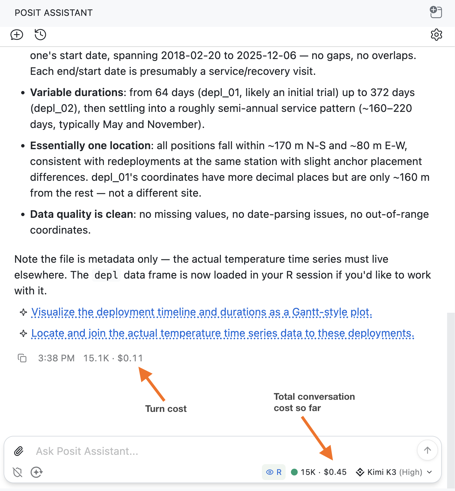
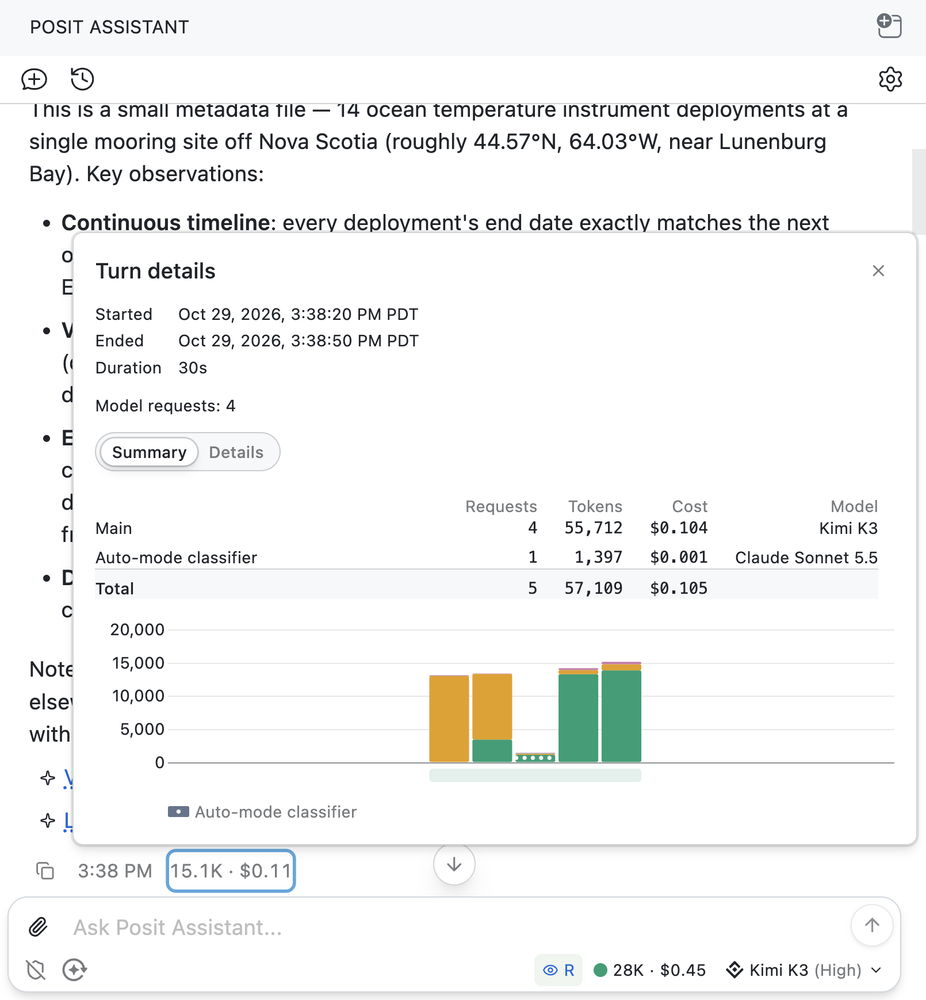
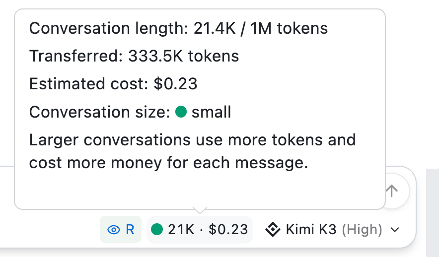
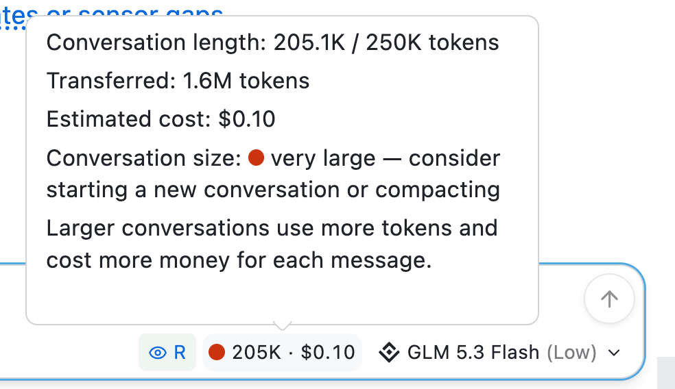
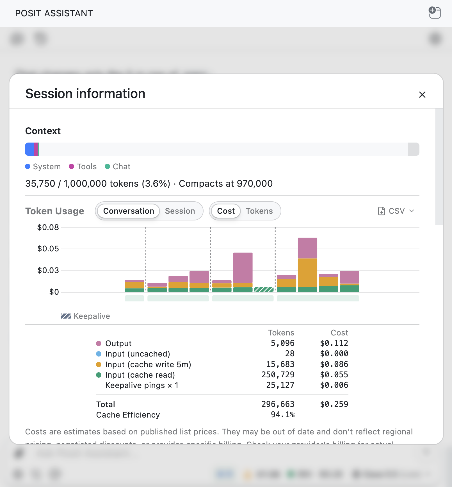
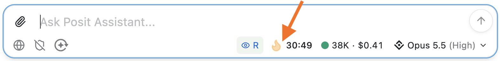
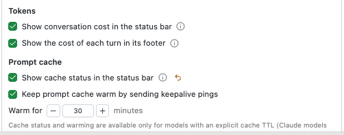
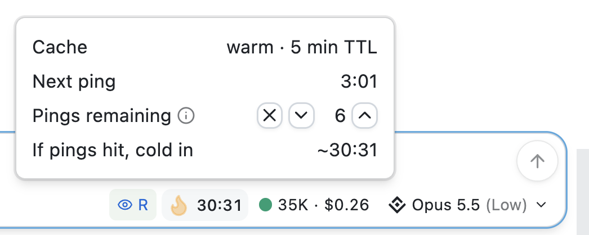

::: {.callout-tip}
Our (Sara and Simon's) writing is published as an RSS feed at <https://opensource.posit.co/tags/ai-newsletter/index.xml>. **If you'd like to get emails when we post**, paste the feed URL into a free RSS-to-email service such as [Blogtrottr](https://blogtrottr.com/), [Feedrabbit](https://feedrabbit.com/), or [Follow.it](https://follow.it/), and each new issue will arrive in your inbox.
:::

LLM tokens can be expensive, but figuring out how much you've spent can be strangely difficult. With Posit Assistant, we wanted to make your spending as transparent as possible.

This is our third post in a series on LLM costs. In the previous two posts, we explained why you [need to care about token caching](https://opensource.posit.co/blog/2026-10-23_ai-newsletter/) and how [Posit Assistant makes your token budget go further](https://opensource.posit.co/blog/2026-10-29_ai-newsletter/). This time, we'll look at how to actually monitor your own costs and cache status in Posit Assistant.

The short version:

- Monitor costs with Posit Assistant's estimated cost tracker to see what you're spending as you work.
- When the [conversation-size dot turns orange or red](#keep-an-eye-on-conversation-length), compact or start a new conversation.
- Understand caching. Returning to a long conversation after a few hours can be costly. Consider starting a new conversation.

## Monitor spending as you work

**Posit Assistant shows you an estimate of how much you've spent on tokens.** You can see the estimated cost of a conversation in the status bar and the cost of each turn below the response.

{width=636px fig-align="center" fig-alt="Posit Assistant conversation with arrows labeling the turn cost below the response and the total conversation cost in the status bar. Both show an estimated cost of $0.11 in this example. The status bar also shows a green context indicator and 15K tokens."}

The same view works across providers, for models where Posit Assistant has usage and pricing data (which is a lot of them!). Note that these costs are estimates based on published prices and might not exactly match your provider's bill.

Want more info about a specific turn? Click the cost below a response to open **Turn details**, where you can see how long the turn took and a breakdown of its requests, tokens, and estimated costs.

{width=636px fig-align="center" fig-alt="Turn details panel with Summary selected for a turn that lasted 30 seconds. The table lists four main-model requests using Kimi K3 and one auto-mode classifier request using Claude Sonnet 5.5, totaling 57,109 tokens and an estimated cost of $0.105. A stacked bar chart below shows token usage for those requests, with the classifier request marked by a dotted pattern."}

When Posit Assistant delegates work to a subagent, that work also costs tokens. The subagent's row shows its cost. Hover over the information icon to see its model and cost without opening its conversation. Subagent costs are also included in the conversation total.

## Keep an eye on conversation length

**Next to the conversation cost, you'll see a colored dot and the number of tokens currently in your conversation context.** This is the amount of information sent to the model with each request, including your messages, the model's responses, and tool results. Because LLMs don't "remember" previous turns, agents like Posit Assistant resend that context each time you send a message. As the conversation grows, it takes up more of the model's _context window_: the maximum number of tokens the model can work with at once. Context window size varies by model.

The colored dot gives you an at-a-glance sense of the current conversation size:

| Conversation size | What to do |
| --- | --- |
| [●]{style="color: #009E73" aria-label="green"} Small | Keep working. |
| [●]{style="color: #E69F00" aria-label="amber"} Medium | Start thinking about a natural stopping point. |
| [●]{style="color: #D55E00" aria-label="orange"} Large | Consider compacting or starting a new conversation. |
| [●]{style="color: #CC3311" aria-label="red"} Very large | Compact or start a new conversation. |

::: {layout-ncol=2 layout-valign="bottom"}

{width=100% fig-alt="Posit Assistant's token-counter tooltip shows a conversation length of 21.4K tokens, a green indicator labeled small, and an estimated conversation cost of $0.23."}

{width=100% fig-alt="Posit Assistant's token-counter tooltip shows a conversation length of 205.1K of 250K tokens, 1.6M tokens transferred, an estimated cost of $0.10, and a red indicator labeled very large. The status bar below shows a red context indicator beside 205K tokens and the same estimated cost."}

:::

### Compact or start fresh when conversations grow long

**Keep an eye on the conversation size and look for a stopping point as your conversation goes on.** If the conversation is getting long and you want to continue the same task, use `/compact` to keep around a summary of your work while reducing the context.

If you're moving on to a different task, you might instead use `/clear` or click the _New conversation_ button in the upper-left of Posit Assistant to start a new conversation. `/clear` starts a new conversation with your current model and thinking level.

[Long conversations make each request or cache miss more expensive](https://opensource.posit.co/blog/2026-10-23_ai-newsletter/#manage-conversation-length). Compacting or starting fresh at a natural stopping point can help control costs and avoid an automatic compaction that might interrupt your work. You don't need to wait until the dot is red.

## Detailed view of spending, caching, and context

In Posit Assistant, you can also see more detailed cost and token information in the **Session information** panel. To open the panel, click on the cost/token counter next to the model picker.

{width=636px fig-align="center" fig-alt="Session-information panel with Conversation and Cost selected. The context meter shows 35,750 of 1,000,000 tokens used and an automatic compaction threshold of 970,000. A stacked bar chart shows estimated cost per request, separated into output, uncached input, cache writes, and cache reads, with a striped bar marking a keepalive ping. The table below reports an estimated total cost of $0.259 and 94.1% cache efficiency."}

There's a lot of information in Session information. We'll cover it top-to-bottom.

### Context window

Use the context bar to monitor context and see when compaction will automatically happen for your chosen model. This can help you understand what's taking up your context window and not get caught off guard by an automatic compaction. Different models have different context windows.

### Token usage

You can switch between **Conversation** and **Session**, and between **Cost** and **Tokens**. A conversation is a single chat thread within Posit Assistant, while a session covers the running Posit Assistant instance and can span many conversations. This means that the session view shows usage beyond the current conversation.

The totals here count tokens used across requests, not just the tokens currently in your context window. Hover over a bar to see more details about a request. Each request is broken down by token type.

You probably want to pay the most attention to the orange bars, which represent the *Input (cache write)* tokens. These are input tokens (i.e., tokens sent to the model) that you're paying to *add* to the cache, rather than reuse at the cheaper cache-read price. Some orange is normal, but if you keep seeing lots of orange and not much green (especially in the _Tokens_ view, not _Cost_), you may not be getting much benefit from the cache. This could be because of your model and provider, but it could also mean that you're missing your cache window by frequently sending requests after the cache has cooled.

### Cache efficiency

Below the plot is a table of your different token types, and below that table you'll see the **Cache Efficiency** row. It tells you what fraction of your input tokens were cache reads. In the screenshot above, our cache efficiency is 94.1% (pretty good).

Cache efficiency is partly on Posit Assistant, but partly on how you use it. A lower percentage doesn't necessarily mean something is wrong, but taking long breaks and then continuing the same conversation (or switching models mid-conversation) can disrupt cache reuse. It's worth checking your cache efficiency every once in a while to see whether you're paying more than you need to for tokens.

## Manage the cache

Beyond helping users understand what they've spent so far in a conversation, Posit Assistant also includes a number of tools to help users understand (and affect) how much the _next_ request will cost. This display and its controls are experimental and likely not necessary for your daily workflow. However, if you want to learn more about your cache status or are really trying to optimize costs, they're worth trying out.

### See whether or not the cache is warm

In the [previous post](https://opensource.posit.co/blog/2026-10-23_ai-newsletter/), we explained how token caching works. If the cache is "warm," your model provider can reuse parts of your conversation that it has already processed, and you pay less for those parts in your next request. If the cache goes "cold," the provider has to process those parts again, which can cost more.

Because of this, it can be useful to see your cache status. If the cache has gone cold on a large conversation, you might want to start a new conversation. If the cache is only going to be warm for 30 more seconds, you might decide to send a new message now rather than later.

Posit Assistant's [optional, experimental cache-status display](https://assistant.posit.co/docs/reference/positron-settings/#experimental-settings) adds a flame indicator that shows whether your cache is warm and estimates how much time you have left before it goes cold. It's off by default.

{width=636px fig-align="center" fig-alt="Posit Assistant status bar with an arrow pointing to an orange flame beside a 30:49 cache countdown. A separate green conversation-size dot appears beside 38K tokens."}

To turn it on, click the cost/token counter or type `/context` to open **Session information**. Under **Prompt cache**, check **Show cache status in the status bar**.

{width=502px fig-align="center" fig-alt="Settings for showing conversation and per-turn costs, showing cache status, and keeping the prompt cache warm with keepalive pings. All four checkboxes are enabled, and the warming duration is set to 30 minutes."}

For supported models, hover over or click the flame in the status bar to open a popover with the details of your cache status.

### Give yourself time for a break

The [cache time-to-live (TTL)](https://opensource.posit.co/blog/2026-10-23_ai-newsletter/#how-long-does-the-cache-stay-warm) tells you how long the cache stays warm after it was last refreshed. For example, if your model and provider combination has a five-minute TTL, that means you have five minutes from the last time the cache was hit, either by your message or a keepalive ping (see the next paragraph). It does not mean you have five minutes from right now.

Posit Assistant can help you keep the cache warm by sending **keepalive pings** in the background while you take a coffee break or think through a decision. Each successful ping starts another TTL window, so by spacing the pings out, Posit Assistant can keep the cache warm for much longer than the TTL without you doing anything at all.

{width=636px fig-align="center" fig-alt="Posit Assistant's flame indicator with the cache-status popover open. The cache is warm with a five-minute TTL, the next ping is due in 3 minutes 1 second, and six pings remain. If those pings hit, the cache is estimated to go cold in about 30 minutes 31 seconds, matching the status-bar countdown. Controls beside the remaining ping count allow stopping pings or decreasing or increasing their number."}

Here's how to read the popover:

|  |  |
| --- | --- |
| **Next ping: 3:01** | The next keepalive ping is scheduled for three minutes and one second from now. |
| **Pings remaining: 6** | Six pings are scheduled to be sent at regular intervals. You can increase or decrease the number remaining.[^pings-remaining] |
| **If pings hit, cold in ~30:31** | If nothing goes wrong and all six pings are successful in refreshing the cache, it should stay warm for about another 30 minutes and 31 seconds. |

[^pings-remaining]: More pings can mean more spending. If you don't care about keeping the cache warm, and are really trying to save on tokens, you might decrease the number. Conversely, if you don't care about spending a little extra and want to keep the cache alive, you might increase them. This is a specialized control, though, and you probably don't need to be adjusting it frequently.

## Know where your tokens are going

You don't need to optimize every token to keep costs down, and [Posit Assistant is designed to be cost-efficient](https://opensource.posit.co/blog/2026-10-29_ai-newsletter/) even if you don't do anything to manage costs yourself. But at a high level, here's what we recommend keeping an eye on:

- **Monitor costs** using Posit Assistant's estimated cost tracker to see what you're spending as you work.
- **Compact or start a new conversation** when the conversation-size dot turns orange or red. Look for a natural stopping point rather than letting the conversation keep growing.
- **Understand caching.** You don't need to closely monitor the cache, but it's worth knowing that if you come back to a long conversation after a few hours, you're probably going to miss the cache and pay more than you need to. It's probably a good idea to start a new conversation.
