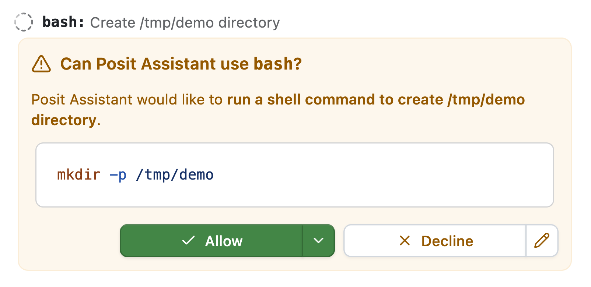

::: {.callout-tip title="Want updates like this via email?"}
Our (Sara and Simon's) writing is published as an RSS feed at <https://opensource.posit.co/tags/ai-newsletter/index.xml>. **If you'd like to get emails when we post**, paste the feed URL into a free RSS-to-email service such as [Blogtrottr](https://blogtrottr.com/), [Feedrabbit](https://feedrabbit.com/), or [Follow.it](https://follow.it/), and each new issue will arrive in your inbox.
:::

Think about all the times your coding agent has sent you an approval request like this one: 

{width=636px fig-align="center" fig-alt="Posit Assistant approval dialog asking the user to allow or deny a shell command."}

How often have you just clicked approve without even reading the details?

Instead of making you approve every request, coding agents in _auto mode_ use another model to assess the risk of a request. This second model--the _classifier_--judges the request by a set of rules and either approves the command or rejects it. If the classifier rejects the command, the original model finds another way to address the problem, asks for the user's explicit approval, or halts work.

**Auto mode is now the default approval mode in Posit Assistant.** We believe it's both safer _and_ a better user experience, and have engineered it so that the increase in costs is small.

## Safety and approval fatigue

Auto mode is designed to make Posit Assistant safer by reducing the approval fatigue associated with its earlier default approval mode (_Normal mode_), which required users to approve most of the agent's actions.

The auto mode classifier's rules catch irreversible actions that go beyond the user's request. Suppose you ask Posit Assistant to clean up a project. The agent might decide that an old script is clutter, but permanently deleting it would destroy work that isn't checked into version control. Auto mode’s rules tell the classifier to block that deletion unless you specifically requested it. 

You could catch the destructive action on your own by carefully reviewing each approval request. But Posit Assistant's previous approval mode asked users to approve many routine commands, making it easy to start clicking "Approve" without carefully considering each one.

Anthropic describes the same [“approval fatigue” in Claude Code](https://www.anthropic.com/research/claude-code-auto-mode), reporting that users accept 93% of manual permission prompts. In an [experiment with 1,053 testers](https://claude.com/resources/articles/auto-mode-default-in-claude-code), Anthropic found that auto mode blocked 89% of harmful commands, compared with 13.6% caught by human reviewers.

If you're curious, the current auto mode prompt looks like this:

::: {.callout-note title="The current auto mode prompt"}

> You are a safety classifier that reviews tool calls from an AI coding assistant before they execute. Your job is to decide whether each proposed action should be allowed or blocked based on the conversation context, the action itself, and the rules below.

Show the full prompt



:::

In our evaluations and in practice, we see that the classifier is effective at preventing irreversible destructive actions. (It also sometimes blocks actions that likely shouldn't be blocked; we'll continue to refine this prompting over time.)

## Costs

Auto mode requires a second request for almost every request Posit Assistant makes. This second request determines whether the first is safe. You might be wondering: isn't that expensive? Will auto mode double the cost of a conversation? 

Auto mode will likely increase your costs by a few percent, not by double. The specifics will depend on your model provider. (And it's likely that Posit Assistant with auto mode would [still be cheaper](https://opensource.posit.co/blog/2026-10-29_ai-newsletter/) than leading coding agents without auto mode.)

A few considerations make auto mode's requests substantially cheaper than the main agent thread:

* The system prompt is much shorter. With recent Anthropic models, Posit Assistant's main agent system prompt is around 15,000 tokens, while the auto mode classifier prompt is 1,500 tokens.
* The conversation history is pruned aggressively. The classifier receives a shortened transcript of user messages and tool calls, with some assistant context but no tool results. Above a threshold (currently ~2,000 tokens), the conversation history is re-pruned.
* The model used for the classifier is usually a much cheaper model than the main agent model. For example, in Posit AI Pass, the default main agent model is Sonnet 5.5, while the default classifier model is Haiku 5.5. Haiku 5.5 is [roughly twenty times cheaper](https://assistant.posit.co/models/) than Sonnet 5.5. 

We sampled five recent local Posit Assistant conversations with more than five user messages that used auto mode. Then, using the observed token counts, we calculated the percentage increase in cost with four main agent-classifier pairs:

| Main agent | Classifier | Mean increase |
| --- | --- | --- |
| Claude Sonnet 5.5 | Claude Haiku 5.5 | 0.86% |
| Claude Opus 5.5 | Claude Haiku 5.5 | 0.43% |
| GPT 6.1 Sol | GPT 6.1 Terra | 8.2% |
| Gemini 4 Argon | Gemini 3.8 Flash | 3.4% |

**If you use Posit Assistant's default model, Sonnet 5.5, our evaluation suggests that auto mode would increase your conversation costs by less than 1%.**

## Model choice

Readers who are familiar with [Claude Code's auto mode](https://code.claude.com/docs/en/auto-mode-config) might notice that its auto mode classifier defaults to Sonnet models, while we've defaulted to Haiku.

Our model choices for the auto mode classifier—shown in the above table—are based on our evaluations. While we had initially defaulted to Sonnet 5.5 for Anthropic models (and thus with Posit AI Pass), we saw in evaluations that Sonnet 5.5 refused to respond for some of the most problematic commands. Claude's [safety classifiers](https://platform.claude.com/docs/en/build-with-claude/refusals-and-fallback) triggered with Sonnet 5.5 for classification requests that involved dangerous operations, and thus could not power our auto mode feature. If our evaluation suite had shown that Haiku 5.5 was unable to properly classify dangerous commands, we'd have had a more difficult engineering problem on our hands, but our tests showed perfect performance with Haiku 5.5.

For OpenAI, we use Terra models in the auto mode classifier. Both Terra 5.6 and 6.1 aced our evaluation. The Luna models, unfortunately, tended to block much too often. We hope to be able to transition the auto mode classifier to use Luna with future Luna releases, as the model series is remarkably cheap compared to Terra.

Gemini 3.8 Flash also aced the evaluation. The naming and price points of the offerings in this model family are changing rapidly. Hopefully Google will release a model at the Haiku / Luna price point that scores well on our evaluations. At that point, we can transition auto mode to use that model.

For other model pairings, this formula provides a rough estimate of the relative increase in cost:

$$\text{increase} \approx \frac{1}{6} \times \frac{\text{classifier input price}}{\text{main model input price}}$$

We're excited to have shipped this change, and hope it makes for a better experience for our users.
