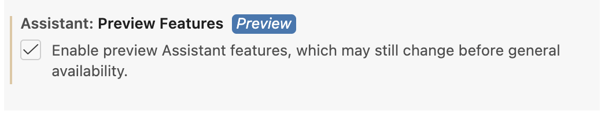
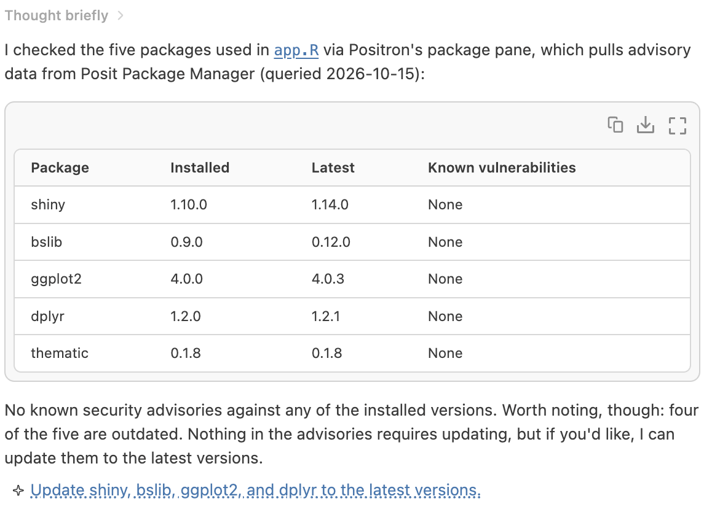
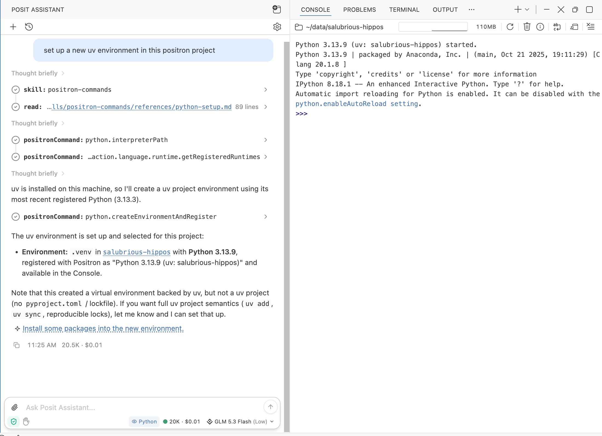
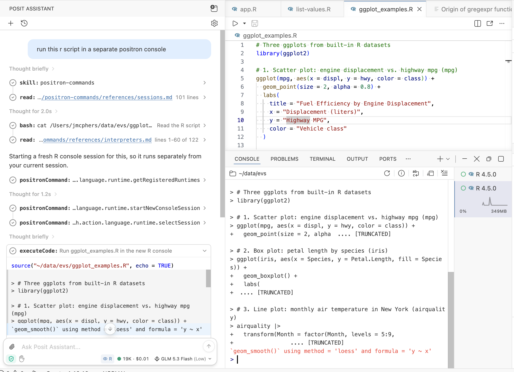
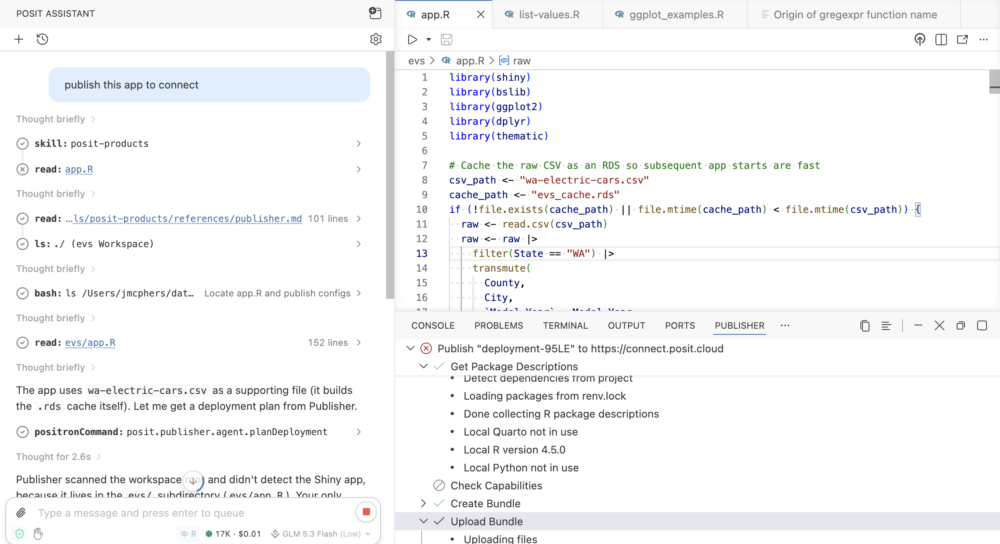

In earlier releases of Positron, Posit Assistant's ability to interact with Positron was mostly limited to the Console and Editor panes. It could run code in Positron, see what that code did, and make changes to your scripts and documents. This alone makes it a powerful data science agent ... but we can do better!

Starting with this month's release (2026.10), Posit Assistant can now interact with nearly the entire Positron surface. This is less about replacing pointing and clicking with prompts (although you can do a bit of that too) and more about revealing things to Assistant that Positron already knows, giving it more and better context for your questions about your data or Positron itself.

These new features are currently in preview; enable them with the [Assistant: Preview Features](positron://settings/assistant.previewFeatures) setting in Positron.

{fig-align="center" fig-alt="The Assitant: Preview Features setting in Positron"}

Enabled? Here are some things you can try:

## Packages

Assistant can now connect to the same internal data source as Positron's Packages pane. This means that requests to install a package will be fulfilled using the method appropriate to your current Python or R installation (Assistant used to get this wrong, occasionally). It also means you can ask for information about installed packages that Positron adds, such as active CVEs.

Try:

> install the ggplot2 package in Positron

or

> do any of the packages used in this script have active vulnerabilities? ask Positron

{fig-align="center" fig-alt="Posit Assistant answering a query about vulnerabilities in the current script"}

## Interpreters

Positron maintains an inventory of every R and Python installation on your system so that can recommend the best one for a new project, show a list when you ask to open a console, and so on. R and Python environment management and discovery is a  complex topic with dozens of different packaging systems and conventions in play, so this inventory is invaluable.

Now Posit Assistant can see that list, too, answer questions about it, and set up new environments for you in Positron.

> why don't I see my R 4.1 installation in Positron?

> what's the highest version of Python available in Positron?

> set up a new uv environment in this Positron project

{fig-align="center" fig-alt="Posit Assistant setting up a uv environment in a new project"}

## Consoles

Posit Assistant can now start and select consoles. This is pretty useful if you work with long-running or concurrently running code!

> run this R script in a separate Positron console

{fig-align="center" fig-alt="Posit Assistant setting up a second R console to run a script"}

## Publishing to Posit Connect

If you use [Posit Connect](https://posit.co/products/enterprise/connect), you can ask Posit Assistant to publish your content to Connect, or [Connect Cloud](https://connect.posit.cloud/).

> publish this app to Connect

{fig-align="center" fig-alt="Posit Assistant publishing a Shiny app to Posit Connect"}

## Security

You'll be prompted each time Assistant wants to interact with Positron. Just as with code execution or shell execution, you can approve Positron commands one by one or auto-approve for your project.

Because Positron commands can make changes and perform some sensitive actions, they are not available in Assistant's _Ask_ mode.

## Troubleshooting & Feedback

We're still improving the way this system works. Many of the queries above are also answerable in some form _without_ consulting Positron, though the results won't be as good or consistent with your environment. Consequently, you may occasionally see Posit Assistant reach for the wrong tool; tell it to "ask Positron" or "use a Positron command" to accomplish a task if it gets it wrong.

We'd love your feedback on this new functionality in Positron, good or bad! Drop us a line in the [Positron Discussions](https://github.com/posit-dev/positron/discussions) forum on Github.
