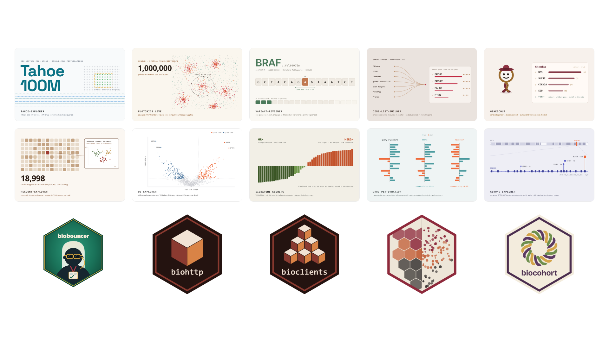
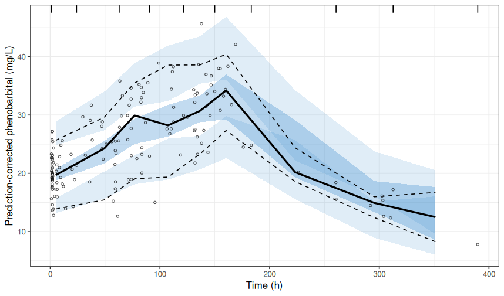

> Welcome to our newsletter, posit::glimpse()!
>
> If you're currently reading this on our blog, consider subscribing to Product Updates - Open Source on our <a href="https://posit.co/about/subscription-management" target="_blank" rel="noopener">subscription page</a> to receive this newsletter directly in your inbox.
>
> Prefer an RSS reader? posit::glimpse() now has its own RSS feed! Find it on our [subscribe page](https://opensource.posit.co/subscribe/).

Every month, we round up some of the most important open-source news for Posit's community! We hope that you enjoy this newsletter and maybe even share it with a friend.

The table of contents on the right can help you navigate through all the updates. As you scroll, it will open up to show you subcategories →

## Key product updates and new releases

### Positron

[Positron](https://positron.posit.co/) is a next-generation data science IDE for R and Python. The 2026.10 release brings Posit Assistant that can drive Positron itself, a built-in MCP server for your own coding agents, Data Connections on by default, faster language features for Quarto, and smoother interpreter and project setup. Posit Assistant can now tap into Positron's packages, interpreters, consoles, and publishing tools, so its answers and actions match your actual environment.

* Read more in the [Positron October Release Highlights](https://opensource.posit.co/blog/2026-10-13_positron-2026-10-release/) and [A deeper Positron integration for Posit Assistant](https://opensource.posit.co/blog/2026-10-21_assistant-drives-positron/) blog posts.

Have a question, a tip, or something cool you've built? Come say hi on the [Positron subreddit](https://www.reddit.com/r/PositronIDE/), where the community is up and running!

### rig 0.11.0

[rig](https://rig.r-lib.org/) is a command-line tool for installing and managing multiple R versions. rig 0.11.0 is a major release, covered in a three-part blog series.

#### rig 0.11.0 part one: R installations

rig 0.11.0 adds a user mode for installing R into your home directory without admin rights on macOS, Windows, and Linux, plus portable Linux builds, Rtools management, and automatic RStudio and Positron configuration. Repository management is improved too: P3M is now the default on most platforms, and new commands add custom repos and check repo status. rig also has a new website at [rig.r-lib.org](https://rig.r-lib.org/).

* Read more in the [rig 0.11.0 part one: R installations](https://opensource.posit.co/blog/2026-10-09_rig-0-11-0-part-one/) blog post.

#### rig 0.11.0 part two: R packages

Part two introduces `rig pkg`, a pak-like command-line tool for installing packages from CRAN, GitHub, git, URLs, and local paths with version constraints, a dependency solver, parallel downloads, and caching. It also adds `rig pkg doctor` for checking library health, commands for package info, dependency trees, and CRAN search, named libraries, and automatic system requirements on major Linux distributions.

* Read more in the [rig 0.11.0 part two: R packages](https://opensource.posit.co/blog/2026-10-12_rig-0-11-0-part-two/) blog post.

#### rig 0.11.0 part three: R projects

The final part introduces `rig proj`, a project manager for R in the style of Python's uv and Rust's cargo. It uses an `rproj.toml` manifest and universal `rproj.lock` files that cover multiple platforms, syncs to fast project virtual environments that share package files, and runs code with `rig run`, including inline-dependency scripts. Projects can be imported from DESCRIPTION files or renv lock files.

* Read more in the [rig 0.11.0 part three: R projects](https://opensource.posit.co/blog/2026-10-15_rig-0-11-0-part-three/) blog post.

### Great Tables v1.0.0 and v1.1.0

[Great Tables](https://posit-dev.github.io/great-tables/) reaches 1.x with v1.0.0 and v1.1.0. The stable core API gains new formatters (`fmt_fraction()`, `fmt_index()`, `fmt_chem()`, `fmt_url()`, and `fmt_email()`), value-based conditional styling with `tab_style_body()`, multi-column stubs, decimal alignment, and diverging, row-wise, and custom `data_color()` scales with APCA-based text contrast. HTML output is now accessible by default.

* Read more in the [Great Tables v1.0.0 and v1.1.0: new formatters, conditional styling, multi-column stubs, and richer color scales](https://opensource.posit.co/blog/2026-10-19_great-tables-1-1/) blog post.

### Shiny for Python 1.9

[Shiny for Python](https://shiny.posit.co/py/) 1.9 removes the process-wide lock on reactive updates, so async effects and outputs now run concurrently within and across sessions. The release also adds `session.run_once_when_idle()`, immediate UI updates from background tasks, accessible sidebar landmarks via `ui.sidebar(role=)`, Express download buttons with icons, and 2–3.5× faster data frame serialization. It includes a few breaking changes, notably that `ui.sidebar()` now renders a `
` rather than an `<aside>`.

* Read more in the [Shiny for Python 1.9](https://opensource.posit.co/blog/2026-10-29_shiny-python-1-9/) blog post.

Looking for a little inspiration for your next app? Take a stroll through the [Shiny in the Public Sector gallery](https://posit-shiny-in-the-public-sector.share.connect.posit.cloud/), which is filled with real-world examples of how teams are using Shiny to share data and serve their communities. It's a great place to spark ideas, and maybe borrow a trick or two!

### Quarto 1.11

[Quarto](https://quarto.org/) 1.11 is out, released early to deliver a Deno security update that protects HTTPS requests made by Quarto commands, including publishing and downloading extensions. Quarto 1.10.20, released just before, is the final patch in the 1.10 series, so all users should upgrade to 1.11. Alongside the security update, this release brings broad accessibility improvements to HTML documents, websites, books, and presentations (skip-to-content links, a more visible keyboard focus ring, and preserved alternative text for diagrams and Word figures), lists of figures and tables for Typst documents, Julia engine improvements, and fixes to shared metadata. You can also adopt the Quarto 2 definition list syntax now, ahead of the next major version.

* Read more in the [Quarto 1.11](https://opensource.posit.co/blog/2026-11-02_quarto-1-11/) blog post.

## AI updates

Catch up on the latest from Posit's AI newsletter:

* [Correct, transparent, and reproducible data agents](https://opensource.posit.co/blog/2026-10-09_ai-newsletter/): An annotated walkthrough of our posit::conf(2026) keynote on building trustworthy AI tools for data analysis, including Posit Assistant and the introduction of commons.
* [Unfortunately, you need to care about token caching](https://opensource.posit.co/blog/2026-10-23_ai-newsletter/): A look at the anatomy of an LLM "conversation" and how understanding cache hits and misses can help you keep costs down.
* [Posit Assistant is cost-efficient](https://opensource.posit.co/blog/2026-10-29_ai-newsletter/): How we measured Posit Assistant's token usage and why it makes better use of your token budget than leading coding agents.

Want to see commons in action? Sara and Simon recently walked through a real workflow in the [commons workflow demo](https://youtu.be/4rUzyOIvAog) on YouTube.

## Learning resources

### New Posit Academy courses

Looking to learn something new? Check out these courses from Posit Academy, now available on our resources page:


- resources/courses/introduction-to-quarto
- resources/courses/introduction-to-positron
- resources/courses/introduction-to-shiny-python-focus
- resources/courses/getting-started-with-posit-ai-in-positron


Browse the full list on the [courses page](https://opensource.posit.co/resources/courses/).

### Explore our new books page

Our open source website now has a [books page](https://opensource.posit.co/resources/books/)! It brings together books on R, Python, Shiny, modeling, and more, all in one place. Here are a few to get you started:


- resources/books/r-for-data-science
- resources/books/python-for-data-analysis
- resources/books/mastering-shiny
- resources/books/tidy-modeling-with-r


### Recent Data Science Lab episodes

The [Data Science Lab](https://pos.it/dslab) is a fun, chill session where practitioners share their screens and live code through real data science workflows. Missed a live session? Catch up on these recent episodes:

* [How do you validate data in R using Pointblank?](https://youtu.be/rthgRFzx30g) with Rich Iannone
* [How do you create custom geoms in ggplot2?](https://youtu.be/eYhSbSsBHTs) with Gina Reynolds
* [How do you create custom Revealjs themes in Quarto?](https://youtu.be/ONAl7iD9h68) with Emil Hvitfeldt

## Showcases from the community



[Samuel Bharti](https://opensource.posit.co/people/samuel-bharti/) spent the summer on the Shiny team and built 10 open-source applications and 5 packages for computational biology, plus a reusable layer that grew underneath them. It's a great read if you're curious about genomics, LLM-powered apps, or building a whole ecosystem of Shiny tools.

* Read more in the [Genomes, Prompts, and Shiny: What I Built During My Summer at Posit](https://opensource.posit.co/blog/2026-10-08_genomes-prompts-and-shiny/) blog post.

---





---

How much medicine is too much for the tiniest patients? Matthew Fidler and Janice Goh use [nlmixr2](https://nlmixr2.org/) in R to model phenobarbital dosing in preterm infants, showing how weight-based dosing keeps nearly all simulated babies within the target range. (It's a teaching example, not dosing guidance!)

* Read more in the [Tiny Doses for Tiny Babies: How much is too much?](https://posit.co/blog/pharmacometrics-in-r-posit) blog post.



If you're on LinkedIn, be sure to follow and tag [Posit Open Source](https://www.linkedin.com/showcase/posit-open-source/) for us to share the amazing things you're working on!

## Upcoming events

Join us for our ongoing virtual events:

* [Data Science Hangout](https://pos.it/dsh) for casual conversations with leaders in the data space
* [Data Science Lab](https://pos.it/dslab) for live coding sessions with practitioners building cool things with code

Mark your calendars: Josh Starmer of StatQuest is joining us on December 17th for this year's Data Science Hangout season finale! In the meantime, catch his session [teaching Naive Bayes with Positron and Posit Assistant](https://www.youtube.com/live/u_9OA3WRHgo?t=2244s).

Want to know where else you can find Posit folks? Check out our [events page](https://opensource.posit.co/events/) for upcoming conferences, meetups, and more.

Hope to see you there!
