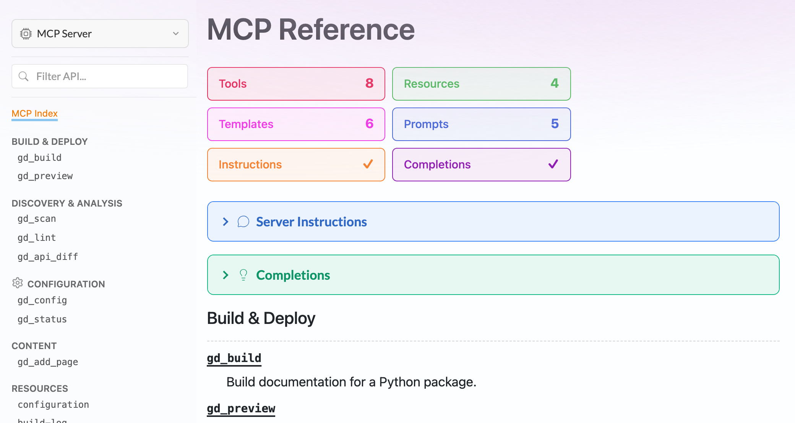
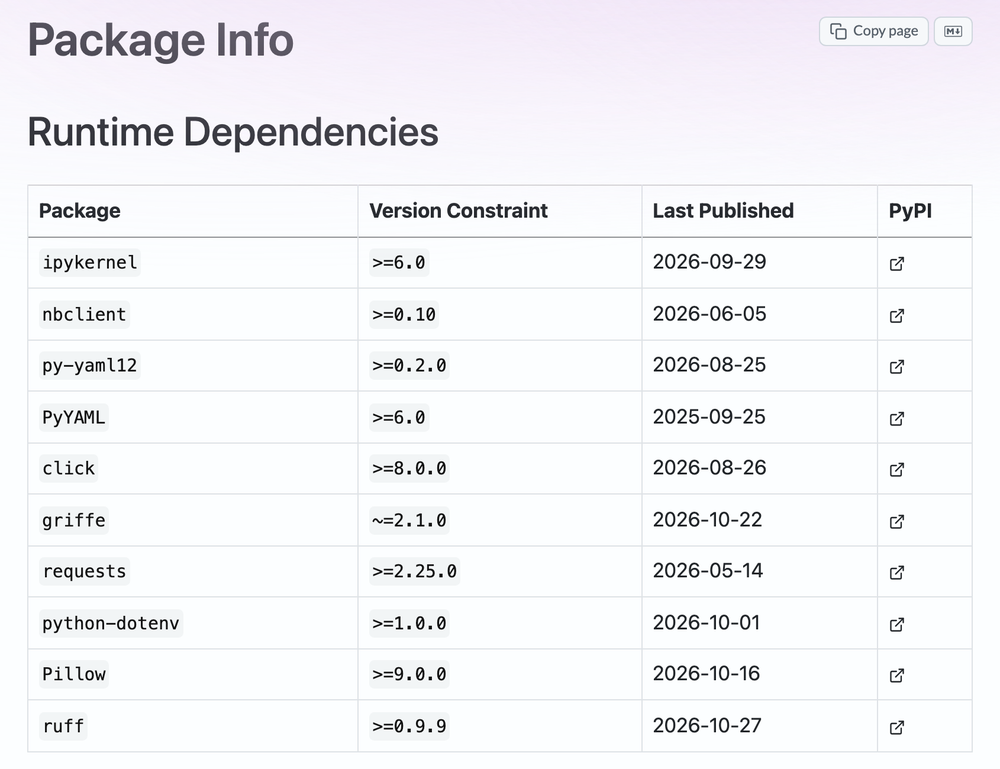
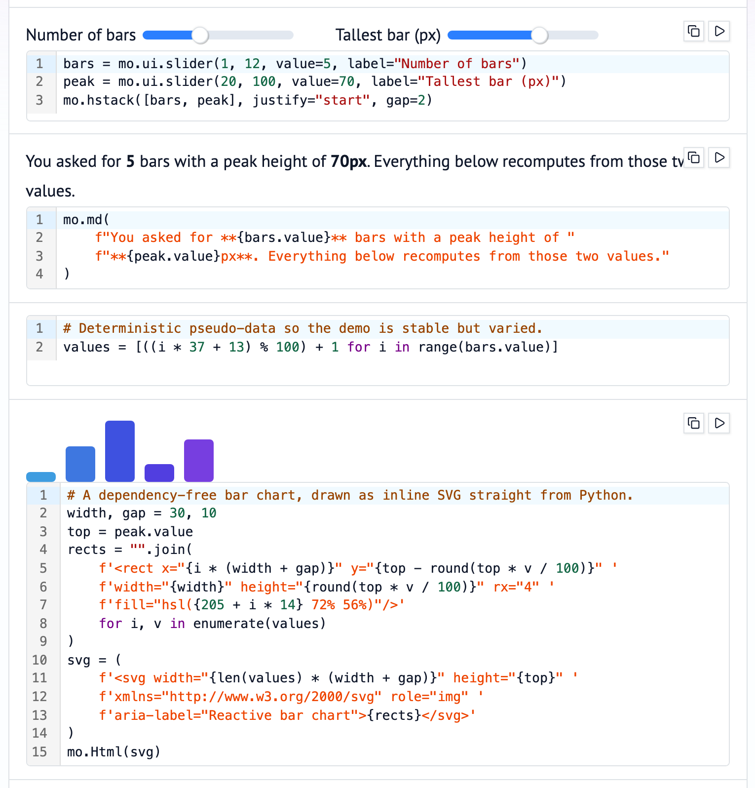
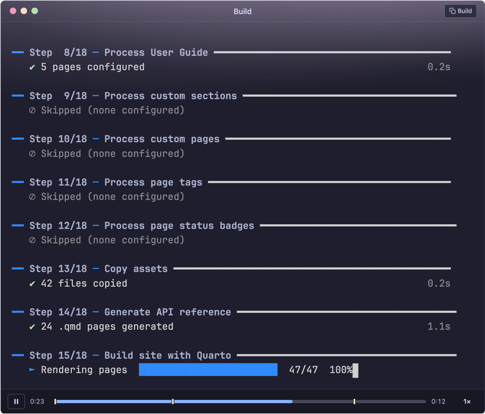
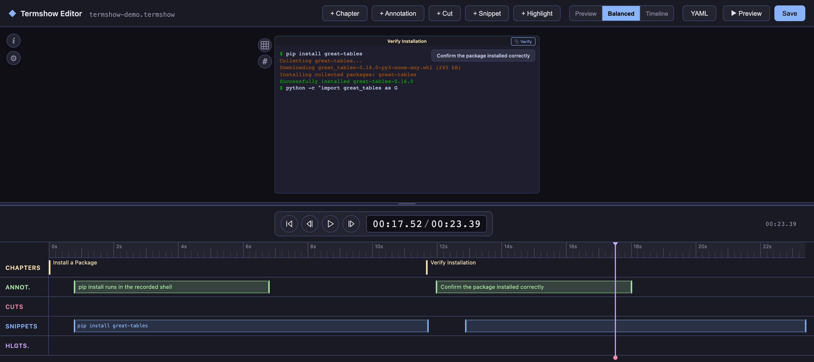

When we last wrote about Great Docs, the project had just reached `v0.10.0` and we took the occasion to look back over ten releases, one feature at a time. Six months have passed since then. In that time we have shipped seven more releases (`v0.11.0` through `v0.17.0`) and built up a substantial amount of work that will be available in the next release. Altogether, that's a little over two thousand commits from thirteen people. That is a lot of activity, and much of it went toward making Great Docs more dependable for its users.

This post is a look at where things stand now. We'll start with the people using Great Docs, since there are quite a few more of them than there used to be (and that's changed how we think about the work). From there, we'll survey the new and improved features and spend some time on Termshow, our terminal recording tool, which started as a small addition and has grown into something with its own direction. We'll finish with two topics that matter more than any single feature: the speed of builds, which is now a central focus, and the refactoring effort that has been quietly rebuilding the tool's internals.

## Who Is Using Great Docs

There are now well over a hundred public documentation sites built with Great Docs. About ten of them belong to Posit projects such as [Great Tables](https://posit-dev.github.io/great-tables/) and [Pointblank](https://posit-dev.github.io/pointblank/). The rest come from the wider community and cover subjects as far apart as multiple dispatch ([multimethod](https://coady.github.io/multimethod)), Bayesian visualization ([tidydraws](https://drbenvincent.github.io/tidydraws/)), web templating ([fastapi-chameleon](https://mkennedy.codes/docs/fastapi-chameleon/)), and comparative genomics ([OrthoEvolution](https://datasnakes.github.io/OrthoEvolution/)). The practical consequence of this growth is that any change to Great Docs now reaches a lot of people at once. A regression that breaks a build, or a new default that alters the appearance of a site, is no longer a private inconvenience. That awareness runs through much of what follows, and it's why a fair share of the recent work has gone into making the tool more predictable rather than simply larger.

## Documenting More Than Python APIs

Great Docs began as a tool for documenting the public API of a Python package, and that remains its center of gravity. But a package's interface is often wider than its importable objects. Many packages ship a command-line tool, some expose an MCP server for use by AI agents, and an increasing number publish skill files that describe how an agent should use them. Over the past several releases, Great Docs has learned to document each of these.

Command-line documentation was the first to arrive. In `v0.11.0`, Great Docs gained the ability to find a [Click](https://click.palletsprojects.com/) command group and generate a reference page for each subcommand, with the usage line, options, arguments, and an extended description drawn from the docstring. Turning it on takes a single setting:

```yaml
cli:
  enabled: true
```

Since then, the same treatment has been extended to CLIs written in Go (`v0.16.0`) and Rust (`v0.17.0`), and support for [Typer](https://typer.tiangolo.com/) will be available in the next release. The `v0.15.0` release added an index page for the CLI section, and subcommands can be grouped into titled sections in the same way that API reference entries can. The Great Docs site documents its own command-line interface this way, so its reference pages are a fair demonstration of what the feature produces.


MCP servers came next, in `v0.13.0`. Great Docs reads the tools, prompts, and resources a server declares and generates reference pages for them, along with an index page that summarizes the server at a glance. It also writes a `.well-known/mcp.json` manifest so that clients can discover the server from the documentation site itself. For packages that expose functionality to agents, this puts that functionality on the same footing as the Python API. That seems only fair, given how much of the interaction with some packages now happens through agents.



There are smaller additions in the same spirit. Projects can now publish multiple agent skills rather than a single one. A Package Info page (added in `v0.15.0`) lists a package's dependencies and metadata, and a License page (`v0.13.1`) presents the license with its SPDX identifier. Type aliases declared with the PEP 695 `type` statement are documented properly as of `v0.17.0`. None of these is large on its own, but together they mean that a reader arriving at a Great Docs site can find most of what they need to know about a package without leaving it.



## Richer Pages

The other broad category of new features concerns what can go on a page. Documentation is mostly prose and code, but the moments that teach the most are often the ones where the reader can see or touch something. A number of features added since `v0.10.0` aim at those moments.

The lightbox, introduced in `v0.14.0`, lets readers enlarge an image and inspect it more closely. You can turn it on for a single image with a `.lightbox` class or for a whole page with a frontmatter setting. It supports captions, credits, galleries, zooming and panning, and alternate images for dark mode:

```markdown
{.lightbox
  caption="The Singapore skyline along Marina Bay"
  credit="Photo via Pexels"}
```

The enlarged view includes a small toolbar for zooming, copying, downloading, and linking directly to the image. The same release added a `{}` shortcode that places two images under a draggable slider. This is useful for showing a before and after state (a chart under two themes, say, or a table before and after styling).


[marimo](https://marimo.io/) notebooks arrived in `v0.17.0`. A marimo notebook is a plain Python file whose cells re-run reactively when their inputs change, and Great Docs can embed one directly in a page using a shortcode. In the default "island" mode, the notebook's outputs and widgets appear inline and stay live, so readers can drag a slider and watch the dependent cells recompute in the browser. An iframe mode goes further and makes the code itself editable.

```markdown
{}
```



Several smaller features round out this category. Collapsible details blocks and mock code cells (which display code as if it had been executed, without running it) arrived in `v0.11.0`. Code includes, added in `v0.16.0`, let a page pull its examples from real source files so they can't quietly drift away from the code. The next release adds [D2](https://d2lang.com/) diagrams, pre-rendered to SVG with separate light and dark versions. It also adds a wide layout toggle that appears on large screens and lets readers widen the content column (press `w`, or configure it with the `wide_layout` setting). Finally, a new `great-docs check-examples` command runs the code cells in your pages and the examples in your docstrings and reports any that fail. That addresses a problem every maintainer has met: the documentation example that stopped working two releases ago without anyone noticing.

## Termshow

Termshow is the part of Great Docs that has changed the most since May, and it deserves a section of its own. It began in `v0.12.0` as a way to record a terminal session and play it back on a documentation page. Many packages are best introduced through a terminal (an installation, a first command, a short interactive session). The usual ways of showing this are a static code block, which conveys nothing of the experience, or a video or GIF, which can't be searched, copied, or edited without recording it again. A Termshow recording is a text file of timed terminal output, and the player renders it in the browser, so the text stays selectable and the file stays small.

The basic workflow is to record a session and then place it on a page with a shortcode. What made Termshow more than a player, even in its first release, was that a recording could be annotated after the fact. You can divide it into chapters, highlight regions of the screen, attach notes that appear at particular moments, and pick out snippets of output that readers can copy. The Great Docs homepage uses a recording of this kind to show the tool being installed and run, with chapter markers along the bottom of the player.



Since August, Termshow has been available as a standalone Quarto extension, so it can be used in any Quarto project and not only in sites built with Great Docs. The work since then has gone in a few directions. One is authoring. The Termshow Editor, launched with `great-docs termshow edit`, is a browser application that lays a recording out on a timeline. Chapters, annotations, cuts, highlights, and snippets can then be placed visually rather than by writing timestamps into a YAML file.



Another direction addresses a weakness that every terminal recording shares: it only shows what a tool printed on the day it was recorded. Termshow now supports scripted recordings, in which a YAML file lists the steps to perform and Termshow types them into a fresh shell:

```yaml
record:
  shell: bash --norc
  cols: 90
  rows: 20

steps:
  - marker: Install
  - run: pip install mypackage
  - marker: Verify
  - run: python -c "import mypackage; print(mypackage.__version__)"
  - sleep: 2
```

Because the steps are written down, they can be run again. The `termshow check` command reruns them, compares the screen at each marker with the committed recording, and exits with an error if the output has changed. Only the text is compared, so a slower machine or a different color theme doesn't count as drift. You can also give patterns for text that legitimately changes on every run (version numbers, dates, temporary paths). Running this in CI turns a demo into something closer to a test, and once the changes have been reviewed, an `--update` flag records the drifted demos again.

```bash
great-docs termshow check docs/assets/*.termshow.yml
```

The remaining work has been about interoperability. Termshow can import recordings from [asciinema](https://asciinema.org/) and scripts from [VHS](https://github.com/charmbracelet/vhs), and it can export to asciicast, animated SVG, GIF, MP4, and WebM, as well as plain transcripts and WebVTT captions. A `<termshow-player>` web component lets a recording be embedded in any HTML page, and there is now a written format specification with JSON Schemas. We looked carefully at the existing tools before choosing this direction. The format used by asciinema is the established standard, and it made sense to build on it rather than compete with it. VHS has shown how much people value recordings that can be scripted and run in CI. What no existing tool really provides is the layer of editing and presentation that sits on top of a recording, and that layer is where Termshow aims to be useful. For now, Termshow is installed as part of Great Docs, which limits its reach. Making it easier to use on its own is one of the things we're considering next.

## Speed as a Focus

If there is one theme that will shape the next several releases, it is speed. Until recently, builds for large packages could be slow enough to be a real obstacle. Our approach has been to measure first (the `great-docs timings` command reports how long each page took) and then remove the overhead that Great Docs itself was adding. That has meant caching package introspection so it happens only once per build, writing sidebars in a form that Quarto can process without slowing down as the page count grows, rendering long reference sidebars once and sharing them across pages, turning on Quarto's freeze mechanism by default, and running independent work (Markdown companion pages, versioned builds, link checks) in parallel. Several of these changes began as bug reports from maintainers of large packages, and some were contributed directly by Yasyf Mohamedali and Andy Thomas. With that overhead largely gone, most of a build's time is now spent in `quarto render`, which renders pages one after another in a single process. The next release tackles this directly with parallel rendering:

```bash
great-docs build --jobs auto
```

With `--jobs`, Great Docs divides the pages into groups and renders them with several Quarto processes at once. With `auto`, it picks the number of processes from your CPU count, up to a maximum of eight. Each process works in its own copy of the build directory and sees the whole project, so navigation, cross-references, and the search index come out just as they would in an ordinary build. At the end, the results are merged into a single site. The groups are balanced using the per-page timings from the previous build, so they all take about the same time to finish. On a laptop with six performance cores, a 395-page site rendered in 52 seconds instead of two and a half minutes, and a 1,865-page site in a little over three minutes instead of nineteen.

The feature is experimental and off by default for now. Small sites, and a few kinds of site that can't be split safely, still render in one process. If anything unexpected happens during a parallel render, its output is discarded and the site is rendered the ordinary way. Further out, we're watching [Quarto 2](https://github.com/quarto-dev/q2) closely. It's being written with performance as a primary goal, and we intend to adopt it as soon as it's ready.

## Refactoring and a Firmer Foundation

Everything described so far is visible to anyone who uses Great Docs. Some of the most consequential work of the past few months, though, has happened beneath the surface, in a sustained effort to refactor the tool's internals. The aim is to give every part of a build a clear place and a clear responsibility. Each page should be produced correctly at the stage where its content is generated, the API reference should be assembled in distinct steps that can each be understood and tested, and the code as a whole should pass strict type-checking. A good deal of that is now in place, and the rest is being approached in the same deliberate, step-by-step way.

The longer-term goal is a project that can grow without losing its footing. To that end, every pull request now runs full builds of forty test packages and compares the results with those from the existing code, so any change in behavior, intended or not, shows up before it reaches a release. That safeguard lets us keep reorganizing the internals with confidence. It should also make the codebase easier for new contributors to approach, since they can see where a change belongs and find out when it has had an effect they didn't expect. The same groundwork prepares Great Docs for larger shifts ahead, such as the move to Quarto 2. This is the foundation on which the next year of features will be built, and we think it will let them arrive faster and more reliably than before.

## Looking Ahead

Taken together, the work of the past six months points in a consistent direction. The features have widened what Great Docs can document and what can appear on a page. Termshow has grown from a playback widget into a small toolkit for terminal demonstrations that stay correct over time. The speed work has made builds noticeably quicker, with more to come, and the refactoring is giving the project a structure that can be tested thoroughly and changed with confidence. With over a hundred projects now depending on Great Docs, that last point may be the most important, because it's what lets the project keep growing while staying something people can rely on.

Much of what is described here is already released, and the rest (Typer support, D2 diagrams, the wide layout, `check-examples`, parallel rendering, and most of the recent Termshow work) will arrive in the next release. If you would like to try Great Docs, it is [available on PyPI](https://pypi.org/project/great-docs/):

```bash
pip install great-docs
```

The [documentation site](https://posit-dev.github.io/great-docs/) is built from the latest development version, so it already shows the upcoming features described above. If your builds are slower than you think they should be, we'd like to hear about it. You can open an [issue on GitHub](https://github.com/posit-dev/great-docs/issues) for that or for anything else you notice.
