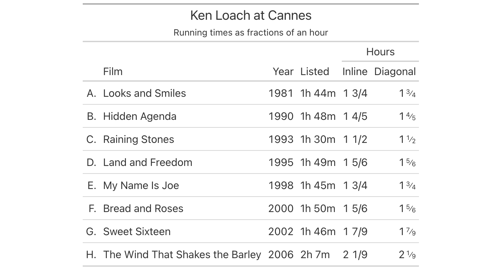
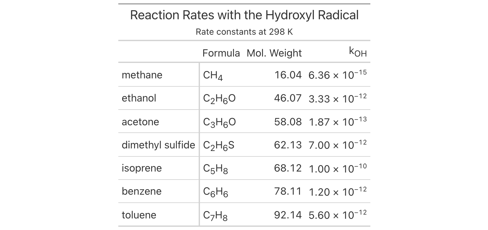
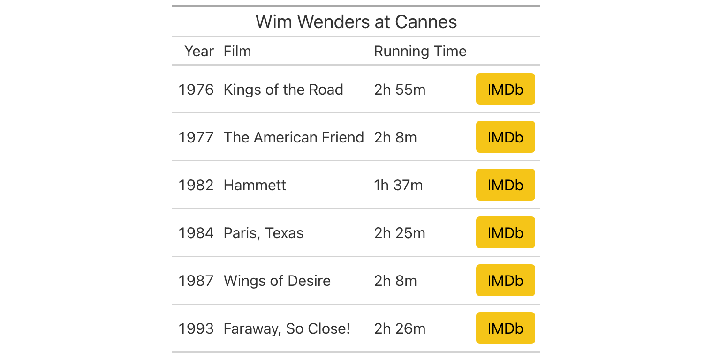
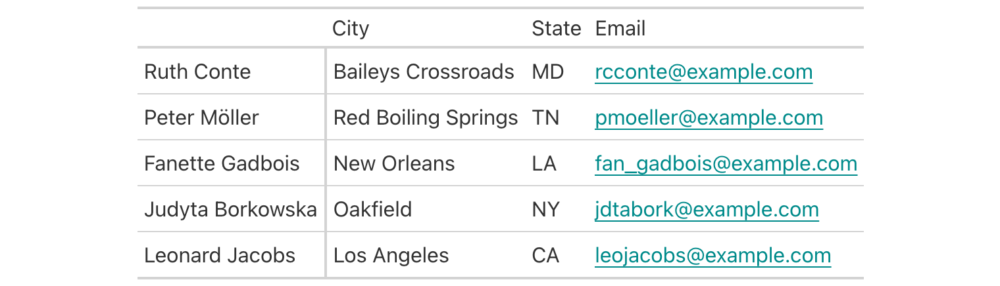
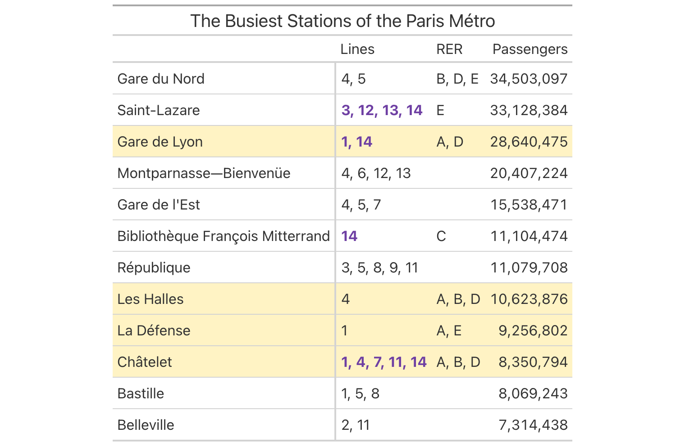
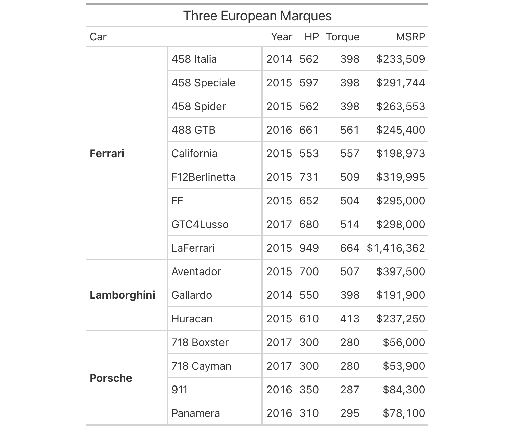
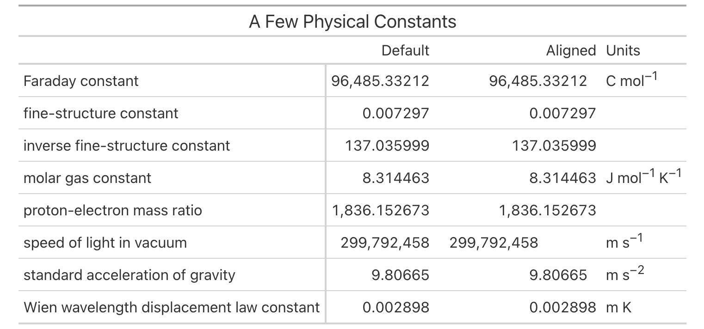
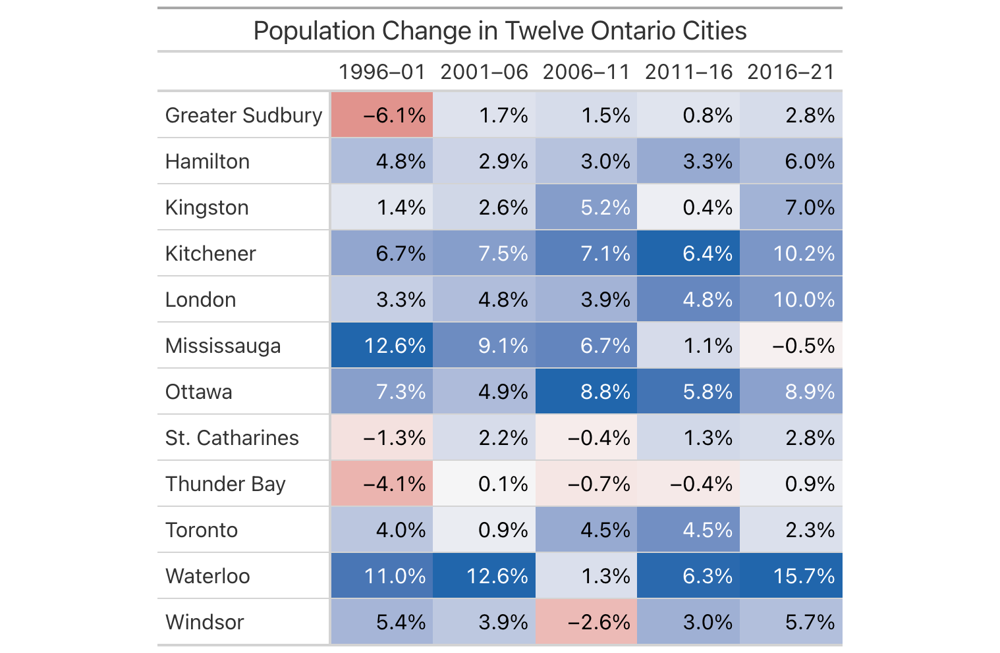
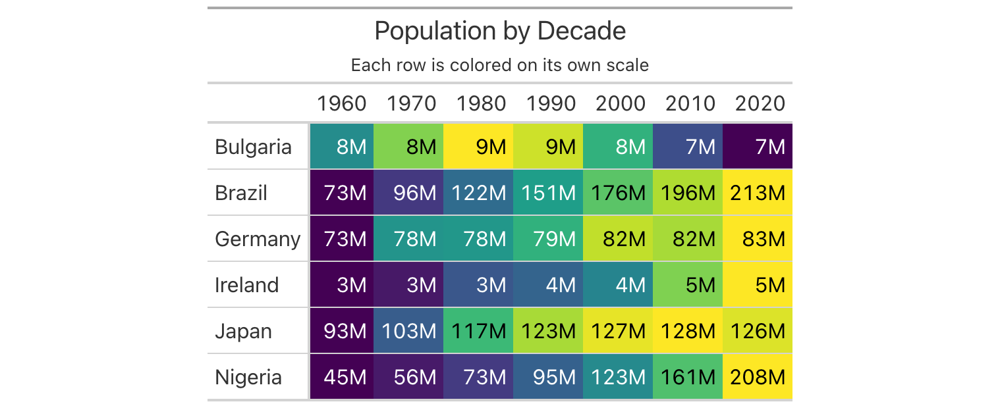
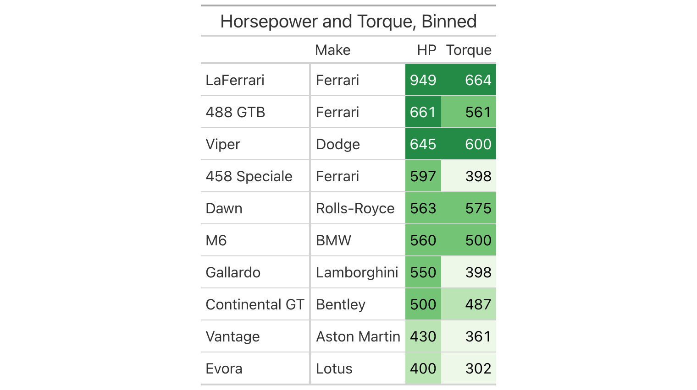

[Great Tables](https://posit-dev.github.io/great-tables/) reached
`v1.0.0` at the end of September, and `v1.1.0` followed only three weeks
later. Crossing into `1.x` territory means that the library's core API
is settled and that the work ahead consists of extending it rather than
reshaping it. The two releases, taken as a whole, move the library
forward along three lines:

1.  tables can now present specialized kinds of content (fractions,
    chemical formulas, links) according to their proper conventions
2.  they can respond to the values they contain, through value-based
    styling and a considerably more capable `data_color()`
3.  they hold up better structurally, with multi-level stubs, decimal
    alignment, and semantic HTML that assistive technologies can
    navigate

This post takes each of these additions in turn and pairs each with a
functional example. Every example draws on one of the datasets bundled
with the package, which are now reachable through a single new function,
`load_dataset()`. Passing it a dataset name and `tbl_type="polars"` (or
`"pandas"`, the default) returns the corresponding DataFrame, so the
examples below can be run as written after upgrading to `v1.1.0`.

## New formatters for specialized values

Some values have conventions of their own that a general-purpose number
formatter cannot honor. A quantity like 1.75 hours reads more naturally
as "1 3/4" in some contexts, a list of items is often labeled A, B, C
rather than 1, 2, 3, and a chemical formula looks odd without its
specialized typesetting (e.g., subscripts, brackets, etc.). Version
`1.0.0` adds formatters for each of these cases: `fmt_fraction()`,
`fmt_index()`, and `fmt_chem()`.

The `films` dataset records every film in competition at the Cannes Film
Festival since 1946, with running times stored as strings like
`"1h 44m"`. If we convert those to decimal hours, `fmt_fraction()` can
present them as mixed fractions. Its `accuracy=` argument governs how
fine the fractions may be: the default `"low"` permits single-digit
denominators, `"med"` and `"high"` allow two and three digits, and an
integer fixes the denominator by that number (so `accuracy=4` gives
quarters). The `layout=` argument chooses between ordinary inline
fractions and a diagonal form with a raised numerator and lowered
denominator, which is how fractions are usually typeset. We'll show both
side by side and use `fmt_index()` to turn a column of integers into
lettered row labels.

```python
import polars as pl
from great_tables import GT, md
from great_tables.data import load_dataset

films = load_dataset("films", tbl_type="polars")

loach = (
    films.filter(pl.col("director") == "Ken Loach")
    .head(8)
    .with_columns(
        hours=(
            pl.col("run_time").str.extract(r"(\d+)h").cast(pl.Float64).fill_null(0)
            + pl.col("run_time").str.extract(r"(\d+)m").cast(pl.Float64).fill_null(0) / 60
        )
    )
    .with_columns(hours_diag=pl.col("hours"), idx=pl.int_range(1, pl.len() + 1))
    .select("idx", "title", "year", "run_time", "hours", "hours_diag")
)

(
    GT(loach)
    .tab_header(title="Ken Loach at Cannes", subtitle="Running times as fractions of an hour")
    .fmt_index(columns="idx", pattern="{x}.")
    .fmt_fraction(columns="hours")
    .fmt_fraction(columns="hours_diag", layout="diagonal")
    .cols_label(
        idx="", title="Film", year="Year", run_time="Listed",
        hours="Inline", hours_diag="Diagonal",
    )
    .tab_spanner(label="Hours", columns=["hours", "hours_diag"])
)
```

<p style="text-align: center;"></p>

The `fmt_index()` method maps 1 to "A", 2 to "B", and so on, and its
`pattern=` argument lets us append a period to each label. For values
beyond 26, the `index_algo=` argument decides what happens next:
`"repeat"` doubles the letter ("AA", "BB"), while `"excel"` follows the
spreadsheet convention of column names ("AA", "AB"). There is also a
`case=` argument for lowercase labels.

The `fmt_chem()` method handles our own brand of chemistry notation and
renders it with the correct typography. So you get to incorporate things
like: subscripted atom counts, superscripted charges, isotope notation,
stoichiometric coefficients, various reaction arrows, etc. The
`reactions` dataset, which contains rate constants for the gas-phase
reactions of organic compounds with atmospheric oxidants, stores its
formulas as plain strings and makes for a good test of this method.

```python
reactions = load_dataset("reactions", tbl_type="polars")

compounds = (
    reactions.filter(
        pl.col("cmpd_name").is_in([
            "methane", "ethanol", "acetone", "benzene", "toluene",
            "dimethyl sulfide", "isoprene",
        ])
    )
    .select("cmpd_name", "cmpd_formula", "cmpd_mwt", "OH_k298")
    .sort("cmpd_mwt")
)

(
    GT(compounds, rowname_col="cmpd_name")
    .tab_header(title="Reaction Rates with the Hydroxyl Radical", subtitle=md("Rate constants at 298 K"))
    .fmt_chem(columns="cmpd_formula")
    .fmt_number(columns="cmpd_mwt", decimals=2)
    .fmt_scientific(columns="OH_k298", decimals=2)
    .cols_label(
        cmpd_formula="Formula",
        cmpd_mwt="Mol. Weight",
        OH_k298=md("k<sub>OH</sub>"),
    )
)
```

<p style="text-align: center;"></p>

The formulas here are simple ones, but the same method will typeset an
entire reaction such as `"2 CH3OH -> CH3OCH3 + H2O"` placed in a cell,
and it does so in LaTeX output as well as HTML as of `v1.1.0`.

## Links and buttons with `fmt_url()` and `fmt_email()`

Tables are frequently a point of departure. You might need a table with
a list of resources, a directory of people, or an index of documents.
The `fmt_url()` and `fmt_email()` methods turn columns of URLs and email
addresses into working links, so the reader can follow them directly
from the table. Both methods accept a fixed label (or a function that
computes one from each value), and both can render their links either as
underlined text or as small buttons with configurable fill, outline, and
width.

The `films` dataset includes an IMDb link for each film, which is a good
candidate for a button. Here we give every link the same short label and
a fill color that matches IMDb's own.

```python
wenders = (
    films.filter(pl.col("director") == "Wim Wenders")
    .select("year", "title", "run_time", "imdb_url")
    .head(6)
)

(
    GT(wenders)
    .tab_header(title="Wim Wenders at Cannes")
    .fmt_url(columns="imdb_url", label="IMDb", as_button=True, button_fill="#F5C518", color="black")
    .cols_label(year="Year", title="Film", run_time="Running Time", imdb_url="")
)
```

<p style="text-align: center;"></p>

The `fmt_email()` method works in the same way, producing `mailto:`
links. In its most basic form it simply makes each address clickable, as
in this small directory drawn from the `peeps` dataset (full of
fictional people).

```python
peeps = load_dataset("peeps", tbl_type="polars")

contacts = (
    peeps.head(5)
    .with_columns(name=pl.col("name_given") + " " + pl.col("name_family"))
    .select("name", "city", "state_prov", "email_addr")
)

(
    GT(contacts, rowname_col="name")
    .fmt_email(columns="email_addr")
    .cols_label(city="City", state_prov="State", email_addr="Email")
)
```

<p style="text-align: center;"></p>

The images in this post are static, of course, but in HTML output these
links are live. Links open in a new tab by default, which can be changed
through the `target=` argument, and in LaTeX output they are now written
with `\href` so that they remain clickable in a typeset PDF.

## Styling cells by their values with `tab_style_body()`

The `tab_style()` method has always asked a question about *where*: you
name a location (a column, a set of rows, the column labels) and the
style is applied there. Often, though, the question we want to ask is
about *what*. We want every cell containing a particular value to stand
out, or every row in which some condition holds, regardless of where
those cells happen to sit. The new `tab_style_body()` method is built
for this. It matches body cells by exact values (`values=`), by a
regular expression applied to the cell's text (`pattern=`), or by an
arbitrary predicate function (`fn=`), and the `targets=` argument
decides whether the style should be applied to the matched cell alone,
its whole row, or its whole column.

The `metro` dataset describes the stations of the Paris Métro, including
the lines that serve each one, the RER commuter-rail connections, and
annual passenger counts. In the table below we highlight every station
connected to RER line A, extending the fill across the entire row (and
into the stub), and separately set in bold purple the line listings that
include line 14 (the fully automated line).

```python
from great_tables import style

metro = load_dataset("metro", tbl_type="polars")

metro_busy = (
    metro.select("name", "lines", "connect_rer", "passengers")
    .drop_nulls("passengers")
    .top_k(12, by="passengers")
    .sort("passengers", descending=True)
)

(
    GT(metro_busy, rowname_col="name")
    .tab_header(title="The Busiest Stations of the Paris Métro")
    .fmt_integer(columns="passengers")
    .sub_missing(columns="connect_rer", missing_text="")
    .cols_label(lines="Lines", connect_rer="RER", passengers="Passengers")
    .tab_style_body(
        style=style.fill(color="#FFF3C4"),
        pattern=r"\bA\b",
        targets="row",
        extents=["body", "stub"],
    )
    .tab_style_body(
        style=style.text(weight="bold", color="#6E3FA3"),
        columns="lines",
        pattern=r"\b14\b",
    )
)
```

<p style="text-align: center;"></p>

The word boundaries in each pattern are pretty important here. Without
them, `"14"` would also match a hypothetical line 140, and `"A"` would
match any text containing that letter. Matching is performed against the
underlying data rather than the formatted output, so a predicate passed
to `fn=` receives the raw value (a number, a date, a string) and can
compare it directly.

## Multi-column stubs

The stub is the column of row labels on the left side of a table, and
until now it could hold only a single column. Many datasets, however,
have a natural hierarchy among their identifying columns: region and
city (`towny`), manufacturer and model (`gtcars`), etc. In `v1.1.0`, the
`rowname_col=` argument accepts a list of column names, and the stub is
built from all of them, with repeated values in the outer levels merged
into a single spanning cell.

Once a stub has several levels, we need a way to refer to each one. The
new `stub` selector serves this purpose in any `columns=` argument:
`stub` alone refers to the whole stub, and `stub(n)` refers to a single
level, counted from the right. In the example below, built from the
`gtcars` dataset of high-performance cars, `stub(1)` is the model and
`stub(2)` is the manufacturer, and we give each its own width. We also
bold the manufacturer level alone by passing `columns=` to `loc.stub()`.

```python
from great_tables import loc, stub

gtcars = load_dataset("gtcars", tbl_type="polars")

cars = (
    gtcars.filter(pl.col("mfr").is_in(["Ferrari", "Lamborghini", "Porsche"]))
    .select("mfr", "model", "year", "hp", "trq", "msrp")
    .sort("mfr", "model")
)

(
    GT(cars, rowname_col=["mfr", "model"])
    .tab_header(title="Three European Marques")
    .fmt_integer(columns=["hp", "trq"])
    .fmt_currency(columns="msrp", decimals=0)
    .cols_label(year="Year", hp="HP", trq="Torque", msrp="MSRP")
    .cols_width(cases={stub(2): "120px", stub(1): "140px"})
    .tab_style(style=style.text(weight="bold"), locations=loc.stub(columns="mfr"))
    .tab_stubhead(label="Car")
)
```

<p style="text-align: center;"></p>

A related change accompanies this feature. Stub and row group columns
are now excluded from column selections, as was always the intent, so
that a method called without `columns=` targets only the body. One
visible consequence is that `data_color()` no longer colors the cells of
the stub when it is applied to the whole table.

## Lining up numbers with `cols_align_decimal()`

Right-aligning a column of numbers works well when every value has the
same number of decimal places. When they differ, the digits of equal
magnitude no longer sit above one another, and the eye must work harder
to compare values. The new `cols_align_decimal()` method solves this by
padding each formatted value with figure spaces (spaces exactly as wide
as a digit) so that the decimal marks fall in a single vertical line.
Because it operates after formatting, it works with the output of any
`fmt_*()` method, including values with suffixes like `%`.

The `constants` dataset of fundamental physical constants is about as
varied in magnitude as data gets. In the table below, the same values
appear twice: once with ordinary right alignment and once aligned on the
decimal mark.

```python
constants = load_dataset("constants", tbl_type="polars")

const_mini = (
    constants.filter(
        pl.col("name").is_in([
            "speed of light in vacuum",
            "standard acceleration of gravity",
            "molar gas constant",
            "Faraday constant",
            "fine-structure constant",
            "inverse fine-structure constant",
            "proton-electron mass ratio",
            "Wien wavelength displacement law constant",
        ])
    )
    .select("name", "value", "units")
    .with_columns(aligned=pl.col("value"))
    .select("name", "value", "aligned", "units")
)

(
    GT(const_mini, rowname_col="name")
    .tab_header(title="A Few Physical Constants")
    .fmt_number(columns=["value", "aligned"], decimals=6, drop_trailing_zeros=True)
    .cols_align_decimal(columns="aligned")
    .sub_missing(columns="units", missing_text="")
    .fmt_units(columns="units")
    .cols_label(value="Default", aligned="Aligned", units="Units")
)
```

<p style="text-align: center;"></p>

In the aligned column, the integer parts and the fractional parts each
occupy their own region, and the relative magnitudes of the constants
become apparent at a glance. Locales that use a comma as the decimal
mark are handled through the `dec_mark=` or `locale=` arguments (or by
the locale set on the table itself).

## A more capable `data_color()`

The `data_color()` method colors cells according to their values, and
`v1.1.0` gives it more new capabilities than any other part of the
library. Three new arguments change what kinds of color scales are
possible, and two changes to its defaults improve every table that uses
it.

The first of the new arguments is `midpoint=`. Many quantities have a
meaningful center (a change of zero, a ratio of one, a score of fifty)
and should be colored with a diverging palette that fades to neutral at
that center and intensifies in opposite directions on either side.
Setting `midpoint=0` centers the palette there and, unless you supply a
`domain=` yourself, makes the domain symmetric around it. The `towny`
dataset records population change across five census periods, and with a
red-to-blue palette, growth and decline become visually opposed.

```python
import polars.selectors as cs

towny = load_dataset("towny", tbl_type="polars")

towny_change = (
    towny.filter(
        (pl.col("csd_type") == "city")
        & pl.col("name").is_in([
            "Toronto", "Ottawa", "Mississauga", "Hamilton", "London", "Kitchener",
            "Windsor", "Greater Sudbury", "St. Catharines", "Kingston", "Waterloo",
            "Thunder Bay",
        ])
    )
    .select("name", cs.starts_with("pop_change"))
    .sort("name")
)

(
    GT(towny_change, rowname_col="name")
    .tab_header(title="Population Change in Twelve Ontario Cities")
    .fmt_percent(columns=cs.starts_with("pop_change"), decimals=1)
    .cols_label(
        pop_change_1996_2001_pct="1996–01",
        pop_change_2001_2006_pct="2001–06",
        pop_change_2006_2011_pct="2006–11",
        pop_change_2011_2016_pct="2011–16",
        pop_change_2016_2021_pct="2016–21",
    )
    .data_color(palette=["#B2182B", "#F7F7F7", "#2166AC"], midpoint=0)
)
```

<p style="text-align: center;"></p>

Because the domain is symmetric, a decline of 4% receives exactly as
much red as a gain of 4% receives blue. The handful of red cells stand
out clearly against the general pattern of growth.

The second new argument is `direction=`. By default, `data_color()`
computes its scale down each column, which is the right choice when the
columns hold different measurements. Sometimes, however, it is the rows
that are internally comparable and the columns that are not. In the
following table of national populations by decade, from the
`countrypops` dataset, coloring by column would merely tell us that
Brazil is larger than Ireland. With `direction="row"`, each country
receives its own scale, and the colors instead trace the shape of each
country's history.

```python
countrypops = load_dataset("countrypops", tbl_type="polars")

pops_wide = (
    countrypops.filter(
        pl.col("country_name").is_in(["Nigeria", "Brazil", "Ireland", "Germany", "Japan", "Bulgaria"])
        & pl.col("year").is_in(list(range(1960, 2021, 10)))
    )
    .pivot(on="year", index="country_name", values="population")
)
year_cols = [c for c in pops_wide.columns if c != "country_name"]

(
    GT(pops_wide, rowname_col="country_name")
    .tab_header(title="Population by Decade", subtitle="Each row is colored on its own scale")
    .fmt_integer(columns=year_cols, compact=True)
    .data_color(palette="viridis", direction="row")
)
```

<p style="text-align: center;"></p>

The patterns are immediately legible. Nigeria and Brazil brighten
steadily from left to right. Japan reaches its peak around 2010 and
begins to recede. And Bulgaria, whose population peaked in the 1980s,
darkens again toward the present.

The third new argument, `fn=`, hands the color mapping over to you. It
takes a function that receives a list of values (a column, or a row with
`direction="row"`) and returns a list of colors of the same length. Any
function with that shape will do, but the library also provides three
helpers that build such functions for common cases: `col_numeric()` for
continuous scales, `col_factor()` for categories, and `col_bin()` for
numeric values cut into bins. Here `col_bin()` sorts horsepower and
torque figures from `gtcars` into four explicitly bounded bands.

```python
from great_tables import col_bin

hp_cars = (
    gtcars.select("mfr", "model", "hp", "trq")
    .sort("hp", descending=True)
    .gather_every(4)
    .head(10)
)

(
    GT(hp_cars, rowname_col="model")
    .tab_header(title="Horsepower and Torque, Binned")
    .fmt_integer(columns=["hp", "trq"])
    .cols_label(mfr="Make", hp="HP", trq="Torque")
    .data_color(
        columns=["hp", "trq"],
        fn=col_bin(palette=["#EDF8E9", "#BAE4B3", "#74C476", "#238B45"], bins=[0, 400, 500, 600, 1000]),
    )
)
```

<p style="text-align: center;"></p>

Because the bin boundaries are fixed rather than derived from each
column's range, the two columns share a common scale: the Rolls-Royce
Dawn's 563 horsepower and 575 lb-ft of torque fall in the same band and
receive the same green. This is something the automatic scaling of
`data_color()` cannot express on its own.

Finally, two changes to the defaults affect every table that uses
`data_color()`, whether or not it uses any of the new arguments. When
the method chooses a text color to sit on top of each fill, it now
judges legibility with APCA (the Accessible Perceptual Contrast
Algorithm) rather than the older WCAG contrast ratio. APCA models human
perception of contrast more faithfully, particularly for mid-tone
backgrounds, and you can see its choices in the tables above where light
text appears only on fills that are genuinely dark. If you need the
previous behavior, `contrast_algo="wcag"` restores it. Palettes are also
now interpolated in the CIELAB color space, which is designed so that
equal numerical steps correspond to roughly equal perceived differences,
and the resulting gradients are smoother and more even than those
interpolated in RGB.

## Accessible HTML tables

A table that looks clear on screen can still be difficult to navigate
for someone using a screen reader, because the visual relationship
between a cell and its headers is not by itself available to assistive
software. As of `v1.1.0`, the HTML that Great Tables produces carries
this information explicitly. Every column header and stub cell receives
an `id`, and every body cell lists the headers it belongs to in a
`headers` attribute. Stub cells are marked up as row headers with
`scope="row"`, column headers carry `scope="col"`, and the table as a
whole is labeled and described by its title and subtitle through
`aria-labelledby` and `aria-describedby`.

A new
[Accessibility](https://posit-dev.github.io/great-tables/user-guide/accessibility.html)
page in the User Guide describes all of this in more detail and it also
offers guidance on creating tables that work well for everyone.

## Smaller changes worth knowing about

Several smaller changes in these releases deserve a mention. The number
formatters gained a `min_sep_threshold=` argument that sets how many
digits a number must have before digit grouping applies. The `v1.1.0`
release also fixed more than sixty bugs, most of them in the number
formatters.

LaTeX output received a great deal of attention as well. Units notation
and `fmt_chem()` now render in LaTeX. Summary rows, decimal alignment,
and stub indentation are rendered correctly. A long list of escaping
problems with special characters has also been resolved.

## Getting started

Great Tables `v1.1.0` is available now on PyPI, so
`pip install --upgrade great-tables` brings everything described here.
The [documentation site](https://posit-dev.github.io/great-tables/)
covers each new method with runnable examples, and the full changelogs
for
[`v1.0.0`](https://github.com/posit-dev/great-tables/releases/tag/v1.0.0)
and
[`v1.1.0`](https://github.com/posit-dev/great-tables/releases/tag/v1.1.0)
list every fix and change in detail.

Looking back across both releases, the common thread is a table that
knows more about what it contains. It knows that a fraction, a formula,
or a link has a proper form. It also knows which cells deserve emphasis
because of what they hold rather than where they sit. Many people
contributed to this work, and we are especially grateful to
[\@LuisFigueroaG](https://github.com/LuisFigueroaG),
[\@raashish1601](https://github.com/raashish1601),
[\@manan28025](https://github.com/manan28025),
[\@Rodrigo-Palma](https://github.com/Rodrigo-Palma),
[\@taekop](https://github.com/taekop),
[\@blaahhrrgg](https://github.com/blaahhrrgg), and
[\@naseem173](https://github.com/naseem173). If you have a feature to
request or a bug to report, the [GitHub
repository](https://github.com/posit-dev/great-tables) is the right
place to get in touch!
