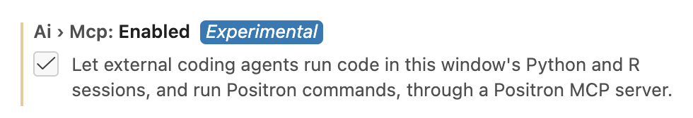
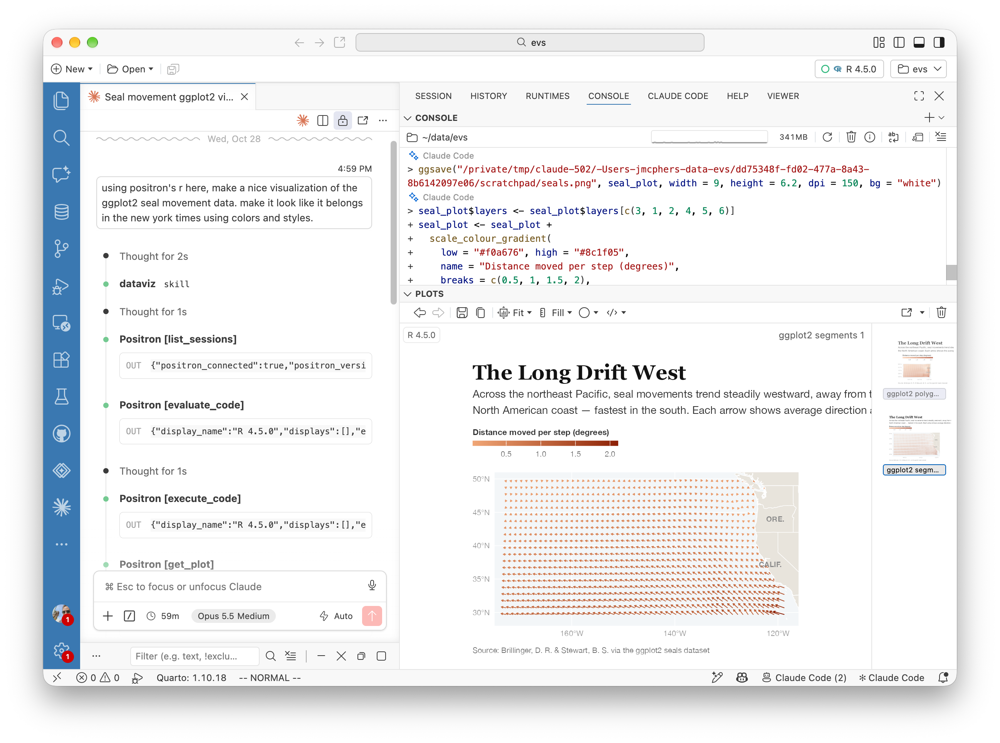
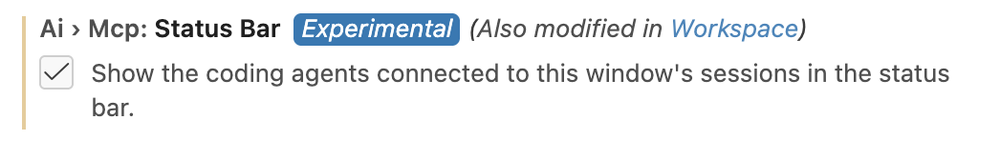
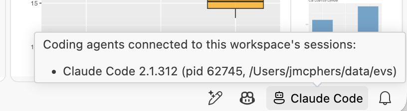

We're very proud of [Posit Assistant](https://assistant.posit.co), our own agentic harness for data science. It's designed to be easy to use even if you have no other AI tools or subscriptions, and it is deeply integrated into Positron and RStudio.

However, in the months since we introduced Posit Assistant, we heard from many of you who prefer to use your own coding agent harness inside Positron. This might be for the familiar interface, or to get access to models and tokens that your company is already paying for -- for example, via Claude Enterprise subscriptions -- that aren't available in Assistant.

While we obviously think our own harness is pretty great, at Posit our goal is to build open tools that help you avoid vendor lock-in. We want to make Positron the best IDE for doing data work no matter what the rest of your ecosystem looks like, and that means giving third party agents access to the Positron IDE surface, too.

Towards that end, in the 2026.10 release of Positron, we've added an experimental **Positron MCP** (a [Model Context Protocol](https://modelcontextprotocol.io/) server). This MCP exposes tools inside Positron that agents can use to work alongside you in the IDE.

To turn it on, enable the new [MCP: Enabled](positron://settings/ai.mcp.enabled) setting:

With this setting enabled, Positron exposes an MCP server any agent harness can connect to, using the standard MCP protocol. Both agents running in terminal CLIs and agents running in Positron extensions can connect.

## Why a Positron MCP?

You don't actually *need* the Positron MCP to use other agent harnesses in Positron -- extensions like Claude Code and Codex already work well in Positron without it.

Without the MCP, however, using a third-party agent harness feels a lot like it might if you were using it inside a plain terminal. It can't see any of your data or live session information or other Positron context. If it wants to execute R or Python code, it'll do it using shell commands and you won't see what's going on.

With the MCP turned on, the agent can work alongside you in Positron:

- You'll see everything the agent does. It can pick up work you started, and you can finish work that it starts.
- It can see your loaded data and will answer questions using it as context.
- It can see your R and Python consoles, and run code in them. When the MCP runs code, it will be annotated with the agent name in the Console pane.
- It can see your plots, too, and can help you iterate on them until they look very nice.
- You can ask it questions about errors or problems and it'll know what you're talking about without any copying or pasting.

## What harnesses does it work with?

The Positron MCP works with just about any agent that supports MCP. We've tested it with:

- Claude Code (extension and CLI)
- Codex (extension and CLI)
- OpenCode
- Kiro
- Gemini
- Copilot CLI

and more.

## Using the MCP

### One-time setup

Enable the MCP in Settings, as described above, then run the *Positron MCP: Add to Coding Agent* command to automatically set up your coding agent. If your coding agent isn't on the list of those Positron knows how to configure, you can still use your agent in Positron! Run the command *Positron MCP: Show Connected Agents*, then choose "Copy Connection Details" option to get the information your agent needs to connect.

Note

Positron's MCPs are started inside projects, and know which project they're working with. If you have multiple windows open with different projects, each has its own MCP, and if you have a window open with *no* project or folder open, it doesn't currently run an MCP.

### Agent and MCP connections

Once the MCP is configured, you don't need to do anything special to start it, stop it, or manage the agent connection; Positron takes care of this automatically. When asking the agent to perform a task, it's helpful to mention "Positron" or tell it explicitly to "use the Positron MCP".

If you're not sure whether Positron and your agent are on speaking terms, you can ask your agent, or enable the [MCP Status Bar](positron://settings/ai.mcp.statusBar) setting:

With this setting enabled, any coding agents connected will get an icon in the Status Bar. Hover over it to see them:

## Security

It's important to keep in mind that the MCP can be used to ask Positron to execute arbitrary code in your R and Python consoles -- and that code will run with your user credentials. Exposing the Positron MCP to an agent is therefore equivalent to giving it unrestricted shell access.

Enabling the MCP doesn't mean you're doing away with security, though; it just means that you're *delegating* trust decisions to your agent harness. Most harnesses will prompt for confirmation and trust when running potentially dangerous operations, but not all. Make sure you understand your agent's trust model and are comfortable with its permissions and execution policies before connecting it to Positron.

## Feedback

How's your experience using the Positron MCP? Was it difficult to configure your agent? Missing any capabilities? We'd love to hear from you on our [discussion forum](https://github.com/posit-dev/positron/discussions)!
