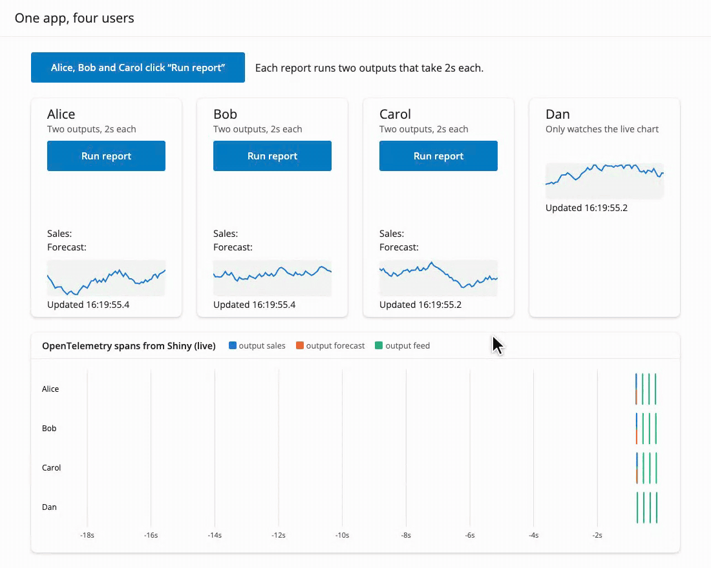

<!-- TODO before publishing: confirm the version number, the date, the authors, and the PR links. -->

We're happy to announce that [Shiny for Python v1.9](https://pypi.org/project/shiny/) is now on PyPI!

``` bash
# to install:
pip install -U shiny
```

This release overhauls the reactive system within Shiny for Python, and now uses a
concurrency model similar to Shiny for R. The key changes:

- [A slow `await` in one session no longer blocks other sessions](#one-slow-user-no-longer-blocks-everyone), so the users of an app no longer wait for each other.
- [Async outputs in the same session now run concurrently](#async-outputs-run-at-the-same-time), so a page with multiple slow outputs is ready in one second instead of eight.
- [`reactive.lock()` has been removed](#reactivelock-is-deprecated), and the new [`session.run_once_when_idle()`](#new-sessionrun_once_when_idle) provides a way to change reactive state from a background task.
- [Other improvements](#other-improvements) <!-- TODO: one-line summary of the other changes in this release -->

Full details are in the [Shiny for Python changelog](https://github.com/posit-dev/py-shiny/blob/main/CHANGELOG.md).

## One slow user no longer blocks everyone

Until now, Shiny for Python processed reactivity behind one lock for the whole process, `reactive.lock()`. When a user's action invalidated an effect or an output, Shiny took the lock, ran everything that was invalidated, and released the lock only when all of it had finished. This model meant that any other reactive effects were blocked for as long as an operation kept the lock. During that time, no other session in the process (*e.g.*, a separate tab or another user) could update anything, not even an output that had nothing to do with the query.

The recording below shows an example of how the new system improves things drastically. It simulates four people using the same app each in a separate Shiny session. Alice, Bob and Carol each click "Run report" at the same time. A report has two async outputs, "Sales" and "Forecast", and each one takes two seconds to finish query. Dan only watches a chart that the server redraws every 0.2 seconds. The plot at the bottom displays the [OpenTelemetry spans](https://shiny.posit.co/py/docs/opentelemetry.html) for the app to visualize the timeline of server processing.

<div class="grid gap-12 items-start mt-12 md:grid-cols-2">
<div class="prose max-w-none">

<figure>

<figcaption aria-hidden="true"><strong>Shiny for Python 1.8.</strong> Because of the <code>reactive.lock()</code>, the reports run serially and finish after 4.0, 8.0 and 12.0 seconds. Every live chart output stops updating until the last report is done. In the OpenTelemetry timeline, the six output spans form a staircase, one after another.</figcaption>
</figure>

</div>
<div class="prose max-w-none">

<figure>

<figcaption aria-hidden="true"><strong>Shiny for Python 1.9.</strong> Because reactive effects are now allowed to run concurrently, all three reports finish after 2 seconds, and Dan’s chart keeps updating during the slow operations.</figcaption>
</figure>

</div>
</div>

In 1.8, the OpenTelemetry data shows the six output spans forming a staircase. Alice's "Forecast" waits for her own "Sales", and Bob's report can't start until Alice's ends. No session redraws its chart (the green ticks) until the last report is done. In 1.9, all six outputs run at the same time, and Dan's chart never stops updating.

In 1.9, a reactive flush starts each invalidated effect as an asynchronous task and the reactive system doesn't wait for it to finish to continue processing events. While Alice's report awaits its query, the event loop is free to serve Bob, Carol, Dan, and everyone else.

<figure>

<figcaption aria-hidden="true">How a report runs in each version. In 1.8, every user waits for one lock, so the six outputs run one after another. In 1.9, each session starts its outputs at the same time, sends them together, and only then applies that user’s next input.</figcaption>
</figure>

The more users that click at the same time, the larger the difference:

<figure>

<figcaption aria-hidden="true">The time until the last user sees a result, when several users click at the same time. Each report has two async outputs that await a two-second query.</figcaption>
</figure>

Put in terms of scaling: when *n* users each start *k* async outputs that each wait *t* seconds, the last user in 1.8 waits about *n* × *k* × *t* seconds, because every output runs after the one before it. In 1.9, every user waits about *t* seconds, for any number of users and outputs. The wait goes from $O(n·k)$ to $O(1)$. In the chart, *k* is 2 and *t* is 2 seconds, so for 8 users the wait goes from 32 seconds to 2.

*Caveat:* this speedup applies when the slow part is waiting on something outside Python that can serve many requests at the same time, such as a database or a web API. Work that keeps Python itself busy will still add up (see [Concurrency needs `await`](#concurrency-needs-await) below).

## Async outputs run at the same time

Apart from the cross-session benefits, the updated reactive system also improves things for a single user, as Alice's two outputs show in the recording above. Before, a flush ran the outputs of a session one after another, so a page with several slow `async` outputs added up their times. Now they all start together and the page updates once all the updates are ready.

In this example, there are three outputs and each one waits for a one-second query. The app then shows how long after the click it was ready:

``` python
import asyncio
import time

from shiny import reactive
from shiny.express import input, render, ui

ui.input_action_button("refresh", "Refresh dashboard")


@reactive.calc
def refreshed_at():
    input.refresh()
    return time.perf_counter()


async def query(name: str) -> str:
    start = refreshed_at()
    await asyncio.sleep(1)  # Stands in for a one-second database query.
    return f"{name} ready after {time.perf_counter() - start:.1f}s"


@render.text
async def revenue():
    return await query("Revenue")


@render.text
async def signups():
    return await query("Signups")


@render.text
async def churn():
    return await query("Churn")
```

[Open this app in Shinylive](https://shinylive.io/py/editor/#code=NobwRAdghgtgpmAXAAjFADugdOgnmAGlQGMB7CAFzkqVQEsZ1SAnC5KAZ1wmLtIB0IDJq2QUGcQYIBmzUjGQcAFnQi5kwlm2ZwoxcQDdJEWfMUq1WOAA90Ojhw2MtGiOgCuFIjogATOMxE7nRSEMFYqh4UAPp64uTRAEaeFOQAFPxgOrJwyplEmQBKcDnKyL6cSomkUMy+mQCUoYIAAjpxdEZYxFAANsSC-tLI2fZKcL6xFGkNiILIC65RWKO5SjPzizoU7swQYhI4AdLRZO6UARsQoZzcxOUlyACO7gG4adDwKBwUzA3IAFoAHyKX5zfaLH61NgAXhGJTGEymV0W7AA7lA6Gxbjw+FgOL04HB0GkAIz-ZAAYmQAGUKFA-I5VMhpCx2MhyHAARw4GQ-OUoPTEpw4M9XsxcFhNgttrt9tJMiBPnAAL7wqC+dRQaRUZjIEDieBHZgnM4XZgzQGg6GILCk6QqjiZZoQNrUfzMLBUawUQQ4+5DeFGMJwGbg1GyvbozFsF5vDJgYrB16NF1uvwBL02X3QLg8B7DDh0ADmYXQHDD0vhOyjUAxWLF8cyNJLZadYCa1y76Y9WZ9frzAcexCUcsrEJlcBr+zrMcbEoTAGFR3tUxBCKgKLh0AgUGBvRQwCqALpAA) to run it in your browser and edit it.

In 1.8, the outputs are ready one at a time, after 1.0, 2.0 and 3.0 seconds, and none of them render until the last one is done at 3.0s. In 1.9, all three are ready after 1.0 second.

<figure>

<figcaption aria-hidden="true">The time until every output is rendered, for a page of async outputs that each take one second.</figcaption>
</figure>

<div class="callout callout-important" role="note" aria-label="Important">
<div class="callout-header">
<span class="callout-title">Concurrency needs <code>await</code></span>
</div>
<div class="callout-body">

Shiny runs on a single [`asyncio` event loop](https://docs.python.org/3/howto/a-conceptual-overview-of-asyncio.html#event-loop). Code can only run concurrently while other code awaits. A synchronous call such as `time.sleep()`, a blocking database driver, or a long calculation still stops every session until it returns, in both 1.8 and in 1.9.

To keep blocking work from stopping the app, use a library that supports async, or run the call in a thread with [`asyncio.to_thread()`](https://docs.python.org/3/library/asyncio-task.html#asyncio.to_thread):

``` python
@render.data_frame
async def results():
    return await asyncio.to_thread(run_slow_query, input.filters())
```

For work that should run in the background while the user does other things, use [`@reactive.extended_task`](https://shiny.posit.co/py/docs/nonblocking.html).

</div>
</div>

## What stays the same

Within one session, Shiny keeps the guarantees that make reactive code easy to reason about. These match how Shiny works in R as well:

- **Inputs don't change in the middle of a cycle.** If a user changes an input while the session's effects are still running, Shiny applies the change only when all of them have finished. An effect that pauses at an `await` sees the same input values when it resumes. Timers from `reactive.invalidate_later()` wait the same way.
- **Outputs update together.** A session sends all of its new output values at once, when its effects have finished, so the page never shows a mix of old and new results.
- **An effect never overlaps itself.** If an effect is invalidated while it runs, the next run starts when the current run ends.

## Changes you might notice

<div class="callout callout-warning" role="note" aria-label="Warning">
<div class="callout-header">
<span class="callout-title">Draft: review needed</span>
</div>
<div class="callout-body">

@schloerke, please review this section before we publish. It may be more detail than is needed, and I'm not 100% certain on the explanations and could use another set of eyes.

</div>
</div>

Most apps won't need any changes, but here are some differences that you might see:

- **Async effects interleave.** Effects in the same session now run in turns at each `await`, instead of one after another. `priority` sets the order in which effects *start*, not the order in which they finish. If one effect depends on another effect's side effect, use a `reactive.calc` or a `reactive.value` to make the dependency explicit. ([#837](https://github.com/posit-dev/py-shiny/issues/837))
- **Destroying an effect cancels it.** Because Shiny no longer waits for async effects to finish, a session can end, or a module can be destroyed, while one of its effects is paused at an `await`. So `effect.destroy()`, the end of a session, and `session.destroy()` for a module now cancel a run that is still in progress, by raising `asyncio.CancelledError` at its current `await`. This stops the effect before it can read values that were destroyed with its module. If an effect needs to clean up, catch `asyncio.CancelledError` (or use `try`/`finally`) and then let the error continue.
- **Message handlers run in their own tasks.** In 1.8, Shiny ran a `session.set_message_handler()` handler before it read the next message from the client, and it kept the global lock while the handler ran. So a slow handler delayed the client's other messages, and every other session as well. Now each handler runs in a task of its own, and the session keeps handling messages while it runs.
- **Setting a value schedules a flush.** Setting a `reactive.value` now schedules a flush on its own ([#21](https://github.com/posit-dev/py-shiny/issues/21)). So a value set from a download handler updates the outputs that read it right away, even while a streamed download is still sending ([#1785](https://github.com/posit-dev/py-shiny/issues/1785)). The reactive graph is still not thread-safe, so from another thread, use `loop.call_soon_threadsafe(value.set, new_value)`.
- **Messages from `session.on_flushed()` callbacks reach the browser.** A callback that sends a message, for example `ui.update_text()`, now has its message sent to the client ([#1889](https://github.com/posit-dev/py-shiny/issues/1889)).
- **OpenTelemetry spans follow the session.** There is now one `reactive_update` span for each session's cycle, as in Shiny for R. It has the session's `session.id`, and the session's calc, effect and output spans are its children.

## `reactive.lock()` is deprecated

Shiny itself no longer uses `reactive.lock()`, and it has been functionally removed in 1.9.Any code calling that method will now emit a `ShinyDeprecationWarning` that returns a lock that never blocks. The `reactive.lock()` API will be completely removed in a future version of Shiny for Python.

The usual reason to use it was to change reactive state from a background task, followed by a flush. You can now just set the value directly, and Shiny will schedule the flush for you:

``` python
# Before
async with reactive.lock():
    latest.set(new_value)
    await reactive.flush()

# After
latest.set(new_value)
```

If your code used `reactive.lock()` to keep two pieces of your own code from running at the same time, create your own [`asyncio.Lock`](https://docs.python.org/3/library/asyncio-sync.html#asyncio.Lock) for that.

## New: `session.run_once_when_idle()`

<div class="callout callout-warning" role="note" aria-label="Warning">
<div class="callout-header">
<span class="callout-title">Draft: doc link needs updating</span>
</div>
<div class="callout-body">

This will need a link to the correct `run_once_when_idle()` docs once those are published.

</div>
</div>

Sometimes a change should wait until a session's running effects have finished, the same way input changes from the browser do. [`session.run_once_when_idle()`](https://shiny.posit.co/py/api/core/Session.html) runs a function once, at the start of the session's next cycle:

``` python
session.run_once_when_idle(lambda: latest.set(new_value))
```

The function runs when all of the session's effects have finished and its outputs have been sent. If the session is idle already, it runs on the next pass of the event loop.

## Try it yourself

<div class="callout callout-warning" role="note" aria-label="Warning">
<div class="callout-header">
<span class="callout-title">Draft: demo sources need links</span>
</div>
<div class="callout-body">
</div>
</div>

The demo apps in this post, with the live OpenTelemetry timeline, are in <!-- TODO: link to where the demo source is published -->. Run them with Shiny for Python 1.8 and 1.9 to see the difference on your own machine. To view the spans of your own app, see [Shiny's OpenTelemetry docs](https://shiny.posit.co/py/docs/opentelemetry.html). <!-- TODO: confirm this URL -->

## Other improvements

<div class="callout callout-warning" role="note" aria-label="Warning">
<div class="callout-header">
<span class="callout-title">Draft: fill in from the CHANGELOG at release time</span>
</div>
<div class="callout-body">

Pick the changes worth calling out from the [CHANGELOG](https://github.com/posit-dev/py-shiny/blob/main/CHANGELOG.md), and leave the rest to the link in the introduction. Delete any subsection that ends up empty.

</div>
</div>

Shiny for Python 1.9 also includes these changes:

### New features

<!-- TODO: new features. Candidates in the CHANGELOG today:
  * `ui.sidebar()` `role` parameter for ARIA landmark markup (#2526)
-->

- TODO

### Improvements

<!-- TODO: improvements. Candidates in the CHANGELOG today:
  * `@render.download_button()` and `@render.download_link()` gain an `icon` argument
  * Navigation links to tab panels set `aria-controls` (#2526)
  * Express `@output_args()` accepts every argument of the output's UI function (#2539)
-->

- TODO

### Bug fixes

<!-- TODO: bug fixes. Candidates in the CHANGELOG today:
  * `Progress.set(0)` with a negative `min` (#2518)
  * `ui.input_date()` `datesdisabled` with a non-default `format` (#2523)
  * Polars 2.0 `Categorical` and `Enum` columns in data frames (#2529)
  * A recursive `reactive.calc` returns its own computed value (#2521)
  * `Jsonifiable` accepts `dict[str, int]` and `list[str]` (#2511)
  * `near_points()` and `brushed_points()` fixes
-->

- TODO

## In closing

This is one of the largest changes to Shiny for Python's internals since its first release, and it brings Python and R to the same reactive model. If an app behaves differently after you upgrade, please let us know! As always, if you have questions or feedback, [join us on Discord](https://discord.gg/yMGCamUMnS) or open an issue on [posit-dev/py-shiny](https://github.com/posit-dev/py-shiny/issues/new). Happy Shiny-ing!

## Acknowledgements

A big thank you to all the folks who helped make this release happen by opening issues and contributing code:

<div class="callout callout-warning" role="note" aria-label="Warning">
<div class="callout-header">
<span class="callout-title">Draft: generate the contributor list for the release, as in earlier
posts</span>
</div>
<div class="callout-body">
</div>
</div>
<!-- TODO: generate the contributor list for the release, as in earlier posts. -->
