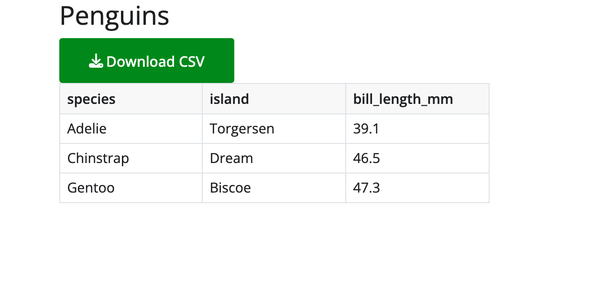

We're pleased to announce that [Shiny for Python v1.9](https://pypi.org/project/shiny/) is now on PyPI!

``` bash
pip install -U shiny
```

The highlights:

- [Async effects and outputs now run concurrently](#concurrent-async), so one slow `await` no longer holds up other sessions or other outputs,
- [`ui.sidebar(role=)`](#sidebar-landmarks) makes a sidebar an ARIA landmark that screen reader users can jump to,
- [Express download buttons take an `icon`](#download-buttons-in-express) and other attributes, with no `ui.hold()` needed, and
- [UI updates from background tasks](#updates-from-background-tasks) now reach the browser right away.

This release has a few breaking changes, so please read [Breaking changes](#breaking-changes) before you upgrade. Full details are in the [Shiny for Python changelog](https://github.com/posit-dev/py-shiny/blob/main/CHANGELOG.md).

## Concurrent async

The biggest change in 1.9 is under the hood. Until now, one lock for the whole process ran reactive updates one at a time. If an `async` output awaited a two-second database query, every other session in the process waited too, and so did the other outputs in the same session.

In 1.9 the lock is gone. Shiny starts each invalidated effect as its own task, so while one output awaits, the event loop is free to run the others:

``` python
from shiny.express import render


@render.text
async def sales():
    return await db.query("sales")  # 2 seconds


@render.text
async def forecast():
    return await api.forecast()  # 2 seconds
```

In 1.8, this page took four seconds for one user, and eight seconds for the second of two users who clicked at the same time. In 1.9, both outputs finish after two seconds for everyone. Within a session, nothing changes that you can see: input changes still wait until all of the session's effects have finished, and outputs are still sent together.

There's a lot more to say about this, so it has its own post: [All Together Now: Concurrent Async in Shiny for Python](../../blog/2026-10-29_shiny-python-concurrent-async/). It covers how the new model works, why concurrency still needs `await` (synchronous code still blocks every session), and the changes you might notice in an existing app. Two API changes come with it:

- `reactive.lock()` is now defunct. It no longer locks anything and emits a `ShinyDeprecationWarning`. Please remove it from your code.
- The new [`session.run_once_when_idle()`](https://shiny.posit.co/py/api/core/Session.html#shiny.Session.run_once_when_idle) runs a function once, after the session's effects have finished and its outputs have been sent. Use it to change reactive state from a background task or a custom timer without changing a value that a running effect is still reading.

## Breaking changes

Besides the concurrency changes above, three changes may need an update to your code or tests:

- **Sidebars render a `<div>` by default.** `ui.sidebar()` used to render an `<aside>`, which is a "complementary" landmark. Now it renders a neutral `<div>` unless you set [`role=`](#sidebar-landmarks). If your CSS, JavaScript, or tests select `aside.sidebar`, select `.sidebar` instead, or set `role="complementary"` to keep the `<aside>`.
- **`near_points(add_dist=True)` names its column `dist_`.** The docs always said `dist_`, but the column was named `dist`, which could collide with a `dist` column in your own data. Code that reads `df["dist"]` from the result must now read `df["dist_"]`.
- **OpenTelemetry `reactive_update` spans follow each session.** There is now one span per session cycle, from when the session turns busy until all of its effects (including async ones) have finished, and it carries the session's `session.id`. Before, one span covered a whole reactive flush, which could serve several sessions. If you have dashboards or alerts built on these spans, check them after you upgrade. Effects without a session no longer have a `reactive_update` parent.

## Sidebar landmarks

Screen readers let people jump between the main regions of a page, called [landmarks](https://developer.mozilla.org/en-US/docs/Web/Accessibility/ARIA/Reference/Roles#3._landmark_roles), such as the navigation, the main content, and the search form. A sidebar often holds one of these regions, but Shiny had no way to say which one.

[`ui.sidebar()`](https://shiny.posit.co/py/api/core/ui.sidebar.html) gains a `role` argument. Pass `"form"`, `"search"`, `"complementary"`, or `"region"` to describe what the sidebar is for:

``` python
from shiny import App, render, ui

app_ui = ui.page_sidebar(
    ui.sidebar(
        ui.input_text("query", "Search penguins"),
        ui.input_checkbox_group(
            "species", "Species", ["Adelie", "Chinstrap", "Gentoo"]
        ),
        title="Filters",
        role="search",
    ),
    ui.output_text("summary"),
    title="Penguins",
)
```

A landmark needs a name, so Shiny labels it with the sidebar's `title`. The sidebar above renders as:

``` html
<div id="bslib_sidebar_363556" class="sidebar" role="search"
     aria-labelledby="bslib_sidebar_363556-title">
```

If your sidebar has no title, pass `aria_label=` or `aria_labelledby=` instead. Shiny raises an error if a landmark sidebar has no name at all. `role="complementary"` renders an `<aside>`, the other roles render a `<div>` with that `role`, and the default (`role=None`) renders a plain `<div>`.

Two more accessibility changes come along with this. `ui.page_sidebar()` now places the whole sidebar layout inside the page's `<main>` landmark, and navset links now have `aria-controls` pointing at the tab panel they show. These changes come from bslib for R ([rstudio/bslib#1359](https://github.com/rstudio/bslib/issues/1359) and [rstudio/bslib#1355](https://github.com/rstudio/bslib/issues/1355)).

## Download buttons in Express

In Express, `@render.download_button` places its button for you. That's handy until you want an icon or a different button style, since there was no way to pass those along. The workaround was to wrap the render function in `ui.hold()` and place a `ui.download_button()` by hand.

In 1.9, [`@render.download_button`](https://shiny.posit.co/py/api/express/express.render.download_button.html) and `@render.download_link` take an `icon` argument, and pass any other keyword arguments to the control they place:

``` python
import pandas as pd
from faicons import icon_svg

from shiny.express import render, ui

penguins = pd.DataFrame(...)

ui.page_opts(title="Penguins")


@render.download_button(
    label="Download CSV",
    icon=icon_svg("download"),
    class_="btn-success",
    filename="penguins.csv",
)
def download():
    yield penguins.to_csv(index=False)


@render.data_frame
def table():
    return penguins
```



This is part of a wider fix. In Express, `@output_args()` now accepts every argument of the output's UI function, with matching types. So `@render.ui` now takes `inline`, `container`, `fill`, `fillable`, and HTML attributes, and `@render.text` takes `container`, instead of raising a `TypeError`. Your type checker now knows about all of these as well.

Also, if a download handler sets a reactive value, the outputs and effects that read it now update right away. Before, they waited for the next message from the browser.

## Updates from background tasks

Sometimes an app starts an `asyncio` task that runs alongside the reactive graph, for example to poll a service or to watch a file. Before 1.9, a `ui.update_*()` call or a custom message from such a task sat in a queue until the user next changed an input. In 1.9, it's sent to the browser right away:

``` python
import asyncio
from datetime import datetime

from shiny import App, ui

app_ui = ui.page_fixed(
    ui.input_text("status", "Last heartbeat"),
)


def server(input, output, session):
    async def heartbeat():
        while True:
            await asyncio.sleep(1)
            ui.update_text("status", value=datetime.now().strftime("%H:%M:%S"))

    task = asyncio.create_task(heartbeat())
    session.on_ended(task.cancel)


app = App(app_ui, server)
```

The text box now ticks once a second, with no input from the user. If the task needs to change a reactive value instead, wrap the change in `session.run_once_when_idle()`, described [above](#concurrent-async), so it doesn't change under an effect that is still running.

## Faster data frames

`@render.data_frame` now serializes data frames faster and with less memory. A 100,000-row frame with mixed column types serializes 2 to 3.5 times faster, with a 15 to 40% lower memory peak. The largest gains are for pandas datetime and timedelta columns, duration columns, and `Decimal` or missing (`pd.NA`) values. Editing a cell no longer copies the whole data frame. (Thanks, [@FBruzzesi](https://github.com/FBruzzesi)!)

Along the way, values of pandas nullable dtypes (`Int64`, `Float64`, `boolean`) now reach the browser as numbers and booleans instead of strings such as `"1"` and `"True"`, so they sort and filter as you would expect. Polars `Categorical` and `Enum` columns work with Polars 2.0, and key-value `Map` columns are labeled as `object`, like struct and list columns.

## Deprecation: `shiny add test`

`shiny add test`, which generated Playwright tests with an LLM, is deprecated and will be removed within the next few releases. To generate tests, use the bundled `shiny-for-python` [Agent Skill](../../blog/2026-08-04_shiny-r-1-14-python-1-7/#agent-skills) with your coding agent instead. The skill also knows about [in-memory server tests](../../blog/2026-09-22_shiny-python-1-8/#in-memory-server-testing), which are often all you need.

## Other improvements

A few more changes worth a quick mention. The full list is in the [changelog](https://github.com/posit-dev/py-shiny/blob/main/CHANGELOG.md):

- Message handlers set with `session.set_message_handler()` now run in their own task, so a slow handler no longer holds up other messages from the client.
- Destroying an effect now cancels its in-progress run. So when a session ends, its in-progress `async` effects and render functions are cancelled instead of running on after the session is gone.
- `req(False, cancel_output=True)` inside a `@reactive.effect` now stops the effect quietly, instead of being treated as an error that closes the session.
- On Windows, an output's busy indicator now shows while the output renders.
- `ui.input_date()`'s `datesdisabled` now works when `format` is not the default `yyyy-mm-dd`.
- `Progress.set(0)` now places the bar at `0` relative to `min` and `max`. Before, `Progress(min=-10, max=10)` showed an empty bar at `0` instead of a half-full one.
- `near_points()` and `brushed_points()` now handle a categorical column whose categories aren't strings, instead of raising `ValueError`.
- Module bookmarks now find the files that `session.bookmark.on_bookmark()` saved when the app restores.
- `shiny create` now offers the "Stream markdown with enterprise LLM" templates, which a misspelled path had hidden.
- `Jsonifiable` now uses `Sequence` and `Mapping`, so values like `dict[str, int]` and `list[str]` type-check as JSON-able. (Thanks, [@wolfgang-aura](https://github.com/wolfgang-aura)!)

## In closing

We're excited to see what you build with this release. If an app behaves differently after you upgrade, especially around async code, please let us know! As always, if you have questions or feedback, [join us on Discord](https://discord.gg/yMGCamUMnS) or open an issue on [posit-dev/py-shiny](https://github.com/posit-dev/py-shiny/issues/new). Happy Shiny-ing!

The example apps in this post are in the post's [`_examples/` folder](https://github.com/posit-dev/open-source-website/tree/main/content/blog/shiny-python-1-9/_examples).

## Acknowledgements

<!-- TODO before publishing: re-run get_contributors.R for posit-dev/py-shiny from v1.8.0, since more issues and PRs will land before the release. -->

A big thank you to all the folks who helped make this release happen by opening issues and contributing code:

[@acrosby](https://github.com/acrosby), [@cpsievert](https://github.com/cpsievert), [@faysou](https://github.com/faysou), [@FBruzzesi](https://github.com/FBruzzesi), [@fricour](https://github.com/fricour), [@jat255](https://github.com/jat255), [@karangattu](https://github.com/karangattu), [@mmporong](https://github.com/mmporong), [@pcbeingused333](https://github.com/pcbeingused333), [@raashish1601](https://github.com/raashish1601), [@Rodrigo-Palma](https://github.com/Rodrigo-Palma), [@schloerke](https://github.com/schloerke), [@taekop](https://github.com/taekop), and [@wolfgang-aura](https://github.com/wolfgang-aura).
