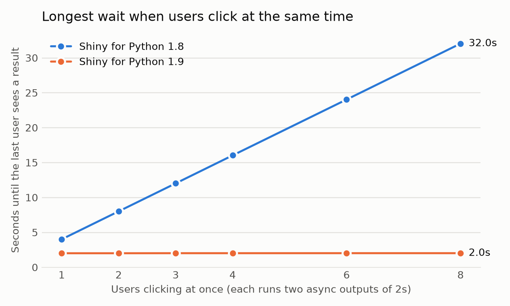
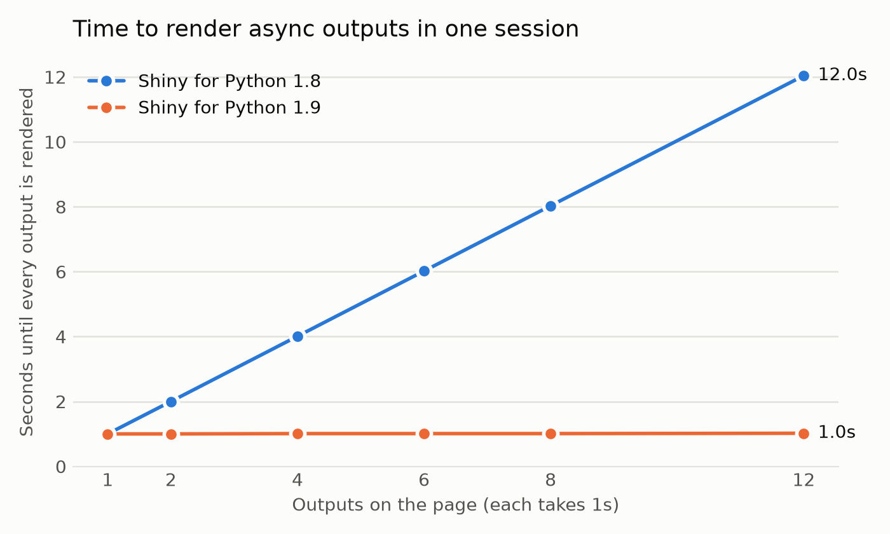

<!-- TODO before publishing: confirm the authors and the PR links. -->

[Shiny for Python 1.9](https://pypi.org/project/shiny/) overhauls how the reactive system runs async code, and now uses a concurrency model similar to Shiny for R. This post explains what changed, and shows how much faster an app gets when it awaits slow work. The key changes:

- [A slow `await` in one session no longer blocks other sessions](#one-slow-user-no-longer-blocks-everyone), so individual users of an app no longer wait for each other.
- [Async outputs in the same session now run concurrently](#async-outputs-run-at-the-same-time), so a page's slow outputs run in parallel rather than serially.
- [`reactive.lock()` is deprecated](#reactivelock-is-deprecated), and the new [`session.run_once_when_idle()`](#new-run_once_when_idle) provides a way to change reactive state from a background task.

These changes only affect `async` code. Your app still runs on one thread with a single `asyncio` event loop, and synchronous
code still blocks other sessions (see [Concurrency needs `await`](#concurrency-needs-await)). The difference is that an async
task now waits for slow work without blocking other tasks, in its own session or in others.

Before 1.9, one lock for the whole process serialized all reactive updates. The lock made sure that an input could not
change while an output that read it was still computing. In 1.9, the lock is gone, and instead each session sends its
outputs before it applies that user's next input, the same model as Shiny for R.
Within that rule, the reactive system starts each effect as its own task and moves on. While one session awaits a query, the
event loop is free to run other tasks, making the app more responsive for everyone.

## One slow user no longer blocks everyone

Until now, Shiny for Python processed reactivity behind one lock for the whole process, `reactive.lock()`. When a user's action invalidated an effect or an output, Shiny took the lock, ran everything that was invalidated, and released the lock only when all of it had finished. This model meant that any other reactive effects were blocked for as long as an operation kept the lock. During that time, no other session in the process (*e.g.*, a separate tab or another user) could update anything, not even an output that had nothing to do with the query.

The recording below shows an example of how the new system improves things drastically. It simulates four people using the same app each in a separate Shiny session. Alice, Bob and Carol each click "Run report" at the same time. A report has two async outputs, "Sales" and "Forecast", and each one takes two seconds to finish query. Dan only watches a chart that the server redraws every 0.2 seconds. The plot at the bottom displays the [OpenTelemetry spans](https://shiny.posit.co/py/docs/opentelemetry.html) for the app to visualize the timeline of server processing.

Each user's card shows the status of their two outputs: a hand while the output waits its turn, a spinner while it runs, and a check when it is done. Under the button, the time since the click is split into three parts that add up to the total: how long the report *waited* before its first output started, how long its outputs *computed*, and how long the session was *blocked* afterwards, before its chart could update again.

### Before 1.9

<figure>

<figcaption aria-hidden="true"><strong>Shiny for Python 1.8.</strong> Because of the <code>reactive.lock()</code>, the reports run one after another and finish after 4, 8 and 12 seconds. Even within one report, Forecast waits for Sales to finish. Every live chart stops updating until the last report is done. In the OpenTelemetry timeline, the six output spans form a staircase, one after another.</figcaption>
</figure>

### After 1.9

<figure>

<figcaption aria-hidden="true"><strong>Shiny for Python 1.9.</strong> Because reactive effects are now allowed to run concurrently, both outputs of every report run at the same time, all three reports finish after 2 seconds, and Dan’s chart keeps updating during the slow operations.</figcaption>
</figure>

In 1.8, the OpenTelemetry data shows the six output spans forming a staircase. Alice's "Forecast" waits for her own "Sales", and Bob's report can't start until Alice's ends. No session redraws its chart (the green ticks) until the last report is done. In 1.9, all six async outputs run at the same time, and Dan's chart never stops updating.

In 1.9, a reactive flush starts each invalidated effect as an asynchronous task and the reactive system doesn't wait for it to finish to continue processing events. While Alice's report awaits its query, the event loop is free to serve Bob, Carol, Dan, and everyone else.

<figure>

<figcaption aria-hidden="true">How a report runs in each version. In 1.8, every user waits for one lock, so the six async outputs run one after another. In 1.9, each session has its own tasks, which start at the same time. The session sends their outputs together, and only then applies that user’s next input.</figcaption>
</figure>

The more users that click at the same time, the larger the difference:

<figure>

<figcaption aria-hidden="true">The time until the last user sees a result, when several users click at the same time. Each report has two async outputs that await a two-second query.</figcaption>
</figure>

Put in terms of scaling: when *n* users each start *k* async outputs that each wait *t* seconds, the last user in 1.8 waits about *n* × *k* × *t* seconds, because every output runs after the one before it. In 1.9, every user waits about *t* seconds, for any number of users and outputs. The wait goes from $O(n \cdot k)$ to $O(1)$. In the chart, *k* is 2 and *t* is 2 seconds, so for 8 users the wait goes from 32 seconds to 2.

*Caveat:* this speedup applies when the slow part is waiting on something outside Python that can serve many requests at the same time, such as a database or a web API. Work that keeps Python itself busy will still add up (see [Concurrency needs `await`](#concurrency-needs-await) below).

## Async outputs run at the same time

Apart from the cross-session benefits, the updated reactive system also improves things for a single user, as Alice's two outputs show in the recording above. Before, a flush ran the outputs of a session one after another, so a page with several slow `async` outputs added up their times. Now they all start together and the page updates once all the updates are ready.

In this example, there are three outputs and each one waits for a one-second query. The app then shows how long after the click it was ready:

``` python
import asyncio
import time

from shiny import reactive
from shiny.express import input, render, ui

ui.input_action_button("refresh", "Refresh dashboard")


@reactive.calc
def refreshed_at():
    input.refresh()
    return time.perf_counter()


async def query(name: str) -> str:
    start = refreshed_at()
    await asyncio.sleep(1)  # Stands in for a one-second database query.
    return f"{name} ready after {time.perf_counter() - start:.1f}s"


@render.text
async def revenue():
    return await query("Revenue")


@render.text
async def signups():
    return await query("Signups")


@render.text
async def churn():
    return await query("Churn")
```

[Open this app in Shinylive](https://shinylive.io/py/editor/#code=NobwRAdghgtgpmAXAAjFADugdOgnmAGlQGMB7CAFzkqVQEsZ1SAnC5KAZ1wmLtIB0IDJq2QUGcQYIBmzUjGQcAFnQi5kwlm2ZwoxcQDdJEWfMUq1WOAA90Ojhw2MtGiOgCuFIjogATOMxE7nRSEMFYqh4UAPp64uTRAEaeFOQAFPxgOrJwyplEmQBKcDnKyL6cSomkUMy+mQCUoYIAAjpxdEZYxFAANsSC-tLI2fZKcL6xFGkNiILIC65RWKO5SjPzizoU7swQYhI4AdLRZO6UARsQoZzcxOUlyACO7gG4adDwKBwUzA3IAFoAHyKX5zfaLH61NgAXhGJTGEymV0W7AA7lA6Gxbjw+FgOL04HB0GkAIz-ZAAYmQAGUKFA-I5VMhpCx2MhyHAARw4GQ-OUoPTEpw4M9XsxcFhNgttrt9tJMiBPnAAL7wqC+dRQaRUZjIEDieBHZgnM4XZgzQGg6GILCk6QqjiZZoQNrUfzMLBUawUQQ4+5DeFGMJwGbg1GyvbozFsF5vDJgYrB16NF1uvwBL02X3QLg8B7DDh0ADmYXQHDD0vhOyjUAxWLF8cyNJLZadYCa1y76Y9WZ9frzAcexCUcsrEJlcBr+zrMcbEoTAGFR3tUxBCKgKLh0AgUGBvRQwCqALpAA) to run it in your browser and edit it.

In 1.8, the outputs are ready one at a time, after 1.0, 2.0 and 3.0 seconds, and none of them render until the last one is done at 3.0s. In 1.9, all three are ready after 1.0 second.

<figure>

<figcaption aria-hidden="true">The time until every output is rendered, for a page of async outputs that each take one second.</figcaption>
</figure>

## Concurrency needs `await`

<div class="callout callout-important" role="note" aria-label="Important">
<div class="callout-header">
<span class="callout-title">Blocking code still blocks every session</span>
</div>
<div class="callout-body">

Shiny runs on a single [`asyncio` event loop](https://docs.python.org/3/howto/a-conceptual-overview-of-asyncio.html#event-loop). Code can only run concurrently while other code awaits. A synchronous call such as `time.sleep()`, a blocking database driver, or a long calculation still stops every session until it returns, in both 1.8 and in 1.9.

</div>
</div>

The recommended way to run slow work is an [extended task](https://shiny.posit.co/py/docs/nonblocking.html). It runs in the background, outside the session's reactive cycle, so the user can keep using the app while it runs. It also gives you the task's status, a way to cancel it, and a button that shows when the task is busy. Inside the task, call an async library, or run a blocking call in a thread with [`asyncio.to_thread()`](https://docs.python.org/3/library/asyncio-task.html#asyncio.to_thread):

``` python
@ui.bind_task_button(button_id="go")
@reactive.extended_task
async def run_query(filters):
    return await asyncio.to_thread(run_slow_query, filters)


@reactive.effect
@reactive.event(input.go)
def _():
    run_query(input.filters())


@render.data_frame
def results():
    return run_query.result()
```

For lower-level control, you can await `asyncio.to_thread()` directly in an output. This keeps the event loop free, so other sessions keep going, but it doesn't have the extended task's features: there is no status, no way to cancel, and the output is part of the session's cycle, so the session sends its other outputs and applies its next input only after the call returns.

``` python
@render.data_frame
async def results():
    return await asyncio.to_thread(run_slow_query, input.filters())
```

## What stays the same

Within one session, Shiny keeps the guarantees that make reactive code easy to reason about. These match how Shiny works in R as well:

- **Inputs don't change in the middle of a cycle.** If a user changes an input while the session's effects are still running, Shiny applies the change only when all of them have finished. An effect that pauses at an `await` sees the same input values when it resumes. Timers from `reactive.invalidate_later()` wait the same way.
- **Outputs update together.** A session sends all of its new output values at once, when its effects have finished, so the page never shows a mix of old and new results.
- **An effect never overlaps itself.** If an effect is invalidated while it runs, the next run starts when the current run ends.

## Changes you might notice

Most apps won't need any changes, but here are some differences that you might see:

- **Async effects interleave.** Effects in the same session now run in turns at each `await`, instead of one after another. `priority` sets the order in which effects *start*, not the order in which they finish. If one effect depends on another effect's side effect, use a `reactive.calc` or a `reactive.value` to make the dependency explicit. ([#837](https://github.com/posit-dev/py-shiny/issues/837))
- **Destroying an effect cancels it.** Because Shiny no longer waits for async effects to finish, a session can end, or a module can be destroyed, while one of its effects is paused at an `await`. So `effect.destroy()`, the end of a session, and `session.destroy()` for a module now cancel a run that is still in progress, by raising `asyncio.CancelledError` at its current `await`. This stops the effect before it can read values that were destroyed with its module. If an effect needs to clean up, catch `asyncio.CancelledError` (or use `try`/`finally`) and then let the error continue.
- **Message handlers run in their own tasks.** In 1.8, Shiny ran a `session.set_message_handler()` handler before it read the next message from the client, and it kept the global lock while the handler ran. So a slow handler delayed the client's other messages, and every other session as well. Now each handler runs in a task of its own, and the session keeps handling messages while it runs.
- **Setting a value schedules a flush.** Setting a `reactive.value` now schedules a flush on its own ([#21](https://github.com/posit-dev/py-shiny/issues/21)). So a value set from a download handler updates the outputs that read it right away, even while a streamed download is still sending ([#1785](https://github.com/posit-dev/py-shiny/issues/1785)). The reactive graph is still not thread-safe, so from another thread, use `loop.call_soon_threadsafe(value.set, new_value)`.
- **Messages sent from outside the reactive graph reach the browser.** A message sent from outside the reactive graph's execution, for example a background `asyncio` task that calls `ui.update_text()`, is now sent to the client right away, instead of waiting for the next input change ([#21](https://github.com/posit-dev/py-shiny/issues/21), [#1889](https://github.com/posit-dev/py-shiny/issues/1889)).
- **OpenTelemetry spans follow the session.** There is now one `reactive_update` span for each session's cycle, as in Shiny for R. It has the session's `session.id`, and the session's calc, effect and output spans are its children.

## `reactive.lock()` is deprecated

Shiny itself no longer uses `reactive.lock()`, and in 1.9 it no longer does anything. Calling it emits a `ShinyDeprecationWarning` and returns a lock that never blocks. The `reactive.lock()` API will be completely removed in a future version of Shiny for Python.

The usual reason to use it was to change reactive state from a background task, followed by a flush. You can now just set the value directly, and Shiny will schedule the flush for you:

``` python
# Before
async with reactive.lock():
    latest.set(new_value)
    await reactive.flush()

# After
latest.set(new_value)
```

If your code used `reactive.lock()` to keep two pieces of your own code from running at the same time, create your own [`asyncio.Lock`](https://docs.python.org/3/library/asyncio-sync.html#asyncio.Lock) for that.

## New: `run_once_when_idle()`

<!-- TODO after the 1.9 docs are published: check that the run_once_when_idle() link below goes to its entry on the Session page. -->

Sometimes a change should wait until a session's running effects have finished, the same way input changes from the browser do. [`session.run_once_when_idle()`](https://shiny.posit.co/py/api/core/Session.html#shiny.Session.run_once_when_idle) runs a function once, at the start of the session's next cycle:

``` python
session.run_once_when_idle(lambda: latest.set(new_value))
```

The function runs when all of the session's effects have finished and its outputs have been sent. If the session is idle already, it runs on the next pass of the event loop.

## Try it yourself

[Open the four-user demo in Shinylive](https://shinylive.io/py/app/#code=NobwRAdghgtgpmAXAAjFADugdOgnmAGlQGMB7CAFzkqVQB0wGmIBZAVwBsKBLAWjYDOcAE7IAJnBilkAM1KiKACzjIAxACYArABYAnMjIRibYcOrFcyARSjEA1lmQAlNhGRKVA2CpncOK8mQAAxgobggg5CgIMWRyOkpld250OJl3JOtbBwSEgBUk9CgAcxUoCmQGAHoGK0VSAHcBWVITZHQ4UnR-ZEFw4oyyzCI4W0VkcKi3bhlhbyIBaVHicfI4BO5mqCs4IrmqHYEBbkDJjytvZAAFXCVA9GFSYjgjxwBBDm5nogAhUgAjKaxADCUEeHGQwlcUQSZnQ8gqDW4SncDWkrQo6DYFAERAYXn8Alq0ViDDkZmIUGsDEcAFExnFsViKlAGmEcQkglTcEYTlgBP5dgAKAAitIAMm8AJoASiCREm3VsAXS2wFjXE5Sg-ypKgAjmwRLhHCLonEIBxLGyKCsXjCLdwAG4qFZgipKcqDHbCZ2iNjoMTlO1wX2WAAMWHUAiwuQgAHk3CEwhEiNsZBxBOMoRBmmtGZjsVEWcl4ER-nBFOFYucHk8XgJeEiJJyzLYeM6sBwnnYhXLHAB1ZRuc5KMwqOEI5pZYTu0ilDzCIgeSy+CCbcZQGRUUTaXEJAAcWxiyAAjFHU8fTRAAOTNV0zqwULrNVw8CFQDgQ0jpDwwWThddHATL0snsEZQ1hXYEX-NcBGULYtxEZAoyBZAr1vAxFDdZA7DgXZmikR1+hjCBcjAKoAH5BBEABeAAeaB4AAPlqTZzRUDphEWG9miIuAGkcABJHFKjAFw3AnGdan+bEnzcLDmnObhSTAbMaXyJJ-keJokIEbpkUUpI2WRKJENEbZiE+ewJkoaQGH7dk4DEBg8TAYFSBgZknOJGIyJ+Lt7G8whUOseQ7RHbh4FkR4-3OSyvjsdxpHODgqQqMwBE4CpAgYVQ4FS9AhGcwgEgaSsVmQcsjEUHBLFbMRozIphGFItdPOg7leVIDZ2ofAArbievhB85hiDyhugnh4ASWYPIMUhPzgYgeHIZpIuGioJANdYIFmv8TE-bh-hwMEhAmXqKj2IQAH09SJVr1ug0gqA4a6KDmZ4JofODwlwGaYrqX7zo25A3mGSFlnbOAiDMGIRBhuA9SINhuH+uafogY0hCOE5pgu5AAGV61x2MxUlKVkBo5CEgAVQJ2knAJynkGAIUGA+L51mCvIoTgGUiDZsA-n+FzkB5w1+eQQXQXBUXxb5gWGCvUWADEPyEGUAF0EjjGm8iuPWmapkB8Q-F4GBQBgCbNolgrJMLKWpWgGBVh20oYABfBIVdpWkRWuq440EgA5PIjeQAA2MNYzjPIJWZ578rej64CwcIsk-XsEmBONg+BGmnCcWlQ+ZhTyneoUiZx8hXOza7yGea6yuoa7lP8BgZQSFg4zFZn8WJ1bIWhT1zi8KKpq5iZ0hzvOC6Lkv8rO-vq5zOowTKZBii7HUIQCuxmAANQZgnBNz67JR+eOqatytMeQR0TywXQAGpWOn3P88L4u8mQReVBvoGDw4C8Afk-ZgCRVCE1vrgT4zpN5OmDAyDAqQZhzCimqbscAKj-EsEIGI-RRJdGoMCLCEAID5VqE+L0exqAUAgcgJEY0BJiySNRUQfEmhRDMFPNBdp07KRUEoNiRRSgLGkEUI4gxuCiHgEcEodpyAkSLuTa6AApcOzVmCMLEI0LAUAxBiFpM6Sg4pNhUHIcIQWsivClFFkKEMtCZSUyYsgE2bgp5SwcZQLAgYbAUSwBQXAHRKY0WvmAIhEASHRHIRwWoAAyOJDCqy6JoZQZAABCUJSSmFOLccgfJ2SdECVSRQHApBrAsHrPI+xxjSm+KgK5AAVKLLxpSNoCBlAAbgSPkr2EAPZdKaowFq2dxSCWBAAaWum8cU4o1EaOGcwAAJEKHRxh4CUBlFgcggt4r2FFrlBxwhcBrDsU4miLi8mFN0e9ZUbxqryH8b2bp7i1lsA2aU7axyib+GWvID4HBBaoO8MAepvBswCG1mALZ5J6QrCFEKWY3hzmXJ6QUpF8AsCGHMRQEUTx3m0KwPOWk-gPk-FwIJMQgs1LQqxVZHsgz3EDJecyoZ4CIAEzyHGK4-Y3h5GBAACXmX3RZLUqhVEJvpES2xOLcQwsZCo4QqGjjwu0N0hlPT6NiP6JKXo2SfhLNDdi7QRAJHFcgT45DEBmolbwZADlkRORQHtL0ezEqvj8FI0QvguLZSZIWacOISLmrte5Ty2InVegnhkTVFR-BpWNd+L1+ZmRrWaNmNcEBijBttcgfymCxDOoBucagsQk0eGkSm7EL5KCeoraIbGxxAh4IahMES5CAAedCIDmvyf6XxKghQpQQZhbChE7QlGTFsm1yA4XjEtS6VolAXwoOHLQxQuZVQ7EMLEMqfgVAmQhReWIQgKAUEJOaBh9R249olUIHd0ZQb324PxJJdxCzbAYOJCGG1pKyUCGQV8R5LBFGojZNtzRYE7XNfeFkzR-h7ycjmmdc6q0VAUlER85RBATEMDGiochPyNGaATaBGFGhuGsfIgQKBtikNiHtGdcV6W9FrRCUeIhfRYZnIZAI-qKCpisOgcIFjopzQMjOhgFIPzGFSjwLNtQqOiNQhZZQ1kXUGVEtJjgsmgzFWQEp1OCRDDWDQ80Km11rq631obSzLyTMVDJtKZmlmnNSjs8Z1aFQfZ+2ugAcTeFcZmEZNCdPyea+95BW1InfcWWDvQAxBnw-NV8UR4OIeckYLzyAIAaipr2ZxaEgxYFyw0ArEqTxhiq2F5A5qOM+iQpJESE9czDkrHePenmcxxpHflyLMQOmFaCEskA-WGoBNICrbgHanJChPDKD2Aggj2ey2VBaKg+tLSi4Ni5wQRssHKDVR4rgqVjY6Yt5bXXTPjNzuHK521DSFuQNeOiekzQ8HPXAGiDAACKhpHsMCYnE1QHb1AAHYww-E6XRKob2IBMWvAQNFGb+goBe3DgwqUjjfbAHpETIheD-HkBIBQcAu28AeJFMEf0wDJE+zj8SmbiiA5h3DhHSPXlrDR69x0AwOF-A7TjsMyBhcngjqeCOtQmxKBxyefctRlDcGKIoCgsv5e07BNwKAvBUrlg4DjvF5DAfXmQK-dx+SXvEGkZZF0guGDq4MLgHHDvhDO9qL4T8OPVBVf3AAZiq9UBHpu0UW7okUFEYgccsG0FgTQyB9yRg4OoLAvvkIp+QDHsHvAY+6Hd34fXDBctG9p9YR4uEvcyEr7UE3ZuCnPdL6QXCjZlIy4YI-B3Dem8LspOgHHx3fIl-eo34BC6+qkHCH3pdxUqhMVZ7z9nCQPYvP8BUN1Tk3gVCphATgHAavhbvVgq9+7MPZgmGtNwtZigZXuiv7jVAxAb+Ztvz8e-asSubm1lQWliNIWUGCasWE7oSQPqpmGIzId+3kFoh+HQ+CWaT+r6RMFAzyCQt+SqnG6szMwAmsy+h+WOFAKseEsQW+jQyBUB2CGWKsAMW+O+LyM0rgy0uMdQJBQgvyT4i47gZOAmmOg2VyKyLBS0bBWyVAXaQ6nBWy5cliDAlkVItsRAlkzQFEFEokHcLKsYMg9BK0bgp6BMNgFAggQoykCwuhfMriaKKyQQqgI2ykHsvAWQehS2WyKuMAgKN2wcBMwAdhcAmsjKfSdBRgmhME64+agUVKFAuSaKDmlUGWzMFQdqCGBalBHkLy+S8RIRiRf41BL+aKcEJBuUqRuExURAQQwRBRLQogI2a2-gQo+RTkC28oURBayALiPm-sAWQWShDAOo+mlsYABoL6dC0KqhrUKybyHyWyOyUh9KByYAqgNKAsKKph7iMwUs2iKS68aSmSVMqxDQTi2xJ0sMpStyzw9yKwjyWApB+Sa+D+m+OWJBjK+Sga6+Nxz+u+aKMBYgBCW+CBWCQoYB1a9xNk24joGBVMWByRDRaRVBOWNB2R9QZWhyBURU0xKhsJuRMxNRhRyhgxZhgseUiJQUWyZg46G+FcDAYKZ2KJ7ifxQasKYwCKykCx2huh+hhhokD2BJPhjKCQIx+KYx2yEAgsGMuAiAhmdirSCxVykRMAAgAwVMrSWAhm-i2mum8mxQ4JyxQoVxj+oSmREIAAPnqRktKQMAaRktSdGOEJZGwBIAIEKMaSVsik4mYHocIBAOqekHaTKfyMyeZlklJktDJpwOUP0B3IsXXhqY8dcSErqU4pGdqbcWVgCQ8VgjodhrafaYxEalJq4EzpSb0r-BwGdBqfaXYThjqVpgGTpkGffqGVcsmRQKmfYZ6dmpma5DosXgCX0qysMasryY4vyYKdAogMCRmFzALOKYVpKdls8Xce6Z4rUg6VFOWWSIQbWSHh4tURQQDJsdCZ+E4quEERlkOkmRamlAQU5DEeCfks6SYG6Win0vkhqVqZvlki8cgKaeku8cRBICvnADUoSpmTKE6VgreeCeaqhtST+pOFetQBBgwvIIlJGahKWkhhEdlk4RCHKQuSOYaP4hhcgIoVieCZEYGszFUOSTYDODjkKMAGGLwLoFgJrM-J3ORFgGTktEKBhQCZEaWmRWCqWtRbRfRYxcxdUGxTNsQJxRQM4QCRGZRRUAkr-DEE4mgT6OrDgJmDRcHO8uWJYoGsACeN4UQNpTALpfYjEAZd4d4XOUKF+VmvyNwAAF4qAuJhjAUul3mtSPmUDoGFn8gIgIoNKVQLFQC0WazIBxFhUAm35kDhr37BbIxsbMy8CCS7QASBLgnkhSyRHABBX-DhVJqqUjk8HrkamAguIeocC5LzRxUXnPxUyAh2oHZKAKlQAdpChBWVVdKsZvjMz-BhYPnICDWREKoXlUzNU1ShDtVhgKg+VqWFlhVhURWY4JRPEAk5HwkzGjWYlBAOrxVZUVHXp-nbV1FEDbVNHIAtH+aBYEWiRdG1A9F9FYJ5lMGbV4kYBInBRBBhpeSxCTCHXraakeS-WnU1W-UXVuam6XW+ytE3UdFgDtmTw9EyDuzYnuIrIIkfUEl6JnqSEI1ai2FbYDaiyxErUhEb4AnmlYC0nwoGFiCMkpk+l01tmnLQrcX0pPFP4wnuLmoFCeADzTDpaNGVVwWdoVD9rFZooYnpHMyVUspck5hYKpVAkfgIoSloXdbuBP6zlopPkc1Rk7kvHhHm4blxkvkxlhl16vW4nbWiy7XsgEIjZQZDrLXPmg0MAKohlo114ewFlnR1kFIbU22OQ7V7UXkHUgDO1m2u360U0ez1Ee0O0Kbe1W1B2Y2FRBRFE-XYiO2R0IIu12pm3u1gCe3J0nmDXXkgWungnDWrblArAJiWjMwY0zE0pbL+BZoojllhg2XS1UGvk77ICKXWgN0WiWCKWk14HnmxDNEw3XVXBOJ91zRUxT2EG91blzSG2D0T3LVL1-iz2+ZtHG115p3okZZ20lHh3yDIBO352k173F33Up1dlECaBuW0GioJCcrcq8r8pCrqLMzf08p8qCrzJYBwipTPCCyWbWYGxhyWaiwDSKJiDvKFRCifDWBCiwOGxAWdwcpcrAN-3CpUxAO-2gPqLgO7CQN-kMCuYSjSgIPBSl6ij0Oyh4Nf15BSjii0giqaIQAYVlikBiCWAgDICK7K4UAoCVZhgACkA1CQROwjriaqBiqOIuseRJ6jYOmgRJ8jEAijlgLiWK5ANg4QSEoj4jKuUjVWcj4gmwSowpsg-gHaYW6YZOvAHxFImhKAZAGYMAbpKjHxWaKAPdQ1EC21RA71GdYgkTGJltcglAthTlcAUjWAJ4OjkgrjJjjYcASuVjkc1WLQiTwJwgWuiT2+8ApTxAKANgMkqUwgvAFTAg4JMA4QvAljkjp4WAYOujFqZj7TuTEjqTPTmTR+VAthRQzwKApWcw6AQxWApdAwojvj8gKAqgmgWgJ42gcAejWAT1FQyzC0qzagGzmgWzOzYTEA1NCahzXYwgazPu-uoTfSPieYtzxz3u-wYYXz-VlzWAXRyjKz9zagxAEc6g+44LejVQjSLCfGBYOIJupZU4mmfUggLIROcCcUWEM4qYQBX+z0T4f45aSQlIwgYgjgjSNQVz5pyjoQwgxQbTT46AtG2IpAuzNLz8yA1NhBtLYIDLEAvATLIT7L-G4KGoojHxekqUjjbjLjUQnwxQArjq0pPjtCIgYWxQGAITWA2gvTHTqTEcvTLzSLltkrDjKA4QC6vAsrYWH4SuSrVAKrBgarwgYWqL1gMwuAvA2KtCqrc14J0uigqTvuergz+Tj8IbozCTFASTzlUjuji+CQ3paZXLeOZCBOROZL5jSSYgSg8boz+rp4vTmbJOzeubQb6jYuozfS0LsLZm5oTdTWJY-QuIlUhYMAaLWGlgRExwCGngyUgBUCQMEKgwMAFLVLOAjw5YyjZr0rFrDo5ChOe8YWgbUj6AcrhbJ4ozpAvo6YjQKAlYBi1AuzMgPLojdL-LgrXQLLT4YWRQqjWaV7zL6jWgRrSbp7F5AgvOyjq7p4NjYWhbmgEc67YWOo9gV+U+azMg2g0HMg6goHxOBOcwHxggKA2gIHlzwKUUojv70jtjm7-7lUiHwLoTO7Ige7DQB7ykEgATLzWEHA6QojsrUjp4IuGSj0M40QFAYWrTArhbzzbKIyrUEg6QbC10KMQomZKApeMMrgAg10TWKAROC0Mo1qJtyxEKCnUEM4anVtBS4IG2sgDAeQaIZmRAIAbmi2v8YwzAenKRQjlgoJ65dnvQ3AacEAzI10bYuM10MkZ6Exqkrg0x36TWos0hRw10OO-wFAArlOdLVovA0jBm-wiXHcHOLndeKMPiTodNOOtt0K6XGXfabnHxjouXDA+UWNxU-MzndnWXpX5XYAGJaXtXen9XOXrXGXjSwAnXRXxX2XZXvXfXmXbncOuXMgDAIA1hthPpYXWO8nOOSLLXJtw3Lnuu+UhXq3GXWX1J4n3AzNNkC6NE8sch83kXDAtY5Yy3W3RX4XC3DA1JYrDQLkQ3RXeDN3VtWVrJ63EIkw2DYcacjrtp73N3msm3q3d3534S-Gshr3yANXK3BS2sJtf8undnBnIqjdVo9d8EXoUGo6UkLULnBjmB7XZXykUX590KyPdeN5rprnJ0pQ10vgM2VKnXWXNgxQ0Y1gMCf5nKXDtICPLnHPJQ3PxApT6ASBpDID-9BMQvdXbnigmgkn8wmOMhUPplvA0cBX7Pbn6AQoBnp36vi3oQBqwhMbBjhNO61OyXvA6g13dnjSBj4PI3A3QoO3-Ge3gsH71XRvEXOOPvDv+S7DwncA6QZOSo0AmhvYaP+SQi8nQgDWogYSyAjSjSQ67W3ovoMoaftn+nVdbgWXdLdgRSApE3n9EAqgVfVf9qg7JybAOwO03srQogHQXQPQYGeYpGQMyCRYIElwE8dIDIRQMSZ+UwwQdEWHcATEQQCQHocapA+ivGUQmAGEIiPg19eYsqgQiK19ZOsA3QKgQQVEifNEHMzwQQWyhMSwNnHn0Q+UY-aouwYISW3fd8jajBZwmQlwNwdwF+jwzwI4EuG-7oJmgcgEwAkDb6H8r06IGAl6F75f9cmogCjJVG0iJ9GorUavjXz5pQUpIrUOgGwHUBhgTwxAELtpzoSEDiBJ6eSopFM6dRiAZnSoJQJIHWxCQBAogSeFiAkgmBHA4gK7GkzUhmB5LWdAyDzAQpOQrIdkGlh5BW5SA-IQUPrws6sMBk9RPdBVCyADZwMWVdUA0GQCCQqgcYBYGwAqhUhMM9SHUEIASBfJLA19CyB+HYzSAzQgWQSCRASAQV+MYjUwWqB9K4Ya4R+CqIRi7CcJzghmEjNAh2CaDlUygBRmgJEC0ZPBx4PdD0HOCQUFUYA6+vVi4xUJSKyIQTGmwsQJAG4giTIJxl0g0C20x6TDLaGsgf420ngsAQBDgioVWoOA0KOgBHpZg5O4Gc4N-h0jCAhIFQeAFSBMB2gXUzGBKJUKlaaYPAc-SKAelsgZAxwaqHjMli1QJZdU5wfVOxjmGOB2BxA4gGHWchCDTy1gGtL1RmEecRAcqBob6jQx35H0ewkgdnRrLHC2IEUceIO09DxpQC5CNIF6kKEw8GEpglHPZR4H7DL6RwjgbEDwJgDi0SQXisSyQH1sRa9aBIB-0CAS0qAWwTVpMAz5Ij8e8WcdB0hNBmgdEdoXLKvnpRiIxGmwSAffwhCAZl0UwEDFADAyTBM+8WUwRiVcGV8sBdbAkdi27QaR+aSfcQHME4TLBxgnInEW4COThhIw26bbG+kUAthIYCCdziOWUhBhrocmEQL2CCCOAcB9SMfqNB0Rjta+sFVTNhDaEEQd2-QDnPP0OBNpBatxCoPOFVIJYB0sIuaJkJECGikg0aE7EhCxZug0RcJZfngU9GS1MBfI1oSP0NQLpYwb-SwJIE0xxgYCeQfKJICwTHIhM0QdIaIE0xohhADgEQRVDYT1DjU2kf0V-lHIJBuB8gaIKUEqinQuExQo-pBQJAvBIg3AoIJBXJABlrAkQOHK2xdQf4Egkou4YGkUjSBahJkUtI+jeCbwxww4BKI-0TD9jCCw4kfkQFOQQAzAYgcUX8OHRwJYM7wPphIyQg6hCxWwPMW1k9BsQPWBqEEdmlhZ0jmx9UZfiOLiBcYn+ewJLAKjyD6xIQGIYoZ6DJHNAKRQIkyFlQuGtgGCcCPeNSPeH5QzGOEPCIVAMx2i4CXiGCrKNDBOjGCaQnkVgMgSDgR4SwDtB0GWixg0+fmbeB+AtTdg0+JsYZB4hnifx54P8P+BkE2DXRE+voD2CgDlGETyAGEeCVDASCYi7Qp+csLfDLS-CggEk9UXvH1FlE9UR1doAAPrC7jfhkFcoPWMNRD8KoTbGwLhGaDaBFRA2MsAGTZHNZTONLU-HmE3Dbg5+SQZ6MoH6F1sVU44cgQ0NggbgzIGeIgPuFQhngrJDUSofYIJ44gOc6EGcaQCMJdAj8yQpIE1nTSuAhIn+BMWY2AFwtwC348kDAEMlZBrcuoVCLlhAm6D5wzQK-HhFXH2AzhdaJIJGKbYLieRafdyEYBMAHFRJOYNPlLA0A6BdAMoEAPH34mlDCx78WeF-AXiFl-4wyISWZjRHyUko84TybNX75RR0RbgbgbYEeCSIdpi4s3ooCWHpSZojQwKduCiBE5Cw6gCKa224HxSYp4gUgOSOeiPgugWUqNHMIXQc5opxwDtFOJH5ThVp3A3ik+HWnwxUIz07SJvCwS1SVxyQRqW5JUCVFBEOwp9Nvx4hxAGgbgeLDaJSntjK0TbI9JVFslnQoAaIgWuhPwhwUUB0kpqb9xEg0t14r08hI4CcBDs74EEwYGiO8AkTYxuY5ELGFDQsYeh-6XaRi3bFqoYkM4u-IsNVTpS++RQkiGLLXFb96RGER4aQOhChdjh3AjoUVhxlniEgdqdMbBWP5sIaIUoFvsHG8CRBJg2wchLoO2K6o1heYKQNwjYSuDRUIfBICJ3miUBwQCnUgB5C97HAJA14+uDASU5hzMKYsXmKp3XIj9F4mBXXlin-xsxEebXNzqSzEC+cHO2cj7iLy55pwMUf5AQMIGIA0Ry+J-WiCAEzJexgo9SBTnJxxxvwh4q8HicHDWDy8tu97IJsUBogzU4eIPPTuPM+7X1WyXc8-MgDpjHx1yNPfPh5QZ7r9+JAia8cXIV4OUo5YIbeUVyy5jc4edecvkKVcRCksAlmX0M6MsxLSQA3cMUM3Jd59dIeUXfRM2PN6E5igVvKLDby-kNBZmL3HOVbX7kZcI+qUKPrjF7Avy9OgbGiL7ijiwKraESHHDaTsBMtO5kcuANHIiR+0FplkcpJnU65gLXenPbnoEiqL89uGpCgpKXLF4S8kCyiBhuoloX9dyF-IcXikCQLAgxkkyaZLMnmRsKGeDXOHll3CCedvO5AXzpLIPmrcKuoYVmsgpc7swrIRqYWKhBlgLQyaiUHWWQN-RCDgFH3N+Z0Ri4U5Sm8XIxX12EWu8xu5fVDKTK6EUAHJgIx0WZJUBKDyYVnSUTGB14gK68JihGta2cZON3GMzDAPK3ta8BlWDYZ4HNU3gYBeAqeL+eEvQBWKJ5yCrLtKwxDXRfG7yHMEKEaSpzCychBaE3BbwboEFfve7mAHo7l9hFicV6EcVTjNLroxSuRS52ACZl1JM866OBgXmMwwecPAOsN1NhsDaAgsTsTbDsQRgTwRACMNoH3BAVlFdne2AIIGIoBJlHggcY7AGICwQs6geZU-GWUnyCkK5IKJsoe7bLVywUIULMqOUjSbFBSD2CsvyTbEJpD6GiHLleX-hPcJ3OHunBsCLRI8scCUD8sCV1L0loC5BR9n8A0QyeHS1ZWAATBDB0ARAcAX6HQFQrheo3EfkKCPiMxT4wcc+G8EvjihqlUPLop-M4LfyPGYIRKDIAbDi5pSvAVkU+CD4ZdAlYgYJWTkiWKtolQPb1i6wYSJcA8JUEBcIo9y644V-yk2v7LhiqhMAXvMwNtGsDJyTa3SqmCqsNDWA9mhoY5G0pf7SkiUPxBgGwg7ilV0g3StiL3KtSddIEFIYnLVCYlL9RIFEbBdeJoiELPquqDag20sAhDkwss-KCRBc5098ZJjEOY8HDkSc4eHqsEDHOoA0RtVLwT5PqtwCGq0E0YecIKU3lghQymSUSN6qCgkL1ymnJtlTA+LLQhQAyuXiaqQIzz5Yk88Nb0ET5e8Z55a8gfKsDli02l4+SgEKBlZdhygTiXgC4j3blBY+EMVebxzmxEApqdyogJYE5amiPIWAVwDMHkAwAhQWvNJocsrbqBcGsYAOWHzV44wZAGasbo6rJYoBGlycZUFgAJgj8nAW2Mluqrryaq4gL0e9c8H5AC1romZA3q+vpqWqcslwG1XmGnkfTr15LTMsmx4wxZFAWy+FqJHfXo8C+yAW1TtFp4YaO1wGxcqnCJJkcgELPZDeAQtX4DoAAgGQeIFPU6Dbo6amPuuU0RgBUyx4SYFlTVBBDNQtTcqdYMqFNs5x6UaIL4r4Yn1VpVMQfhPCzgm1JBJkegXyAFAYSWG5MSebxUk07DpNzajDUfLxWtzA0tcyboGkQAp4ZAz8njVAGugCVy+IAUtCZt9xmaKNsYQOQJL1ESLsQu4-jAsAFpob8kAAAWUkdhKQOmdcoHLE6AbfNVtawczCuhwBbotpdzRQB65gA6UL6SgK3IOgTSwQKwBgJrF7CdhS8KQQWBRA7iTycNq86wfWsFjmrgowALDd4TCqxg68AWtUUFpkyhbT1fEsThwiY0gKW14W7wAVjYhQSsNTWgpC1u84dgw+p7GiSbUDnXRetLnZYl1rbU9bItLnO9c0oI0TSV4QoHaWnBiatqRAAGwbUBTG3+bYYJOddajBNoTaEJqcVpAYQ87YhwGrgSefQNo3pAuxwPKdeVtvJRAFUVgIIQxqNAyb1yLWuGP0JRjg7AtD22pE9uZCvaIA726jUYE+1lFBxSBdbSvP+1yaKg9G6wWDpNrwglU5mWjdtBoohYweBmNqh3RohXVA4IcMOJPKyp9LJgo0UoEKAZ1BxQ4TMO1PNl+0FISdy6PRJgFLSSdOCfapVLZX7U4hgAiXbwiH2a2Xa-R0Oubaep96Lb0NeoAwvJ260vpEyZW-PpNtTjhBNRA6HUUGEsQRhD1nXYXUGmQTi7e19umXaTvl2GUztIC0rDER2Gl4twcwwWDIwFSIAZGLAEPQTFDKcty+WAKbgOqk0B6nEMLSrE4hkZ-tm5nXMgMTjJ21AaQY+cIIikm7cAXlIAIgctTlyp9kAlgfnSZvUCObacX3JdeBmoAEp9gf5e3R0iN2V1V5WXQCSwHFCIq9OMgdHN+35ykA7cYAYXMLhADc6mdfO08L7SIG1AgErmt4HpAEJOBgypAHHEXi5gI44eQ+sPAtBgRoT29OOEAJnrJYCBm5vygvJAFZqPgy8X2XKOoCgBg59wYgSXLTmvBw9bwQ+JvPAoYD29aczoP5A02m0CFt95AWwsFv6AzdH9geOfMUD33+L0UDAV7Kbw4BMQaYiWeKo3MaAexWcGBliETzs7yre+VMMGPr2QR7dvNSfPBptpTh6IDEociNB1XBh3dPW-Ekfng2ChgBAkHQWgHwc4JgAXlriSAN4EEMMGH1eAXgz6xoAoBP6LUJcfjw4THikgFsiAJmNJQ5jcEIM5LMmN-itNYp6k84ENL0C0apAGAzkICvsFqStUt4jHLWEAGLAFAg7XCHTIpC0I7xc8+AF7NwDHoJBzB47FQDUmubeMf4Uweolzh998QIMmkMEFaXtK5QYo1kOEe6HRD9GsQ9gnmEgUcRdINMzfl5tQjwhPwy-YIyoBEmzKrDmhwoPSNkBYJbQU4PQ2R1b6pRJggE4CYCtGBlofwp01oMrkwwGHqS7wVqB0aCwprTMvMqCe4u5m4BxJrWlQEhKsADsVAqh9w5hMxEhkIASQiowRJ2lj8MSeUi4KAPH6cERA0AdjB9AIRgdcIMQX2XwzRh-hLM6hF0nFrZ34xokz0TfTmFjAccKgSDB6PjAniPGLNd3PhPjHqR3cQT-BghH8eQCghPw2oG9F9Hx2UUV8VAcBhiC2Muppw6JwjYjB1UiQ4TL61Vd2hxNomsEGJjKPCEVprR8YL6vSKtCb67QAY58uE5QeRg3a5+xyKdS6giQvRsx70SwHCeaXrk+TMBAU-ACFP8gxADgDKC30AHAxoIDJhU9hvRQAx+TWYqU8chlMOBmlSph8C+v0RIm4AT66IEQDNMQALTI-K4NpKODyAiAPMZUMIFtN2iScE4jtM8El56CLotIUwKs3XL6mqYo21qBMl9hXBro9MGeCKHDhRxYwkCUxBI14BSAJABgIMMUHkBfBGJ6oESCeF1Sp5ERFmoiI5QhintYYzwNVHiZIgTIQ4-sHOOKDjCMx05MxF-W-o-3TE8o-wCOH7m0AdmTwOoGQGDiplgBkesYPzZCfm7GZ5ukqaIC+rIA3r1yUnB-euR2nSd3o75TDXuPE1uh523aOvHZsBIbmsNzMEM7GCLg5wnAMZlAFWqS1KprTs54DeFWNh9J6YBME+GfGDhvAWAtIAmNea+BJaZOD+p864l8KRJ5unrZmAielVwBgAwAS03OeJzU6GAehQ-h4XehGFhA4VQ0qNpHPHq1wP4FOGPxG1c5ztZ65oHOdoSWnbSlp1084fkDY78kLGiZBhOs7qD4xGmESIGmQlJBVDlINwIeNZDeHVh3CF8aJsWReU7Ogc6RYGj235QZACwEfigEtNEASkuSkxpwRohYbR1LiLDYLr077G+sI-HGu9COgRpcwogEAAMiq3LxnRB2ijcN2WL7GINvw7gXDn2JeHhtH03S6cvyQlJmY55xszGaq1uWSk-IEfq3BA0oH9LNMqmKFacvpA-LPcrc31wCuXn3Cbln1l2jCvRAIrwF+C8BoH0ZdMyNENy62R8t9SSrFcHaSpS+00zPLFQY80lfIQ-LtzVFNy4GjehzC4gCgTTXMIA3A8flSuyS6eukXi6WC8lu8SgCNOBg+2lp7S5ubtVRWIY85ogs4FpAXmgrOajK+paytw4Irneq2hp2A1EWvLJFpazhpWtsVjwVMNy6Wk6tRQMhvV+AP1Zk3DdjAT4SvD7sxQTwXro65AGGdpARmozucGMxXpPDXQqsYYCG1VmhvRwlr2g8K8pHAzAAGV19OwDDHAypWgrMSobekH6G8VuB+N48HRAMCstK8msPSxlx-JrWNr6VxG2IFHOh90gNhzOPNeU4cAp1LGhC2S1mMYQRxnMgvs0DVjzS8JcQCU1qZ0O2FZTY-VpjjHsosbQN+p5yyk064trhblg4nY8CIgk4YijB+cD+uO21htbeoyecsSgmbAbDRgNvVrYETsEnTzwF0zbZJwMW1AoMWUVRKsiHoXgqpqwHYBSDppvbJgCsxICoAME-Bag8YCjT8BzybgQjARKGrs5G3bbzMe2yIFdPG3LE8poO19hVPZ2hQrEgSZzAI0WxRIQpDxpIG6giHPdLnLbaegNvCA2lTtvUUnedspym7-QrVFwZytOH6w8gIUBRcoBUXew2m1efLDws9rvAO250bJZXgRW1z7BJc6XnmveWTar5988Ss-Pfn0r-65SMBczLj26N-6wDTBqUvPrgN810vEebOt-b6ea9olddE3s-mqtMGv9SvBqvLWnV+xpq8yZPWqggjoEtg8+w5NkXPWKAYEOBYvXL3r7Zy0VETAazLWvD34z0LEfzGixTBZ2CGHJhHRUJSsPIuvEEA4MXrIg4a28eg3v5EA-bylNVJWiyqTiMcVCASw0F3GiBjz2Qv2yglKTMaK+65D7S5pBlAbSTU1gk6mvmsMmaTQgSm97o03fW+rBSg62gMwLLzB919GDeBgwZML1rgVgmFgBwovBh7lNuvEqGeCrXCHuAIDStYOvhkEr1DP6s0BXvGKTG4QQ0HD1yMUOqwMWmx3DzQGi73ihVlziMpu4MBcjJd1x+VbrwMBKHxUFAJE5atIrA0Jd8x5-dWl2pSsTiCrHAF0CxO9OFXAfCgGPNHXLrvFZW-gqlgv3eKKTxoGk9PAZOsnlzYbvI4w1iOmTQoAEz4lQa2k0BkseAB8Us38Gn9aATAFZG+NVAATTm2TZgHg14mvOEz8o-0PKMWlFaM4QqzNW4xVngjxEJwAA+qAjjRYI4+dVgnqANQaIyWvzLSDyC5bJ58qq4G8GDgShiGWJZgGrUnIa1TM0am4qMUJTEptDlAclJSkmUvRBWKcF6pEVyNk6ojwcfYkIAN5hy6kWoU9J2Hv4dJiK2WSJ2C4Ji5xIXf5N5z4jhdYIsAqL7iqtmSQNAiYD6E8zpT1HYv6k8L7YoS81pSrmYVL3F6UgZfLk+DvMBgMi81o-d+wFS5mBDlTAdpNgAqMNjcXUDwcXn+O79lqphd6qjQPyAQn3fxC84Xqt+aIKcWT67lXiPNCVFcGoxpmTpbEWoecArHTiT8mUtFHsWaUnF6gmrgrLtlEbqvbXMW8jluvVepxSs5WP9oUyXxjb1C-hRgow+hdNBj6BSEany5uu85UttCXl+WyvJBzXnjQEV3kxuJSrauShCaq1XapECBY2L+KLQmTcSNlqbVYV6K6qegvOw1AYoEoCN0oB1AEceN5EQ6bMwK3Hdat+MBhbaRC3KuKGiW4EDdvuOK5qN6ehJKlM-ONDWpaK9FgdMTykRboM9Fjdd0c2KIO1Dy75f86JXJtSIlI5NTCAip7rkrHcVqzeue665c1G8CCkWQqR7QRAVECFfyzxh1kRYDllfRIOxdYIMTH+H8BbgkoZ7iVKUwkZAQFwSIIQJUKKFehT8wiBNJsOJcLBxeC0CEIhtEilZ1IW77LMJnTarWnX19LegakUre67U2H0QCTe2KkulR-Oxt9lm-c3EMP5CWIEoSI9l7kA0zDUHalI9E0GolHzWkDPyxhFCsa78tlDQRST0w+fH9-MS7I8DZE97QLsBQEXeKB43t+DELwzABcfQCAHyYLFfxz0epgGr5jwmXjdZV0Gh+MnbR4vJKFhcKAZvEwkk+cerAyAOiFsQk8cfmm9n+qshFDcBLpyCcDT24E5bNNauGpCoCTeo-vlDSFQFxKF85bseH0TibFE452a1dIixQHj8gHaphF43lxKj9qAf43XoybHJQrZW0+3VJiCUB6sh8aChkUAw2UbBdky-5hTcVMIIHRAXRpeTwOOEbCl+v2g4OvIALr7UFwDteGA2vSveoF6-NvCP97gd+npAWd5+neUbZr7jEDl8H9w+Mtq3jAAnhA8nXOiObzS+9f+vtOJ3AwBGwTfI41+r+UR5xytMDE7cevdk2ODOVZcW3kg4Pvzxe5Tm5zQHE7Ry8cACDVQc3jP3jcV0NyZn+mpbTrzKf3PzX1rx2iG9gARs7VIjwtlqA9eTvIAJHw8mEAo+jv8P7Xp11wBjf0fZ3vt9N9qBzevc3zKnyLEHyP71vigWXLHkDyXYTaIPitzTSQ1kPmrEwdWojyh9NfdvnBfb8N4G+9fuAFert6K6hqS+U3x7+6Zy20DX7o2sbfp2eDz5vfPcuUan982++R17+-3wHyz59onlzUIoI8ecFRd9NrAF5SMSAS4LPuUh5CSDGYnDrSJTMWQGwcOC+nrk53Njxl8Rlq6tV9ewbhYvna5ZYBMTTDnCFWGidVhowq4MQKlQkDtUhQdgBYg4Eif5fqxkTpxAMiN3U0-A24BFNpAWLZ-3HTEKmMLkUoVvLSGYG0sG4RfkJq7Vtfyks46plgFix0TP4R-xdVgTyRnyInDKTRGPaiEPsN9l9+Er1EX7nZP3GBkAN-cjJ5LL5rUz9UxUXwAMvzEGwJJfsspFYgroJXW6JA09XnitdYTJCfqx6mgegags-6fL-ylerxqV4ohfRPYXhWZF9f-RfnPsXoOfJkNAn-ssDtGFwqYdqkzcF1LiwtRRPICgADNaXQXGpDsLNyFB91UAIQDZ1UtCIAova5BJcXPICmWogApfwTcKgRzlPJfhTtyTcpfTlkid-mEkCWoyAhoAHcYA0zHGB8sKgJ1ALKQymWpWAmgLDBvCCX3ICU3er358J+LxmF8EfDHzDBr9Y7zEDcAa-QAMxAhoGv0Omcb2v1hAcfSANOuKVV68qAoFmv0Rse-yIJr-CECUJrwKVV4AugWwGRApAkLE0AGAE3B6JPYGfCN9nlId2zR8cYQF71xQBOGxAa6MbQ+1-XMOwakGUMfyFMx-Zf1ecXgcR0M48deoxtAkNJlxsB4XA6HM40zW0B6JcsGbjChagbsj04g3aIOpMmTLAABNh7YHzTNYgzxFyQQfU9DyA5hDECHQJhb107I0UHgHsBSCAZFIIFbSjUDlEjekTkVQXFAHUc0LTC3B5UXP82WhBgjCw3MULfwHGD3Af0GmCJ1LggWDNYZYPB5GkcHneUzsXc2ZhKscHilU45bRSph1baGFKpusewUjR2bFO15hweSHnnsr7SfwWtjg5HU5tRUJcXzlksRhy-E9DF1C5B-7Vgz7BSLIIFRdIgUIEwlJxTPyoRNMfwFKBjwH7mYd3ZKWFhCWxKhyKBpEM6k8k1TFIm4E3hJICHQugQRn84YAJxD2BsoXo3HBGgDCGbdHRTTGvE7wFo3RUAYOGzrwqER+HtRkQcYCCBNA+WHqJzgBRwg5dBKhAZc4of-ATtGLCvisdXRGyAzh-AQtFVsdNPOSzkxFeULJZroP-BJxBYDQy0NBTXMR2c-FYbiy59eBgFSopQsWzVZtDIUyltEobIVVRR4PQ0dEDDVMSDQOVOvEnlInHUTMRFHMU2vpuAAWBichMJaBUpZRCphEAgwVPzj9AeSQGB4XbRELYDVrPbWol9lSMCOUlld+wttTgq2zjCloDCycQeJNfWIBOuV0PUcfHcXWGUInKsBLtfQoJ1+8QnX71cgYwkuxjDXIIFhLsazYODrM4wBs0ZhgAbgE1gQfZ0PXIoQ9TQZ5j5EBW65FQ7KwFJyrXTWiA-HPrh544VGcK25y+WdigBHGS1n6Z8iFdgqUpGdQAw5N2HcLlZ1fD7k+5OiYjnBR9EbgFQ5kIDDhuMIOE7BQAQAOwGABrwIFmvAewsLEPCjwmBwvY2mAD3yZ0OOVl9Bmgj8FZUFWCACs8TwEDg-CbuSx1INanR8MrC9cXLVqdAleACSVsVUg3300bcDALCzETriGUQFQJRkAGgRpjdcIQAQAwMOCcnEt4xsG3hZVfcKFRHt-tLLnzlCrZiP-wVQ7oz1E4eBgA1CJbEIMKkAYAw3QYEEFigwC4AaEMywXOYRQRUxwjhS-ZigPbUoV+nXDkI5lwxxg3CnQuzgp4HuAF1FNxVYbgy1hAW-R1CflVuVBcaIVpxQZPIW0lBcnlfJFblUXCyO4g2nayNDCYgN0LVVTIrUHKUmESq0sQNgnAK8ibAZnne9LI9p0RR88OyMfBeeAPmcYWOPMzZU2WAzDaZ+ObpFpxliBl2-tkFaSLc45IrhUl4hQa51uc5kVhWQVNAqVWQU35SHnB4eDIgD4MgkBAAUNzeEQ3M5xDeAEENtVaRGzERdCgC7RZDdS3kNUATUzNDjkC0NCRH4bQAjA4bXgz6dBDZqI9hNYIAA) to run it in your browser. Shinylive runs Python in the browser with [Pyodide](https://pyodide.org/), and each of the four panels connects to that one Python process as its own Shiny session, the same as four people using one server. Click "Alice, Bob and Carol click 'Run report'" to start three reports at once, and watch the OpenTelemetry timeline as the outputs run. Shinylive uses the latest release of Shiny, so the demo shows the 1.9 behavior; the [recording above](#before-19) shows 1.8.

<!-- Before publishing: the Shinylive link includes a requirements.txt that pins opentelemetry-sdk==1.40.0, to match the opentelemetry-api that Shinylive bundles. After the Shinylive release with Shiny 1.9, check that the demo still starts, and update the pin if Shinylive bundles a different opentelemetry-api. -->

To view the spans of your own app, see [Shiny's OpenTelemetry docs](https://shiny.posit.co/py/docs/opentelemetry.html).

## In closing

This is one of the largest changes to Shiny for Python's internals since its first release, and it brings Python and R to the same reactive model. The [Shiny for Python 1.9 release post](../../blog/2026-10-29_shiny-python-1-9/) covers the rest of the release. If an app behaves differently after you upgrade, please let us know! As always, if you have questions or feedback, [join us on Discord](https://discord.gg/yMGCamUMnS) or open an issue on [posit-dev/py-shiny](https://github.com/posit-dev/py-shiny/issues/new). Happy Shiny-ing!

<!-- Halloween easter egg: once the "In closing" heading scrolls into the top quarter
     of the screen (or the page ends first), a moonlit graveyard rises from the bottom
     of the screen. A skeleton climbs up behind the headstone of reactive.lock() and
     waves, jack-o'-lanterns pop out of the ground, and bats cross the moon. It plays
     once per page view, is skipped for readers who prefer reduced motion, and a click
     the close button, or the Escape key dismisses it. -->
<script>
(function () {
  if (window.matchMedia("(prefers-reduced-motion: reduce)").matches) return;

  const DURATION = 8500;
  const BONE = "#ECE5D3";
  const BONE_EDGE = "#6B6352";
  const NIGHT = "#0E0A19";
  const STONE = "#1B1429";
  const RIM = "rgba(244, 236, 210, 0.16)";

  // The scene is one SVG in a 1600x420 coordinate system, anchored to the bottom
  // center of the viewport, so narrow screens crop the edges and keep the
  // headstone and the jack-o'-lanterns around it.
  const strokes = (paths, width, color) => paths
    .map((d) => `<path d="${d}" fill="none" stroke="${color}" stroke-width="${width}" stroke-linecap="round"/>`)
    .join("");
  const bones = (paths, width) => strokes(paths, width + 3, BONE_EDGE) + strokes(paths, width, BONE);

  // Skeleton, in its own coordinates with the center of the skull at (0, 32).
  let spine = "";
  for (let y = 76; y < 240; y += 10) {
    spine += `<rect x="-4.5" y="${y}" width="9" height="7" rx="2.5" fill="${BONE}" stroke="${BONE_EDGE}"/>`;
  }
  const ribs = [];
  for (let i = 0; i < 6; i++) {
    const y = 104 + i * 15, w = 38 - Math.abs(i - 1.5) * 3;
    ribs.push(`M-4 ${y} C${-w} ${y - 4} ${-w - 2} ${y + 12} -6 ${y + 10}`);
    ribs.push(`M4 ${y} C${w} ${y - 4} ${w + 2} ${y + 12} 6 ${y + 10}`);
  }
  const skeleton = `
    <svg x="732" y="136" width="161.5" height="240" viewBox="-80 -14 190 282" overflow="visible">
      ${spine}
      ${bones(["M-2 92 L-50 99", "M2 92 L50 99", "M-50 101 L-60 168", "M50 101 L80 62", ...ribs], 4.5)}
      <g class="spk-forearm">
        ${bones(["M80 62 L92 8"], 4.5)}
        ${bones(["M88 4 L85 -6", "M92 1 L91 -10", "M96 2 L98 -8", "M98 7 L104 1"], 2.4)}
        <circle cx="92" cy="5" r="5.5" fill="${BONE}" stroke="${BONE_EDGE}" stroke-width="1.5"/>
      </g>
      <circle cx="0" cy="32" r="30" fill="${BONE}" stroke="${BONE_EDGE}" stroke-width="1.5"/>
      <path d="M-26 40 C-24 18 24 18 26 40" fill="none" stroke="rgba(107, 99, 82, 0.25)" stroke-width="6"/>
      <rect x="-17" y="50" width="34" height="22" rx="7" fill="${BONE}" stroke="${BONE_EDGE}" stroke-width="1.5"/>
      <rect x="-15" y="48" width="30" height="6" fill="${BONE}"/>
      <ellipse cx="-11" cy="33" rx="8" ry="9" fill="#120C1E"/>
      <ellipse cx="11" cy="33" rx="8" ry="9" fill="#120C1E"/>
      <circle class="spk-eye" cx="-11" cy="34" r="2.4" fill="#FFB347"/>
      <circle class="spk-eye" cx="11" cy="34" r="2.4" fill="#FFB347"/>
      <path d="M0 43 L-4 51 L4 51 Z" fill="#120C1E"/>
      <g stroke="#120C1E" stroke-width="1.3">
        <line x1="-12" x2="12" y1="62" y2="62"/>
        <line x1="-7" x2="-7" y1="58" y2="66"/>
        <line x1="0" x2="0" y1="58" y2="66"/>
        <line x1="7" x2="7" y1="58" y2="66"/>
      </g>
    </svg>`;

  // Four finger bones hooked over the curved top of the headstone, with the tips
  // hanging down its face.
  const stoneTop = (x) => 270 - 50 * Math.sqrt(1 - ((x - 800) / 65) ** 2);
  const grip = [752, 760, 768, 776].map((x, i) => {
    const y = stoneTop(x), drop = 9 + (i === 0 || i === 3 ? 0 : 3);
    return `M${x - 1} ${y - 5} Q${x + 2} ${y - 2} ${x + 1} ${y + drop * 0.5} L${x} ${y + drop}`;
  });

  // Headstone lettering is cut into the stone: a dark edge above each stroke and
  // a pale face below it.
  const epitaph = (dy, fill) => `
    <g transform="translate(0 ${dy})" fill="${fill}" text-anchor="middle" font-family="spk-epitaph, Georgia, serif" font-weight="600">
      <text x="800" y="266" font-size="11" letter-spacing="3.5">HERE LIES</text>
      <text x="800" y="298" font-size="12.5" letter-spacing="0.5">reactive.lock()</text>
    </g>`;
  const headstone = `
    <path d="M735 350 V270 A65 50 0 0 1 865 270 V350 Z" fill="${STONE}" stroke="${RIM}" stroke-width="2"/>
    <path d="M776 277 H824 M800 273.5 l3 3.5 l-3 3.5 l-3 -3.5 Z" stroke="rgba(220, 212, 190, 0.45)" stroke-width="1" fill="rgba(220, 212, 190, 0.45)"/>
    ${epitaph(-0.9, "rgba(0, 0, 0, 0.75)")}${epitaph(0, "rgba(220, 212, 190, 0.68)")}`;

  const graves = `
    <g fill="${STONE}" stroke="${RIM}" stroke-width="1.5">
      <path d="M402 356 V300 A30 26 0 0 1 462 300 V356 Z" transform="rotate(-7 432 356)"/>
      <path d="M1124 360 V316 H1104 V302 H1124 V282 H1138 V302 H1158 V316 H1138 V360 Z" transform="rotate(5 1131 360)"/>
      <path d="M1196 362 V322 A22 18 0 0 1 1240 322 V362 Z"/>
    </g>`;

  let fence = `<path d="M50 316 H330 M50 340 H330" stroke="${NIGHT}" stroke-width="4"/>`;
  for (let x = 54; x <= 326; x += 17) {
    fence += `<path d="M${x} 356 V306 M${x - 4} 308 L${x} 298 L${x + 4} 308 Z" stroke="${NIGHT}" stroke-width="3" fill="${NIGHT}"/>`;
  }

  const tree = strokes(["M1392 340 C1386 296 1398 252 1380 206"], 18, "#140E22")
    + strokes(["M1383 222 C1352 196 1330 190 1300 162", "M1385 212 C1412 182 1442 174 1472 142", "M1381 206 C1378 176 1392 154 1386 118"], 8, "#140E22")
    + strokes(["M1300 162 C1290 150 1286 140 1290 126", "M1328 188 C1316 176 1312 166 1298 160", "M1472 142 C1482 130 1480 120 1494 110", "M1440 172 C1452 168 1462 172 1474 168", "M1386 118 C1380 106 1386 96 1378 86"], 3.5, "#140E22");

  // Jack-o'-lanterns: [x, ground y, scale, delay in ms]. Each one rises out of a
  // clip at its ground line, so it appears to push up out of the earth.
  const lanterns = [[600, 372, 1, 700], [684, 382, 0.7, 860], [936, 378, 1.15, 1020], [1032, 386, 0.72, 1180], [258, 382, 0.85, 1340], [1300, 384, 0.9, 1500]];
  const face = `
    <path d="M-25 -37 L-9 -37 L-17 -50 Z M9 -37 L25 -37 L17 -50 Z M-4 -29 L4 -29 L0 -35 Z
             M-27 -22 Q0 -6 27 -22 Q24 -9 15 -7 L12 -13 L6 -6 L0 -12 L-6 -6 L-12 -13 L-15 -7 Q-24 -9 -27 -22 Z"/>`;
  const pumpkins = lanterns.map(([x, y, s, delay], i) => `
    <clipPath id="spk-ground-${i}"><rect x="${x - 80}" y="${y - 120}" width="160" height="122"/></clipPath>
    <ellipse class="spk-halo" cx="${x}" cy="${y}" rx="${70 * s}" ry="${16 * s}" fill="url(#spk-halo)" style="animation-delay:${delay + 300}ms"/>
    <g clip-path="url(#spk-ground-${i})">
      <g class="spk-pop" style="animation-delay:${delay}ms">
        <g transform="translate(${x} ${y}) scale(${s})">
          <path d="M-3 -58 C-4 -66 0 -72 8 -75 L10 -71 C4 -68 3 -63 4 -58 Z" fill="#3D4A1F"/>
          <g fill="url(#spk-pumpkin)" stroke="rgba(60, 18, 0, 0.6)" stroke-width="1.2">
            <ellipse cx="-19" cy="-30" rx="24" ry="29"/>
            <ellipse cx="19" cy="-30" rx="24" ry="29"/>
            <ellipse cx="0" cy="-31" rx="21" ry="31"/>
          </g>
          <g class="spk-face" fill="#FFD27A" filter="url(#spk-glow)" style="animation-delay:${-i * 370}ms">${face}</g>
        </g>
      </g>
    </g>`).join("");

  let embers = "";
  lanterns.forEach(([x, y, s, delay], i) => {
    for (let j = 0; j < 3; j++) {
      const ex = x + (j - 1) * 18 * s, dur = 2600 + ((i * 3 + j) * 431) % 1400;
      embers += `<circle class="spk-ember" cx="${ex}" cy="${y - 40 * s}" r="${1.4 + (j % 2)}" fill="#FFB347"
        style="animation-duration:${dur}ms; animation-delay:${delay + 600 + j * 520}ms; --drift:${(j - 1) * 14}px"/>`;
    }
  });

  const scene = `
    <svg class="spk-scene" viewBox="0 0 1600 420" preserveAspectRatio="xMidYMax slice">
      <defs>
        <radialGradient id="spk-pumpkin" cx="0.42" cy="0.38" r="0.75">
          <stop offset="0" stop-color="#E9832F"/><stop offset="0.55" stop-color="#A9440F"/><stop offset="1" stop-color="#4A1704"/>
        </radialGradient>
        <radialGradient id="spk-halo">
          <stop offset="0" stop-color="#FF9A3C" stop-opacity="0.55"/><stop offset="1" stop-color="#FF7A1A" stop-opacity="0"/>
        </radialGradient>
        <linearGradient id="spk-far" x1="0" y1="0" x2="0" y2="1">
          <stop offset="0" stop-color="#2B2145"/><stop offset="1" stop-color="#171026"/>
        </linearGradient>
        <filter id="spk-ink" x="-5%" y="-5%" width="110%" height="110%">
          <feTurbulence type="fractalNoise" baseFrequency="0.8" numOctaves="2" seed="7" result="grain"/>
          <feDisplacementMap in="SourceGraphic" in2="grain" scale="2.5"/>
        </filter>
        <filter id="spk-glow" x="-60%" y="-60%" width="220%" height="220%">
          <feGaussianBlur stdDeviation="3.5" result="blur"/>
          <feMerge><feMergeNode in="blur"/><feMergeNode in="blur"/><feMergeNode in="SourceGraphic"/></feMerge>
        </filter>
      </defs>
      <path d="M0 300 C200 252 400 274 600 244 C800 214 1000 262 1200 232 C1350 210 1500 242 1600 226 V420 H0 Z" fill="url(#spk-far)"/>
      ${tree}
      <g class="spk-climb">${skeleton}</g>
      ${headstone}
      <g class="spk-grip">${bones(grip, 3.4)}</g>
      <path d="M0 352 C250 322 500 348 800 334 C1100 318 1350 348 1600 332 V420 H0 Z" fill="${NIGHT}"/>
      ${graves}${fence}${pumpkins}${embers}
    </svg>`;

  const bat = `
    <svg viewBox="0 0 100 40"><g class="spk-wings">
      <path d="M50 15 C48 11 46 10 44 11 C40 3 26 -1 2 9 C14 11 20 15 22 23 C26 19 32 19 35 25 C38 21 43 22 45 27 L50 33 L55 27 C57 22 62 21 65 25 C68 19 74 19 78 23 C80 15 86 11 98 9 C74 -1 60 3 56 11 C54 10 52 11 50 15 Z M46 12 L45 6 L49 11 Z M54 12 L55 6 L51 11 Z"/>
    </g></svg>`;
  // [top in vh, width in px, crossing time, delay, bob time]; smaller bats are farther away.
  const bats = [[14, 90, 4200, 1100, 900], [24, 62, 5200, 1500, 1100], [9, 44, 6000, 1900, 1300], [30, 120, 3600, 2500, 800], [18, 36, 6400, 2900, 1500]]
    .map(([top, width, cross, delay, bob]) => `
      <div class="spk-bat" style="top:${top}vh; width:clamp(${Math.round(width * 0.55)}px, ${width / 13}vw, ${width}px);
        animation-duration:${cross}ms; animation-delay:${delay}ms; opacity:${0.55 + width / 270}">
        <div class="spk-bob" style="animation-duration:${bob}ms">${bat}</div>
      </div>`).join("");

  const boo = [..."Boo!"]
    .map((ch, i) => `<span style="--tilt:${[-4, 3, -2, 6][i]}deg; animation-delay:${1700 + i * 160}ms">${ch}</span>`).join("");

  // Cinzel and Cinzel Decorative by Natanael Gama and The Cinzel Project Authors,
  // SIL Open Font License 1.1 (https://openfontlicense.org), subset to the letters
  // used here and renamed as the license requires for modified versions.
  const font = (family, weight, data) => `
    @font-face { font-family: ${family}; font-weight: ${weight}; src: url(data:font/woff2;base64,${data}) format("woff2"); }`;
  const css = `${font("spk-epitaph", 600, "d09GMgABAAAAAB0gABAAAAAATJgAABzAAAIAAAAAAAAAAAAAAAAAAAAAAAAAAAAAGnwbmiochRYGYD9TVEFUHACBUBEICus011kBNgIkA4I4C4EeAAQgBYNGByAMBxsHQVUHYtg4AGD5jEDy/6cDboiI9EHttgtFUXoyZTUlBiy3jHI7nrqlV0/dPpjHzWvXRjhOcIzfl3lRNxZwOV7hOHx073P+MBxSMZ/Cb/b79cUvdm9Ex8R8igJKXG9HH+qBkjI9U7bzqUu6pMS88CcjJJnlefrlu/O2ZfPzJrP/s6G0JkstTsViDIPQSAZhERqLMAz6LupKSZYdx3HCx/hEPLc8Ak1Lt6lHNGdzd5DkNoZHgAZKEqBogllCTCFKoTRGUKvb/9f+HapiLyL0xaE8T97e35h2m6VxUtYsCDwwjutwzia03Gyrx/BfAkxuYJ2FVhzK4isNgN6n0TClhZTcT0k9RwH8H7lZO5FmhlwVeBGtVIuKJXFyQox3YVu2PXP/9sT/XLPEboQpoAMGvxvVqUTt6zp1THd/X8pc/e9tpu2+XenQtJJDIDuIvZnLEPS0+nt7q9U/abU6EgZYI8tARwbRjFcYAu6MhFWAKo+rEBQNTa/y0mXSVWmxiuvCdRNbVsuGkehNKpIbWb97v59ZYHsqKW45w8GIE5zFERsS37v/+w+jABWARgIJSFKQ5kIeCwUiKJGHiipQTR1qakEdXWjCFDRjBpo1i8zZgLbtQHsqYY5oYM4YYBBY6JpHQ220A2t6+zqAhQEJBMrZ0NMBNKAABSMaMf7BjDEwuWY3xyJtJvIIarNog3teTrwIJuKy7kSmgN/e0sbe4T4NHb2exCjFrD5jgIY+obPPF5dDG7X6AJa7Vn9v44VccpNmMdexcZBclx0gKwhyev18D5DjNXYD0q/ShnqPYE1n19FOcf3DbzQCWnm6s6t74eRpd/MMJvUG1jycX3gth9vu9R1i9pIejAUXF6Tlli7yaep/7Z2fHT1MQSDI0R+PNAJ7IqkdqKMjxYbVxEqC3n55NMSdB3GheKeIDdGT0TQQnlH476VTEdnPjLG8KHvcmHRDBSFB+MZ7Aeyh2S3Jaq+ojqeQtkNR7DKCQk9V12b+w1BPcV0u7B4zYkyEtAD5uwsiFpJ+F28acwbNboCOpaVPZjNRg93/zOElp/Yg20zv2z1+HA/qSHijw5gQvLvp4w1P7yK8F5kkAUcjicrSRKsb5c++4h06L1aIJrqKiiv78mtakM44hbAgQrIE9KASokzLS27eScd6HlF4bPQSL6OmB/jx7gxLuEMolobdCxaxYY3fR4Y5aFxvKCBQmTRAkctm4pXtZz+SJR88r8vyJB98y4NGnJurFAehHDWsqO4iHXLzYdndwfBE3+4JhZ5D6g0m1fWYCZ6W6XwNtEPUuT06yHLZbNQZSQh0aZmIdMqYu+3q/2VHFbfRLChskWMxJ4RwWAGlI2Qz3ShkoGH158KauGrMAEWovZlDLaMaBqugNO44Bj9fKHPmTLv14ZcexWtpp50lsp2CjZpHt9ZTJRK3U1VdIAD56BaGtKsR2jAdn7KjMHYvwxqBa3S6pmSQhV4LgJiIOn3jZSymdw35//XzYuTGlU+MUiACy5qgtQuhD1f4mfaNySo2UpBHJhIxU4ILBewG6h7+efB2c/oXgM78tF7wTwHy7i7n82kSanLRahnu5gYDeaLuByxo+f3zaZJ2HMmbJrgdgXAR1s0NO/pr5RuKiwZyMvoAgaMtVAITJGKKxDtyQOUGMB7wjlRae1U1evnEhrIgt/LqMVzhqLA/DBUGVa7EKgJGUEHZPD6zWCYSEDLuwOrcSv6HNUSWr+p0yNqYP17ymmG+kqPh5HMqnPIuxYTS+mtuKYaP4j3UTMlWkYCXv5OyGJ18YYZvmXN7nq3UGiu+w30OJDdA5cY+fSthsdL7MYw2SHyK7HgjjGAs3eQmZkP3acCQR1eVUv+HCMdOo5olgVovKuJAXeCkvq4JM3o2bBjbsi/NIQOJKyZFELpClZEGABzjGwmhnoaEMaGgyCpTphDSF2hLCdNaqmbU1IF9ADDKYUNqZo+LjUVc4ISmPGOSx1MCGox3Z/TkLKPbH9YKlRgJTULhLPKfB5hTlVcAZsq9ThGy+oA3DkhHqMCuwCXKuHosiRkpyJaa/uxi8jhSDI7QJttEVQLM9mq7oRf5RNUqt6dWG1gDJWN5g5KTSwSmdm9bH4iPtuZGSJ+d/jaQXr3ZEqukltr3XAPFEDuCBgPGczxThgV1oNElDSXjl5j01XanPT1pbgEDSj6HKQCAdy3ZLB36pNSESVOmzdiwlU9Su6AU1InSAv5UlAKAy/si77DMaClD+RDjFOUAM0Vgry5po0FK555QCW2y475CASXuVQJm0PIhKT26JixZsY4cq0DFM4Mqq07hNBfF9Mw7lti12vAo4dQJOdDo2/ZkbTtFEciUNfVNmkWEeYQtItoy4lpFfGtIALEDOEuyEkV1XXPIlAVk2hKybQXZsY4csWdw1gwuf7ohFDSPrQiev5KygTSTVJ0F+g8OegnnOexvvf/hwSMvfXp9L69+wGEEeekdUwWbu7GpD8PzO2idM7FZvuw/cFYTM1pGpu1RUNOxsnOp4eUX1KxLjz6Dpv6Bw4b6p1bRMqjmrNygSatioLcnyf7DvW4nfyWxW81SsZDPZTPplDOmfqzOOKHAJASKa/AN5Q+ra+zcxi3cAPSQx/DIRFM0B5EkojHF0fSz5/dARlxd4QxcjtRcrJNNqWy5PDunOyyM3Zjwi10RsHqh0/4LDQdtVtAOZcxFujIGI9hHa8r+gcpAF3GNJ1ka72rSblJF0QH9xhf9PIxWmGcRNkHAhl3DqBQG8ZCgylomSa3UqizaT64H3kNwRKtsltXw1iuDHymZ8CULKvfV464H2kUw9eae+T3rgfdzVUEe66Os8QdZTSRvSHpJhMofZJoUd43HUVjWulJhrkhT+sw4dQsXtp7t5oKAY05ZnxptJnx1ws5hMly5byNiCIIEWbltHke74jjQcCDCFCikukIIEpgCJLlPvHcmbQ/gApSQKM9xD5o7E3OQqUtQ0vShP3dNgRhDyDAFLB0fr8xuw8WVLkII9g4PirQIMx5DZqssgj56R0ysdlEQAARmsIAiRgAa1MXeJajKIUESw29PrMAxiD6s3Ts/EHMJcO2DOSElAaRIRgVQAuGMRwJ2/mSsLuMcQ1ddvwfK2WXsF5ApeZEJMXRzn1FzQARSIPeUJLWAS2Am2YZikiOlsIjcoC/feFbQgwfRKKoCoKOXzpI5f8H/ECbxOJo5Pf8ugdGQwysNYvgoSYFYmV/413g1BFmAHJde0jEBkOQJ9AvM3/icex2g4aenNQISQ9MvtCUymTOT5rafCxhKUFxII9pK8TZZCIXjRO+J/5sTFUftmVAcqqlhKFGlhmzgVyWj12obrGXM0s7a5UwRQxe/I+Ws9kurds+DfB/oqA7gj9ppl90TTzrvZXFbJqelqqNAXMJR6VziU8jxc2bZPVD9bDlCjcjsbgAX4j1jGrsbQOkHEWwf+otZAbxhGr4DcF0kRk1/no3ajAURypQ1oRfmKaEbNmVLd7W1QbPmH5FxHeWOIr2+DO3gAgzdn0kR3eRxcWoUk6kGzcniK8BC9ae6C5ChvkctD3ozFL4Vqzh0lwK1V1tSRnX7pAJZNLcx4VU6Be0cRsOVfwNGmnWEiCU1lK8yGgH1jjqGPpEgbigP1PlwMuYdMDm1rUAdiUX67zGCtZCnTexSLMgXpoS/aoBBb4RUCsIY3d+iM2TVP7p5OYZJJCiDqQs/H5x5CYYAU3Nx3RoHYeGgwrx5JtJjqPbrbmWs6goQ2dYRnFVICg3VXrISjnGNLEvRyBokAekyfECJ+PWCICxr6f7cRXFmT0tPg0ECnDJ3HI/GcKNg+A4nVR70Eh6ouomXu+ZbIpJox+7YXTA7wsmAHJAzdUKzL0OQ4EKsk1AEYZf+TbWeu9T1N7YlAmirMNO0hRvq2enx83QzLIevggC4UN5ExW6/B0JDskZQPJNwUpBIjRGRZsco7NQPKkH0EfuFxa6W6aREi5mY7hBuHrv5lvZWD9zt82vYLalXYULEKFso15p3AHddEB5Jhzm2gUaUwjfbsSdn0nd173ywRAVjD67smgfWILEdWHraDExyf2mZu2xMwYULzTm0B+o/rNF9+PbKeKQPqa2rbkK+fbQe4w+9X7usQK3gGj/H4Re+R6GM5GvBzD9axWEwKKVaVq0yvGYQwyWfM2+flNE0b2Sf+3k3ddgHrWq4KWj3STcF/Ku2OmoP7rC4QU4akwDJWUIgKh101xIszftVxpLPQElC7Jn2WBpShOwfA7E5QCdnzSe9sfJENkGTboTBtIT0DzOt5gQY6epFXqnPPDueJnikAKTry+JM0GsL07gT+e37yeecz+3iN6aK9EWdTK8TpMpkpyek4wlVI9QHZ84pTJ0pK9Rbu2Sj9PelUR1iv7dV/2tYMmYStsP1YQKstx8DdcRRN9VRmyHoo7ml0iHWmq6P1HD/ux2goWNe9sSFHa+B+e0YkTVhfmV3FCWvdC8P/c/Jte/hiJ4vF5f3f0j9SEyz6WzHGvr5f3BD+UtX8PvE2dH3ysrX7hH6VANnZnysRe3rmnc+w5/buRECDJ8tmXrQe5YbKIFzSHVylDaIRM4KZ5bysscYPx820ptZoAuCyE4cGivnw9abZ/mcN08cSd527tn4p0/tmy8fPiyMR3N3CpetRTHXnj1zvbLWuDpm1dfsjqfT730BLsJq7jxJNlo/q4g+/xi7+9nTcufZxZ2BvhxUbHS+uUOU9jEDy2NJlE8rAXK+qpYTdC7Lk95+pmYVNEkWd8EXpn6JF4IEOMeg4J3H9x8/zuccefbo2bPYyXSHM+8zrXum2GHLGLcE9DWOwv/N0IEMEvux8vmefrnQtzDH8USyT8BhRo8ShyNi+OkuRb7/Tsm1tU+Tt33Z+/YsBokeIiCBw3heXBDS9LdXiVkj71IPkzMfiTPEqv0rn1sO0AAJEBl5H+6cwbYGDeVtQl0v7HN5NnZ3Tt64zz3VPH38Nup6kls/y+moHjDLVvr95at7rEbM0CFV9zN98Kd1etrpeWsp8clfKcVfi6MsydHJVaOSM6fyc3RCifJ/71InogveFODVg04b/umbAlT4rAmxxCNduDcvfiqKCX199hydFQET+EoSTyVIJR+YgKzgeXUWy7fyVa+1i9yLmMLbIqI2u7fnPIWBmeE+rOApr8/nRnGvuE1kIvR60jBGri/1XLLz9xnDbWQ9hry9jNrfMXgP/AKG3mHGpInff4pU9IcrhmqF376fLdu2CfyBNE9vROA1ChmSuDRfj+0fzRD5wdWHvTA6pm2DEd4huknVa4G59VN9CGVa081mrKDW88IgIpyCxpmz6bpOhLEhdmXZPQzHw1rC2GRZEW8linfKemS+G0V5GVuSuO0Xa28szPnPdkc1J8Y0JxbYGOpsLaQWlZHs8IlhOA7dN1v8qK/FR2FqbAgiMF4Or7NMJhYByKZpm98xBao6zflIDTNZemGNHMiOGaYz2+0CT0oSmlO+K3FyPJ97AUdu9O52T9rU2cmMdfb27bokdhU6YOiwlK4KBIghuUF+Z8MPM9MtwewcBw0TWmR5Vq4LLUGw4WjI8NbSLBbIFeZyB1RWMglO4dubQhj5yzD8MLMwwxr90Xi1JF3k0BXatsNfC1+4/H6NbGUssuVao09Z3fahZZj4f1sVwq3313v3v80tYeEquSYxYaWAwBSVzHuJ3G4DdEAWoN+IzFG/1kudhXK0JcXFyhLEZR06//IykVGA185qbRcZGf+2bdwP15LS1GprpueBXp47biTy8JKPxPaMrCyzM+MHMqQpGuYdPzHtRDchbhW3jG9eyUx+4ZknN27KN8wVB7fzk/Um4XkxYK5szluzODp6KoLOcMW1NZ8kZ64LbcK8KmSN/PivUfLJwjOfRPU0Lx0T9/wIrIR+ZWnfg4wji7f/NvXgkw9YdXfYcGAjSXLafu6Y8y5V/PB7ycU1p5ywZh6XjPHt8UXIZ66LItFdBDTg1K0/vvh8KRQVvWTOnbzR3Rb1wyLPlMpplQlTtH+teO9wycwZlSxgAPoOsQT+rzvxFfhTWwILZSFgQkxTWYVIZWD6wSZNA8aug7IjoWn5xfsrV+86E05DVxDQIPrkx9gEPPhhiPr7v723/lgmm4eFhDB++ZKPT0YBDRAN0cLPwIJ/xapqbW4gvqIVhnT25T6fbfmQvr1yMHYR9XUap7ZPbzUEFbnTbfa8GQGFCtMGM0oDpBU+D7n73S3SL6mi+xzRA9EYX/RClLsnbcfW36dlCaeeTew0IzIu+lNc324y4ILoOLJgTz2dLpwuIlwSfisZL0e+pA4zAiZwxkKx93DKaAGYgMzW21HxRY9E8PEomOhhmTWYvO8MMeE+euRhTZOow3J0Vgz+HsFhFrc0cfHQsSIwYMk5UzvBPeDeHissEzb9X6FGQMc4YzG9RAyLA3RAat5tAX7AYF/OKAfLWcfdFeP+HNpDhI4VLGZrQOgYbhjdl/ITF8zwjRMdPidMLibwymMihTL5QMeQiTc+Igl04GdQjsAp42EMmPtQ2/JjOm/peVKGNhiNNcJVnjXmNqiQkpm259IVFDIkXkhoYe+7ESR5/S13vxtzO0CEcVihPUQMi4uRqNNIvBJOYXIgg8DumqW/U0V5C9LvSP47LWRf3f1eheZncYaA/blo4EyAVgNHgc2KJsfpuRR5AAELeHVFw/T/dllkiYQrpcXbysPK6wMJj9PWo+OFp2sCc/Lfst1QJkUV1XGBDaihSUKRlJAszwfgaagIJdsqKJTTZXoEYcD5P6YllBEN4YD0ZY0pzQO/tDzPIeVQzfxpvMoCZMv074KlZQYE4RDD2C/zf76XMD9gnJ02qUrao9UWxjKtYBwp66CuVwaT3K8onGF3FE4nQU5HKJjusBfMmAXwNBQ0NkyQGth8qd2eESSYJHQ3bKzZlJ7OoKnk5TIIYEbjpnSYZAweVsDoGGo/0s/ceu0hTfBBqCfdGL6VmS4SqEf+WJz0VOgbF1M0lhGDKvN1kanmloYpuak/zU4gsexPPT+43kxOZmF1vOlh5/eHgkSK3ANunNthbHP4Zzcn+CkGpwMyNleixEcDGge/3THocBGiIlFhYj2dgS+TdZQjRh3WmMUVKpJu7g3hK6AV918+IVuWxED10p6Cw5EtJCgYgvoV566mvR7i/3D01bc/R9z+fZh/ULB7TwQVXUZAg6iTv0xd8svO2CfClnRG1bxXVqXcvNHNdB/bD/v2UUlO8F0058IO0dVHt9e8svl3WPkKhYype+PFxIqWcBo6iYAK/DPLfDAH3hqKtQawJN+CQ85T6mDUx7VmA30QMYzqLyef2MLZKI8CBqAniBk7+siJLcG/ej+OgTgI6BCdmP9jhQZh9JiV9XWtHTeLylfyYxX82JxYfi7tRlL8eXbxnLBiaCybddD+6LGqXTQMXqwpeWfllCH3V167qi9pCWhBJ1ygavZr/of4R64fLdMyoxv0oBUu2WH2LE/cQ18MMWUnNIFXPKxsh9Q9nBHOB8A9AF6bVm7TjfH/NinDp2+dLS4SO5/KBEGiSlShya6VLPUJJI2l9QZl7bg68scFobP1HatTOgdNTwT2CZbFxggJSOXzKN60V+sCC6U231Beh7d4vsVaurDd+2buJGk9q4p/n7qeFJgsQVGBrCnTaE/u19Rr1y52TgLPWpttI9aT2BCXBzw5eVQpHhMfsCQfTF6TeO4nVf64nFhKVEG1moXkxKdKT43GEX+qVovF1Z5diz144bheAejYeA0OZIYZ01wa9uNU1tIgVTVhYEA7Xs1VBWomxH3iepHOgjCE8e0kaMFbJHDvropLTGUsc9NUqeDFtARfGQuXUAlt5NmJPEtpzxEJhbP0DYY+cbOD34WvWpcxgZK9O2x2K9tLkZOyIVTrIDQYCjiGs9MHsfMCBOBhVhfcTjHjEWNSy/ufIhX6fMVLtbnf3syWHVsc0edH1cTP73a6KXfzO7otpqocV+wIojTTuoVT3OX6eFO+lnD1ErVW8miGrI5j/wMNf1quIvrhx/T7T79sym9ndYa1i5qzPZI1XzUnjSAcDVK7r73TVnBGtjeN35ezWjCdGgzfRnzsZNaWYLXgc4ZoyKVeg+is9ao6n3AIVzdeXhwDWaadSrdFKdLEKmmhpMaWnXhXazTU/p0n6wrOK7ZgKN7CshEOjiO7yuD4YnuWbOy1B38sXECE9Txcn0jzxhThcYKNoscpUJDu7TjeMTj8ELDc4z1lTyAK3yMPxAvGaVMo70+ms2g7ThFeDV4dYqNA56Z4SIC1i/zZPd9i2+dpiSEstovs6pvU+ph1DFKqwpnYUXAgwqeyt6/IEqYiKEeHyEpOF7u2WGFt+vRs5t4QctJq0+iqylhFfnZewEivTG2XmVzJXqQJn8NpNmnmsJ2lc213gPEo5eVmYlK6VUWYZ2BfHVen2yP+LdrRTNRNsFRGljZiDHmlMdcVOVb+TGNDkWseQqRIGJISx3pCnra1N+FrG+5IxEIRr/+GUHj5cogz3ezOUxK9HbHeYr07tUdpL1vS5Xs7d1LdO7ndvvLFNmvR/BaPluvuyPJE9xZ36Yfn2R2OudW61xvkCb0V7rqsC3JDapqMZeiDv6nd09bhDp0VMXk2NEggBZ+JrNbrf71h2yUSWxyTq7t2qJKVdCApxTy/v/Cy4upHPF0YXuOzmskvKce2zs1FvE9G/B6cF2hkudgwV2tvKFPbjk47OtBG8FSxDGS5mwi8FPzCz/XwgwWiOcrg6S+ejAIJ9Vp9S5pa05Ils0YG+M2zFrVQ+3I8nuLKQmtqmgqvSq9+vnvaSLI9LTPT5Mwsixiv3rqWMgsR+uLiQmVxHPbLrXR4/beQT744XyNhW/cvENKNQoUppaDol5E6MMbDGBiyPo8j4b0rVhcoDPm+2Efo0sTsCv0E8y+sl1saWvh289uf1jSkNUk0bbvDxQdSVG2KNHPYTdKjSng1XZGo2PVLF8mqY9WukoznzBmf5Plttv4sMwU9rJPKTWnuG2cq1k38Wr69psK/vNUZvl9lJGD/p6gjIY9RH2PBSSytGWf+OCX6RXVqVZ00AKw0T+FEtdaZko1kGom8uiA4oY0b4OjWP+2XssdKs4stdZUle4g6iYLBi5fNFAoMbipKLPeufS0w+ramlkugG+CsjoI3jvMBgTpV4DJQHqytuI+nqwhfR4MvbBnylzf95t7zbZxU0l0lafuFLutzrX4ZAUTDj8c/pCa79L8miG8Bv+vruYC/f31HGeu6wqEQ94FBAwr/Jm3qTzpSLrPuAQrZu1fY78x764XaEzaQrZzsmXKu5zPVx4RzMDvYjYiQNC+FDviFx5j8BLkuI/LDdy8PBLgsxIMMzJRq5In4SbpaPngVYxMHs0CjBB32jganrVgtvSVMa4XRLApZVz87s+8P3IH7kHrLecOWU+dfoPnCb15+RQQuY9YpWCvwX4X0AgyxUA174QiRLW0mgRl2E292coerXE8x1Q+ETb45dTrtasrZRoafUKFbmPMCqU74bkjvvXe2v00xl5cE/PPpYwLDK3hNxk55asev1WJhGwilI4Hv4PLQYj/DhzY2/ZK3ZfJOHNrby3UYFJ8fCwMz/x+KwfkLmzocaildlgOdukzVo1mjJn0SzJv9tDY9DqGh/QPNOkwjoS2d4FaPTi2w38S6p9/2rUmnHr0SDKGsfbq4ZLEZMz5p1vr0+/lkeqdTuyzXlHRsFCycVKplOdOketDVt06tpkpwpGsjeO3YNKnWoFG/Nl49nBoQuJt16vCDnjYbMgvjbw9K7EfOwNWn2QALxgcehHP7efUSgIpvk+CnLl1KL3dpIC6boM4u30h1+DMvFv7glwAAAA==")}${font("spk-title", 900, "d09GMgABAAAAAANUAA8AAAAABhAAAAL/AAEAgwAAAAAAAAAAAAAAAAAAAAAAAAAAGhYbgRQcMAZgAEQRCAqCEIICATYCJAMQCwoABCAFgzwHIAwHG/QEQK4GY2Ml9pspIpEKhDpnv9fYYf6/IKK6KrK6V70HYtbgia+bPbwB/GR8xbmY28QamndPMstioWme/cR+YlASpZMyDR6+na/qgkgiyQaeDjaiMY6G0n5XJsPf6/9C+9pFCbzu5oeyhI6Qef48sS5y4MiatyTxQGphEFIgkKXb1EcvYWBp1aJtENANAChCaIQAwxTetBkZn07/zCrq6N96eyN9OsACAXJVtDaiAAFCp4BiGEN0owPR5+xe2r6JMowOxjFRNNCPKzCAUBSNiauQYmWbOIKqVAJtLe/TFmMF9ahsGOJGVVlskgnAACNWhIwjK5GjgaZy838XtE/aYRCAetVRYBQFFNBAPxoB/eicgS1bCowWigLxe5aXggAAEBLoCUAHYAusQTKGegwA/QCAoqhmO6K3vW1eupGZa/90ye0Fd8y35pd0aQuGDpyfYbXyuGFId3PGMeZvt48z25vvzU++myv3T0fqDx7IgvuGmHcNXVdnvneP+f+u+4sePDM/WHR/yd2Fr2tNiyNNi/un/kKvxIXHhse5xzKf1qqU4Q4rDs/M626kDu5uuO9Mit/hF/IdN120Cm8pWL+4OG/rtxEq+EVZWQ7mSsgoiAu0639eO8spFxzOKNvcsuvZycVPT2Y+PVm55UDllkl5NJyB5ZbUV3WMMfFZK1WXESAW/c7PKSvq6f/N1l77CHCVyO0A7/9k/X/3b24m7RZgSwEQ/JK36n29OxMIzKD7jQwc8hfL2mLGEKArJAFQQAgIxgAANnLxpNoBexlmKAbZi0oP56XWkbqilen+r7I2IMVzQRIvGY/DVQA7mFFcOXPhapREuoIupkMhEEUX0YFJasRs5Chm8eRMpIIyyLJQhkTGTEaZxlNwgVQohzIVZAGRSKy48/4RBCYK44m9odBQmgQhgReQzlMIoSvkKIV0mSeUyXlIDLhw5MyZKz/JboAz5zqvRgrmDqqcO/Lgye+1IYCrSraFeh7DRnKuXLhx5cFPsGM8ACzDFeKDrKX9+lIA")}
    #spooky-egg { position: fixed; inset: 0; z-index: 9999; pointer-events: none; overflow: hidden; transition: opacity 0.8s ease; }
    #spooky-egg.spk-leaving { opacity: 0; }
    .spk-art { position: absolute; inset: 0; }
    .spk-close {
      position: absolute; top: 16px; right: 16px; width: 44px; height: 44px; padding: 0;
      display: grid; place-items: center; border-radius: 50%; cursor: pointer; pointer-events: auto;
      border: 2px solid #EDE4CC; background: rgba(14, 10, 25, 0.7); color: #EDE4CC;
      animation: spk-fade 0.6s 0.4s ease both; transition: background-color 0.15s, color 0.15s, border-color 0.15s;
    }
    .spk-close svg { width: 22px; height: 22px; fill: none; stroke: currentColor; stroke-width: 2.5; stroke-linecap: round; }
    .spk-close:hover { background: #D2601A; border-color: #D2601A; color: #FFF8EA; }
    .spk-close:focus-visible { outline: 3px solid #D2601A; outline-offset: 3px; }
    #spooky-egg.spk-leaving .spk-scene { transform: translateY(12%); transition: transform 0.8s ease-in; }
    .spk-veil {
      position: absolute; inset: 0;
      background: radial-gradient(ellipse 120% 90% at 50% 30%, rgba(24, 17, 48, 0.8), rgba(11, 7, 25, 0.92) 60%, rgba(6, 4, 16, 0.97));
      -webkit-backdrop-filter: blur(3px); backdrop-filter: blur(3px);
      animation: spk-fade 0.9s ease both;
    }
    .spk-moon {
      position: absolute; top: clamp(40px, 9vh, 100px); right: clamp(24px, 11vw, 220px);
      width: clamp(68px, 10vw, 140px); aspect-ratio: 1; border-radius: 50%;
      background:
        radial-gradient(circle at 63% 30%, rgba(160, 140, 100, 0.32) 0 8%, transparent 9%),
        radial-gradient(circle at 34% 60%, rgba(160, 140, 100, 0.28) 0 12%, transparent 13%),
        radial-gradient(circle at 70% 70%, rgba(160, 140, 100, 0.22) 0 6%, transparent 7%),
        radial-gradient(circle at 38% 34%, #FFFAEE, #EFE2BD 55%, #CDB98A);
      box-shadow: 0 0 40px 8px rgba(255, 240, 200, 0.32), 0 0 160px 50px rgba(255, 214, 150, 0.16);
      animation: spk-moon 1.8s 0.3s cubic-bezier(0.2, 0.8, 0.2, 1) both;
    }
    .spk-scene {
      position: absolute; left: 0; bottom: 0; width: 100%; height: clamp(220px, 44vh, 440px);
      animation: spk-rise 1.1s cubic-bezier(0.16, 0.84, 0.24, 1) backwards;
    }
    .spk-fog {
      position: absolute; left: -25%; width: 150%; bottom: 0; height: 30vh; filter: blur(8px);
      background:
        radial-gradient(ellipse 22% 40% at 18% 72%, rgba(196, 186, 232, 0.2), transparent 70%),
        radial-gradient(ellipse 28% 36% at 52% 82%, rgba(196, 186, 232, 0.17), transparent 70%),
        radial-gradient(ellipse 20% 34% at 84% 76%, rgba(196, 186, 232, 0.15), transparent 70%);
      animation: spk-drift 12s linear both, spk-fade 2s 0.5s ease both;
    }
    .spk-fog.spk-back { bottom: 8vh; animation-direction: reverse, normal; opacity: 0.7; }
    .spk-climb { animation: spk-climb 1.3s 1s cubic-bezier(0.3, 1.25, 0.5, 1) backwards; }
    .spk-forearm { transform-origin: 80px 62px; animation: spk-wave 0.55s ease-in-out 2.2s 10 alternate; }
    .spk-grip { animation: spk-fade 0.4s 2s ease both; }
    .spk-eye { animation: spk-candle 1.4s ease-in-out infinite alternate; }
    .spk-pop { animation: spk-pop 0.75s cubic-bezier(0.3, 1.5, 0.5, 1) backwards; }
    .spk-halo { animation: spk-fade 0.6s ease both, spk-candle 1.7s ease-in-out infinite alternate; }
    .spk-face { animation: spk-candle 1.3s ease-in-out infinite alternate; }
    .spk-ember { opacity: 0; animation: spk-ember ease-out infinite; }
    .spk-bat { position: absolute; left: 0; color: #120C1E; animation: spk-fly linear both; }
    .spk-bat svg { display: block; width: 100%; height: auto; fill: currentColor; }
    .spk-bob { animation: spk-bob ease-in-out infinite alternate; }
    .spk-wings { transform-origin: 50px 18px; animation: spk-flap 0.15s ease-in-out infinite alternate; }
    .spk-title {
      position: absolute; left: 50%; top: clamp(60px, 14vh, 160px); transform: translateX(-50%);
      width: min(92vw, 720px); text-align: center;
    }
    .spk-boo {
      display: block; font-family: spk-title, Georgia, serif; font-weight: 900; filter: url(#spk-ink);
      font-size: clamp(72px, 12vw, 150px); line-height: 1; color: #EDE4CC;
      text-shadow: 0.04em 0.035em 0 #D2601A;
    }
    .spk-boo span {
      display: inline-block; transform: rotate(var(--tilt));
      animation: spk-stamp 0.42s cubic-bezier(0.5, 0, 0.75, 0) backwards;
    }
    .spk-sub {
      display: flex; align-items: center; justify-content: center; gap: 0.8em; margin-top: 0.7em;
      font-family: spk-epitaph, Georgia, serif; font-weight: 600; font-size: clamp(14px, 1.9vw, 21px);
      letter-spacing: 0.14em; color: #EDE4CC; animation: spk-fade 0.8s 2.5s ease both;
    }
    .spk-sub::before, .spk-sub::after {
      content: ""; flex: 0 1 64px; height: 5px;
      border-top: 1.5px solid #D2601A; border-bottom: 1.5px solid #D2601A;
    }
    @media (max-width: 600px) {
      .spk-sub::before, .spk-sub::after { display: none; }
      .spk-sub { text-wrap: balance; }
      .spk-moon { top: 20px; right: 76px; width: 56px; }
      .spk-title { top: 17vh; }
    }
    @keyframes spk-fade { from { opacity: 0; } }
    @keyframes spk-rise { from { transform: translateY(100%); } }
    @keyframes spk-moon { from { opacity: 0; transform: translateY(40px) scale(0.92); } }
    @keyframes spk-climb { from { transform: translateY(200px); } }
    @keyframes spk-pop { from { transform: translateY(95px); } }
    @keyframes spk-wave { from { transform: rotate(-20deg); } to { transform: rotate(14deg); } }
    @keyframes spk-candle { 0% { opacity: 1; } 35% { opacity: 0.78; } 55% { opacity: 0.95; } 80% { opacity: 0.7; } 100% { opacity: 0.92; } }
    @keyframes spk-ember {
      0% { opacity: 0; transform: translate(0, 0); } 15% { opacity: 0.9; }
      100% { opacity: 0; transform: translate(var(--drift), -150px); }
    }
    @keyframes spk-drift { to { transform: translateX(8%); } }
    @keyframes spk-fly { from { transform: translateX(-15vw); } to { transform: translateX(115vw); } }
    @keyframes spk-bob { from { transform: translateY(-2.5vh) rotate(-4deg); } to { transform: translateY(2.5vh) rotate(5deg); } }
    @keyframes spk-flap { to { transform: scaleY(0.3); } }
    @keyframes spk-stamp { from { opacity: 0; transform: rotate(calc(var(--tilt) * -2)) scale(1.6); } }`;

  function play() {
    const style = document.createElement("style");
    style.textContent = css;
    const egg = document.createElement("div");
    egg.id = "spooky-egg";
    egg.innerHTML = `
      <div class="spk-art" aria-hidden="true">
      <div class="spk-veil"></div>
      <div class="spk-moon"></div>
      ${bats}
      <div class="spk-fog spk-back"></div>
      ${scene}
      <div class="spk-fog"></div>
      <div class="spk-title">
        <span class="spk-boo">${boo}</span>
        <span class="spk-sub">Happy Halloween from the Shiny team!</span>
      </div>
      </div>
      <button type="button" class="spk-close" aria-label="Close the Halloween animation">
        <svg viewBox="0 0 24 24" aria-hidden="true"><path d="M7 7 L17 17 M17 7 L7 17"/></svg>
      </button>`;
    document.head.appendChild(style);
    document.body.appendChild(egg);

    let done = false;
    function finish() {
      if (done) return;
      done = true;
      egg.classList.add("spk-leaving");
      setTimeout(() => { egg.remove(); style.remove(); }, 800);
      document.removeEventListener("pointerdown", finish);
      document.removeEventListener("keydown", onKey);
    }
    function onKey(event) {
      if (event.key === "Escape") finish();
    }
    egg.querySelector(".spk-close").addEventListener("click", finish);
    document.addEventListener("pointerdown", finish);
    document.addEventListener("keydown", onKey);
    setTimeout(finish, DURATION);
  }

  function onScroll() {
    const heading = document.getElementById("in-closing");
    const pageEnd = window.scrollY + window.innerHeight >= document.documentElement.scrollHeight - 2;
    if ((heading && heading.getBoundingClientRect().top < window.innerHeight * 0.25) || pageEnd) {
      window.removeEventListener("scroll", onScroll);
      play();
    }
  }
  window.addEventListener("scroll", onScroll, { passive: true });
})();
</script>
