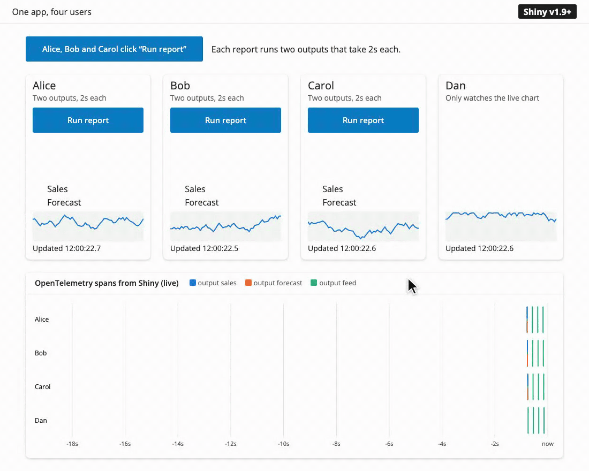

<!-- TODO before publishing: confirm the version number, the date, the authors, and the PR links. -->

[Shiny for Python 1.9](https://pypi.org/project/shiny/) overhauls how the reactive system runs async code, and now uses a concurrency model similar to Shiny for R. This post explains what changed, and shows how much faster an app gets when it awaits slow work. The key changes:

* [A slow `await` in one session no longer blocks other sessions](#one-slow-user-no-longer-blocks-everyone), so the users of an app no longer wait for each other.
* [Async outputs in the same session now run concurrently](#async-outputs-run-at-the-same-time), so a page with three slow outputs is ready in one second instead of three.
* [`reactive.lock()` is deprecated](#reactivelock-is-deprecated), and the new [`session.run_once_when_idle()`](#new-run_once_when_idle) provides a way to change reactive state from a background task.

Your app still runs on one thread, on a single `asyncio` event loop. Shiny 1.9 doesn't use free-threaded Python or worker threads, and code that keeps Python busy still blocks every session (see [Concurrency needs `await`](#concurrency-needs-await)). What changed is when sessions take turns. Before 1.9, Shiny took one lock for the whole process while it ran a session's reactive updates, and released it only after every `await` in them had finished. The lock made sure that an input couldn't change while an output that read it was still computing, so removing it meant giving each session that guarantee on its own. In 1.9, each session sends its outputs before it applies that user's next input, the same model that Shiny for R uses. Within that rule, the reactive system starts each effect as a task and moves on, so while one session awaits a query, the event loop runs the others.


## One slow user no longer blocks everyone

Until now, Shiny for Python processed reactivity behind one lock for the whole process, `reactive.lock()`. When a user's action invalidated an effect or an output, Shiny took the lock, ran everything that was invalidated, and released the lock only when all of it had finished. This model meant that any other reactive effects were blocked for as long as an operation kept the lock. During that time, no other session in the process (*e.g.*, a separate tab or another user) could update anything, not even an output that had nothing to do with the query.

The recording below shows an example of how the new system improves things drastically. It simulates four people using the same app each in a separate Shiny session. Alice, Bob and Carol each click "Run report" at the same time. A report has two async outputs, "Sales" and "Forecast", and each one takes two seconds to finish query. Dan only watches a chart that the server redraws every 0.2 seconds. The plot at the bottom displays the [OpenTelemetry spans](https://shiny.posit.co/py/docs/opentelemetry.html) for the app to visualize the timeline of server processing.

Each user's card shows the status of their two outputs: a hand while the output waits its turn, a spinner while it runs, and a check when it is done. Under the button, the time since the click is split into three parts that add up to the total: how long the report *waited* before its first output started, how long its outputs *computed*, and how long the session was *blocked* afterwards, before its chart could update again.

### Before 1.9

{fig-alt="Shiny for Python 1.8: three users click Run report at the same time. Alice's report computes for 4 seconds and is then blocked for 8 seconds. Bob waits for 4 seconds, computes for 4, and is blocked for 4. Carol waits for 8 seconds and computes for 4. Dan's chart is blocked for 12 seconds. In the timeline, the six output spans form a staircase, one after another."}

### After 1.9

{fig-alt="Shiny for Python 1.9: three users click Run report at the same time. Every report waits 0 seconds, computes for 2 seconds, and is blocked for 0 seconds. Dan's chart keeps moving. In the OpenTelemetry timeline, all six output spans start and end together."}

In 1.8, the OpenTelemetry data shows the six output spans forming a staircase. Alice's "Forecast" waits for her own "Sales", and Bob's report can't start until Alice's ends. No session redraws its chart (the green ticks) until the last report is done. In 1.9, all six outputs run at the same time, and Dan's chart never stops updating.

In 1.9, a reactive flush starts each invalidated effect as an asynchronous task and the reactive system doesn't wait for it to finish to continue processing events. While Alice's report awaits its query, the event loop is free to serve Bob, Carol, Dan, and everyone else.

{fig-alt="Diagram in two panels. The top panel, Shiny 1.8, shows Alice holding one lock for the whole app while Bob and Carol wait for it. Behind the lock, in a box labeled Global queue, six outputs run in a single line: Alice's Sales, Alice's Forecast, Bob's Sales, Bob's Forecast, Carol's Sales, and Carol's Forecast. The bottom panel, Shiny 1.9, shows three separate sessions for Alice, Bob and Carol side by side. In each one, the user's click starts Sales and Forecast at the same time, inside a box labeled Per-session tasks, both feed into one step that sends both outputs together, and then the user's next input is applied. A note says that all six outputs run at the same time, and that each session applies its next input only after it sends its outputs, so inputs never change halfway through."}

The more users that click at the same time, the larger the difference:

{fig-alt="Line chart. With Shiny for Python 1.8, the wait for the last user grows by 4 seconds for each user, up to 32 seconds for 8 users. With 1.9, it stays at 2 seconds for any number of users."}

Put in terms of scaling: when *n* users each start *k* async outputs that each wait *t* seconds, the last user in 1.8 waits about *n* × *k* × *t* seconds, because every output runs after the one before it. In 1.9, every user waits about *t* seconds, for any number of users and outputs. The wait goes from $O(n \cdot k)$ to $O(1)$. In the chart, *k* is 2 and *t* is 2 seconds, so for 8 users the wait goes from 32 seconds to 2.

*Caveat:* this speedup applies when the slow part is waiting on something outside Python that can serve many requests at the same time, such as a database or a web API. Work that keeps Python itself busy will still add up (see [Concurrency needs `await`](#concurrency-needs-await) below).


## Async outputs run at the same time

Apart from the cross-session benefits, the updated reactive system also improves things for a single user, as Alice's two outputs show in the recording above. Before, a flush ran the outputs of a session one after another, so a page with several slow `async` outputs added up their times. Now they all start together and the page updates once all the updates are ready.

In this example, there are three outputs and each one waits for a one-second query. The app then shows how long after the click it was ready:

```python
import asyncio
import time

from shiny import reactive
from shiny.express import input, render, ui

ui.input_action_button("refresh", "Refresh dashboard")


@reactive.calc
def refreshed_at():
    input.refresh()
    return time.perf_counter()


async def query(name: str) -> str:
    start = refreshed_at()
    await asyncio.sleep(1)  # Stands in for a one-second database query.
    return f"{name} ready after {time.perf_counter() - start:.1f}s"


@render.text
async def revenue():
    return await query("Revenue")


@render.text
async def signups():
    return await query("Signups")


@render.text
async def churn():
    return await query("Churn")
```

[Open this app in Shinylive](https://shinylive.io/py/editor/#code=NobwRAdghgtgpmAXAAjFADugdOgnmAGlQGMB7CAFzkqVQEsZ1SAnC5KAZ1wmLtIB0IDJq2QUGcQYIBmzUjGQcAFnQi5kwlm2ZwoxcQDdJEWfMUq1WOAA90Ojhw2MtGiOgCuFIjogATOMxE7nRSEMFYqh4UAPp64uTRAEaeFOQAFPxgOrJwyplEmQBKcDnKyL6cSomkUMy+mQCUoYIAAjpxdEZYxFAANsSC-tLI2fZKcL6xFGkNiILIC65RWKO5SjPzizoU7swQYhI4AdLRZO6UARsQoZzcxOUlyACO7gG4adDwKBwUzA3IAFoAHyKX5zfaLH61NgAXhGJTGEymV0W7AA7lA6Gxbjw+FgOL04HB0GkAIz-ZAAYmQAGUKFA-I5VMhpCx2MhyHAARw4GQ-OUoPTEpw4M9XsxcFhNgttrt9tJMiBPnAAL7wqC+dRQaRUZjIEDieBHZgnM4XZgzQGg6GILCk6QqjiZZoQNrUfzMLBUawUQQ4+5DeFGMJwGbg1GyvbozFsF5vDJgYrB16NF1uvwBL02X3QLg8B7DDh0ADmYXQHDD0vhOyjUAxWLF8cyNJLZadYCa1y76Y9WZ9frzAcexCUcsrEJlcBr+zrMcbEoTAGFR3tUxBCKgKLh0AgUGBvRQwCqALpAA) to run it in your browser and edit it.

In 1.8, the outputs are ready one at a time, after 1.0, 2.0 and 3.0 seconds, and none of them render until the last one is done at 3.0s. In 1.9, all three are ready after 1.0 second.

{fig-alt="Line chart. With Shiny for Python 1.8, the time grows by one second for each output, up to 12 seconds for 12 outputs. With 1.9, it stays at 1 second for any number of outputs."}

## Concurrency needs `await` {#concurrency-needs-await}

::: callout-important
## Blocking code still blocks every session

Shiny runs on a single [`asyncio` event loop](https://docs.python.org/3/howto/a-conceptual-overview-of-asyncio.html#event-loop). Code can only run concurrently while other code awaits. A synchronous call such as `time.sleep()`, a blocking database driver, or a long calculation still stops every session until it returns, in both 1.8 and in 1.9.
:::

The recommended way to run slow work is an [extended task](https://shiny.posit.co/py/docs/nonblocking.html). It runs in the background, outside the session's reactive cycle, so the user can keep using the app while it runs. It also gives you the task's status, a way to cancel it, and a button that shows when the task is busy. Inside the task, call an async library, or run a blocking call in a thread with [`asyncio.to_thread()`](https://docs.python.org/3/library/asyncio-task.html#asyncio.to_thread):

```python
@ui.bind_task_button(button_id="go")
@reactive.extended_task
async def run_query(filters):
    return await asyncio.to_thread(run_slow_query, filters)


@reactive.effect
@reactive.event(input.go)
def _():
    run_query(input.filters())


@render.data_frame
def results():
    return run_query.result()
```

For lower-level control, you can await `asyncio.to_thread()` directly in an output. This keeps the event loop free, so other sessions keep going, but it doesn't have the extended task's features: there is no status, no way to cancel, and the output is part of the session's cycle, so the session sends its other outputs and applies its next input only after the call returns.

```python
@render.data_frame
async def results():
    return await asyncio.to_thread(run_slow_query, input.filters())
```


## What stays the same

Within one session, Shiny keeps the guarantees that make reactive code easy to reason about. These match how Shiny works in R as well:

* **Inputs don't change in the middle of a cycle.** If a user changes an input while the session's effects are still running, Shiny applies the change only when all of them have finished. An effect that pauses at an `await` sees the same input values when it resumes. Timers from `reactive.invalidate_later()` wait the same way.
* **Outputs update together.** A session sends all of its new output values at once, when its effects have finished, so the page never shows a mix of old and new results.
* **An effect never overlaps itself.** If an effect is invalidated while it runs, the next run starts when the current run ends.


## Changes you might notice

::: callout-warning
## Draft: review needed

@schloerke, please review this section before we publish. It may be more detail than is needed, and I'm not 100% certain on the explanations and could use another set of eyes.
:::

Most apps won't need any changes, but here are some differences that you might see:

* **Async effects interleave.** Effects in the same session now run in turns at each `await`, instead of one after another. `priority` sets the order in which effects *start*, not the order in which they finish. If one effect depends on another effect's side effect, use a `reactive.calc` or a `reactive.value` to make the dependency explicit. ([#837](https://github.com/posit-dev/py-shiny/issues/837))
* **Destroying an effect cancels it.** Because Shiny no longer waits for async effects to finish, a session can end, or a module can be destroyed, while one of its effects is paused at an `await`. So `effect.destroy()`, the end of a session, and `session.destroy()` for a module now cancel a run that is still in progress, by raising `asyncio.CancelledError` at its current `await`. This stops the effect before it can read values that were destroyed with its module. If an effect needs to clean up, catch `asyncio.CancelledError` (or use `try`/`finally`) and then let the error continue.
* **Message handlers run in their own tasks.** In 1.8, Shiny ran a `session.set_message_handler()` handler before it read the next message from the client, and it kept the global lock while the handler ran. So a slow handler delayed the client's other messages, and every other session as well. Now each handler runs in a task of its own, and the session keeps handling messages while it runs.
* **Setting a value schedules a flush.** Setting a `reactive.value` now schedules a flush on its own ([#21](https://github.com/posit-dev/py-shiny/issues/21)). So a value set from a download handler updates the outputs that read it right away, even while a streamed download is still sending ([#1785](https://github.com/posit-dev/py-shiny/issues/1785)). The reactive graph is still not thread-safe, so from another thread, use `loop.call_soon_threadsafe(value.set, new_value)`.
* **Messages from `session.on_flushed()` callbacks reach the browser.** A callback that sends a message, for example `ui.update_text()`, now has its message sent to the client ([#1889](https://github.com/posit-dev/py-shiny/issues/1889)).
* **OpenTelemetry spans follow the session.** There is now one `reactive_update` span for each session's cycle, as in Shiny for R. It has the session's `session.id`, and the session's calc, effect and output spans are its children.


## `reactive.lock()` is deprecated

Shiny itself no longer uses `reactive.lock()`, and in 1.9 it no longer does anything. Calling it emits a `ShinyDeprecationWarning` and returns a lock that never blocks. The `reactive.lock()` API will be completely removed in a future version of Shiny for Python.

The usual reason to use it was to change reactive state from a background task, followed by a flush. You can now just set the value directly, and Shiny will schedule the flush for you:

```python
# Before
async with reactive.lock():
    latest.set(new_value)
    await reactive.flush()

# After
latest.set(new_value)
```

If your code used `reactive.lock()` to keep two pieces of your own code from running at the same time, create your own [`asyncio.Lock`](https://docs.python.org/3/library/asyncio-sync.html#asyncio.Lock) for that.


## New: `run_once_when_idle()`

::: callout-warning
## Draft: doc link needs updating

This will need a link to the correct `run_once_when_idle()` docs once those are published.
:::

Sometimes a change should wait until a session's running effects have finished, the same way input changes from the browser do. [`session.run_once_when_idle()`](https://shiny.posit.co/py/api/core/Session.html) runs a function once, at the start of the session's next cycle:

```python
session.run_once_when_idle(lambda: latest.set(new_value))
```

The function runs when all of the session's effects have finished and its outputs have been sent. If the session is idle already, it runs on the next pass of the event loop.


## Try it yourself

::: callout-warning
## Draft: demo sources need links
:::

The demo apps in this post, with the live OpenTelemetry timeline, are in <!-- TODO: link to where the demo source is published -->. Run them with Shiny for Python 1.8 and 1.9 to see the difference on your own machine. To view the spans of your own app, see [Shiny's OpenTelemetry docs](https://shiny.posit.co/py/docs/opentelemetry.html). <!-- TODO: confirm this URL -->


## In closing

This is one of the largest changes to Shiny for Python's internals since its first release, and it brings Python and R to the same reactive model. The [Shiny for Python 1.9 release post](#) <!-- TODO: link to the 1.9 release post --> covers the rest of the release. If an app behaves differently after you upgrade, please let us know! As always, if you have questions or feedback, [join us on Discord](https://discord.gg/yMGCamUMnS) or open an issue on [posit-dev/py-shiny](https://github.com/posit-dev/py-shiny/issues/new). Happy Shiny-ing!

```{=html}
<!-- Halloween easter egg: when the end of the post scrolls into view, a skeleton
     rises from the bottom of the screen and waves, jack-o'-lanterns pop up, and bats
     fly past. It plays
     once per page view, is skipped for readers who prefer reduced motion, and a
     click anywhere dismisses it. -->
<div id="spooky-egg-trigger" aria-hidden="true"></div>

<script>
(function () {
  const trigger = document.getElementById("spooky-egg-trigger");
  if (!trigger || !("IntersectionObserver" in window)) return;
  if (window.matchMedia("(prefers-reduced-motion: reduce)").matches) return;

  const BONE = "#EEE9DC";
  const OUTLINE = "#7D7563";
  const DURATION = 7000;

  const bones = [
    "M-2 92 L-50 99", "M2 92 L50 99",
    "M-50 101 L-60 168", "M-60 170 L-54 232",
    "M50 101 L80 62",
  ];
  for (let i = 0; i < 6; i++) {
    const y = 104 + i * 15, w = 38 - Math.abs(i - 1.5) * 3;
    bones.push(`M-4 ${y} C${-w} ${y - 4} ${-w - 2} ${y + 12} -6 ${y + 10}`);
    bones.push(`M4 ${y} C${w} ${y - 4} ${w + 2} ${y + 12} 6 ${y + 10}`);
  }
  const strokes = (paths, width, color) => paths
    .map((d) => `<path d="${d}" fill="none" stroke="${color}" stroke-width="${width}" stroke-linecap="round"/>`)
    .join("");
  let spine = "";
  for (let y = 76; y < 240; y += 10) {
    spine += `<rect x="-4.5" y="${y}" width="9" height="7" rx="2.5" fill="${BONE}" stroke="${OUTLINE}"/>`;
  }
  const forearm = ["M80 62 L92 8"];

  const skeleton = `
    <svg class="spooky-skeleton" viewBox="-80 -14 190 282" aria-hidden="true">
      ${spine}
      ${strokes(bones, 7.5, OUTLINE)}${strokes(bones, 4.5, BONE)}
      <g class="spooky-forearm">
        ${strokes(forearm, 7.5, OUTLINE)}${strokes(forearm, 4.5, BONE)}
        <circle cx="93" cy="2" r="7" fill="${BONE}" stroke="${OUTLINE}" stroke-width="1.5"/>
      </g>
      <circle cx="-54" cy="238" r="7" fill="${BONE}" stroke="${OUTLINE}" stroke-width="1.5"/>
      <ellipse cx="-17" cy="254" rx="17" ry="12" fill="${BONE}" stroke="${OUTLINE}" stroke-width="1.5"/>
      <ellipse cx="17" cy="254" rx="17" ry="12" fill="${BONE}" stroke="${OUTLINE}" stroke-width="1.5"/>
      <circle cx="0" cy="32" r="30" fill="${BONE}" stroke="${OUTLINE}" stroke-width="1.5"/>
      <rect x="-17" y="50" width="34" height="22" rx="7" fill="${BONE}" stroke="${OUTLINE}" stroke-width="1.5"/>
      <rect x="-15" y="48" width="30" height="6" fill="${BONE}"/>
      <ellipse cx="-11" cy="33" rx="8" ry="9" fill="#0B2238"/>
      <ellipse cx="11" cy="33" rx="8" ry="9" fill="#0B2238"/>
      <circle cx="-13" cy="31" r="1.8" fill="#6FC1EE"/>
      <circle cx="9" cy="31" r="1.8" fill="#6FC1EE"/>
      <path d="M0 43 L-4 51 L4 51 Z" fill="#0B2238"/>
      <g stroke="#0B2238" stroke-width="1.3">
        <line x1="-12" x2="12" y1="62" y2="62"/>
        <line x1="-7" x2="-7" y1="58" y2="66"/>
        <line x1="0" x2="0" y1="58" y2="66"/>
        <line x1="7" x2="7" y1="58" y2="66"/>
      </g>
    </svg>`;
  const bat = `
    <svg viewBox="0 0 40 18" aria-hidden="true"><g class="spooky-wings">
      <path fill="#2B2B38" d="M20 7 C18 4 16 3 14 4 C10 0 4 0 0 5 C4 5 6 7 7 10 C9 8 12 8 13 11 C15 9 17 10 18 12 L20 15 L22 12 C23 10 25 9 27 11 C28 8 31 8 33 10 C34 7 36 5 40 5 C36 0 30 0 26 4 C24 3 22 4 20 7 Z"/>
      <circle cx="18.6" cy="8" r="0.9" fill="#FFB300"/><circle cx="21.4" cy="8" r="0.9" fill="#FFB300"/>
    </g></svg>`;
  const pumpkin = `
    <svg viewBox="0 0 60 56" aria-hidden="true">
      <path d="M28 10 C27 5 29 2 34 1 L35 4 C32 5 31 7 32 10 Z" fill="#5B7F2B" stroke="#33461A" stroke-width="1"/>
      <ellipse cx="30" cy="33" rx="27" ry="21" fill="#F28C28" stroke="#8A3B0B" stroke-width="1.5"/>
      <ellipse cx="30" cy="33" rx="16" ry="21" fill="none" stroke="#D9701A" stroke-width="1.3"/>
      <ellipse cx="30" cy="33" rx="6" ry="21" fill="none" stroke="#D9701A" stroke-width="1.3"/>
      <g fill="#FFD54F" stroke="#8A3B0B" stroke-width="0.8">
        <path d="M15 28 L24 28 L19.5 20 Z"/>
        <path d="M36 28 L45 28 L40.5 20 Z"/>
        <path d="M28 31 L32 31 L30 35 Z"/>
        <path d="M13 37 L18 41 L22 37 L26 42 L30 37 L34 42 L38 37 L42 41 L47 37 Q44 49 30 49 Q16 49 13 37 Z"/>
      </g>
    </svg>`;

  const css = `
    #spooky-egg { position: fixed; inset: 0; pointer-events: none; z-index: 9999; overflow: hidden; }
    #spooky-egg.leaving { transition: opacity 0.4s; opacity: 0; }
    .spooky-pumpkin svg, .spooky-bat svg { display: block; width: 100%; height: auto; }
    .spooky-skeleton {
      position: absolute; right: 6vw; bottom: -70px; width: clamp(120px, 16vw, 180px);
      animation: spooky-rise ${DURATION}ms ease-in-out both;
    }
    .spooky-forearm { transform-origin: 80px 62px; animation: spooky-wave 0.5s ease-in-out 0.9s 9 alternate; }
    .spooky-bat { position: absolute; left: 0; width: clamp(64px, 8vw, 104px); animation: spooky-fly linear both; }
    .spooky-pumpkin {
      position: absolute; bottom: 4px;
      animation: spooky-pop cubic-bezier(0.3, 1.4, 0.5, 1) both;
    }
    .spooky-wings { transform-origin: 20px 9px; animation: spooky-flap 0.16s ease-in-out infinite alternate; }
    .spooky-note {
      position: absolute; right: calc(6vw + clamp(120px, 16vw, 180px)); bottom: 120px;
      padding: 0.5em 0.9em; border-radius: 1em; background: #0F1B2A; color: #DCEEFB;
      font-weight: 600; box-shadow: 0 6px 20px rgba(0, 0, 0, 0.25);
      animation: spooky-note ${DURATION}ms ease-in-out both;
    }
    @media (max-width: 600px) {
      .spooky-note { right: 12px; bottom: 130px; max-width: 70vw; }
    }
    @keyframes spooky-rise {
      0% { transform: translateY(105%); } 13% { transform: translateY(0); }
      86% { transform: translateY(0); } 100% { transform: translateY(105%); }
    }
    @keyframes spooky-pop {
      0% { transform: translateY(115%); } 12% { transform: translateY(0); }
      86% { transform: translateY(0); } 100% { transform: translateY(115%); }
    }
    @keyframes spooky-wave { from { transform: rotate(-18deg); } to { transform: rotate(14deg); } }
    @keyframes spooky-flap { from { transform: scaleY(1); } to { transform: scaleY(0.35); } }
    @keyframes spooky-fly {
      0% { transform: translate(-10vw, 0); } 25% { transform: translate(20vw, -4vh); }
      50% { transform: translate(50vw, 3vh); } 75% { transform: translate(80vw, -5vh); }
      100% { transform: translate(112vw, -2vh); }
    }
    @keyframes spooky-note {
      0%, 16% { opacity: 0; transform: scale(0.6); } 22% { opacity: 1; transform: scale(1); }
      82% { opacity: 1; transform: scale(1); } 90%, 100% { opacity: 0; transform: scale(0.8); }
    }`;

  function play() {
    const style = document.createElement("style");
    style.textContent = css;
    const egg = document.createElement("div");
    egg.id = "spooky-egg";
    egg.setAttribute("aria-hidden", "true");
    const bats = [[18, 4200, 200], [30, 5000, 700], [10, 3800, 1200]]
      .map(([top, duration, delay]) =>
        `<div class="spooky-bat" style="top:${top}vh; animation-duration:${duration}ms; animation-delay:${delay}ms">${bat}</div>`)
      .join("");
    // [left, width, delay] for each jack-o'-lantern; they all sink at the end.
    const pumpkins = [[5, 76, 600], [17, 56, 900], [30, 88, 1150], [45, 62, 1400]]
      .map(([left, width, delay]) =>
        `<div class="spooky-pumpkin" style="left:${left}vw; width:clamp(${Math.round(width * 0.6)}px, ${width / 12}vw, ${width}px); animation-delay:${delay}ms; animation-duration:${DURATION - delay}ms">${pumpkin}</div>`)
      .join("");
    egg.innerHTML = skeleton + pumpkins + bats + `<div class="spooky-note">Boo! Happy Halloween from the Shiny team!</div>`;
    document.head.appendChild(style);
    document.body.appendChild(egg);

    let done = false;
    function finish() {
      if (done) return;
      done = true;
      egg.classList.add("leaving");
      setTimeout(() => { egg.remove(); style.remove(); }, 400);
      document.removeEventListener("pointerdown", finish);
    }
    document.addEventListener("pointerdown", finish);
    setTimeout(finish, DURATION);
  }

  const observer = new IntersectionObserver((entries) => {
    if (entries.some((entry) => entry.isIntersecting)) {
      observer.disconnect();
      play();
    }
  });
  observer.observe(trigger);
})();
</script>
```
