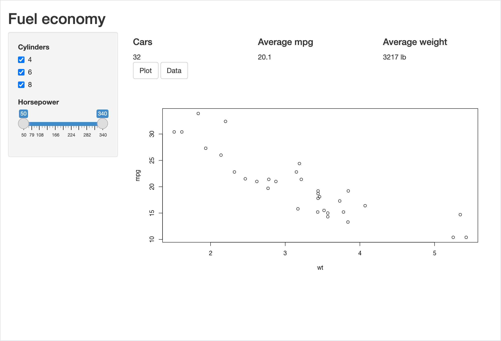
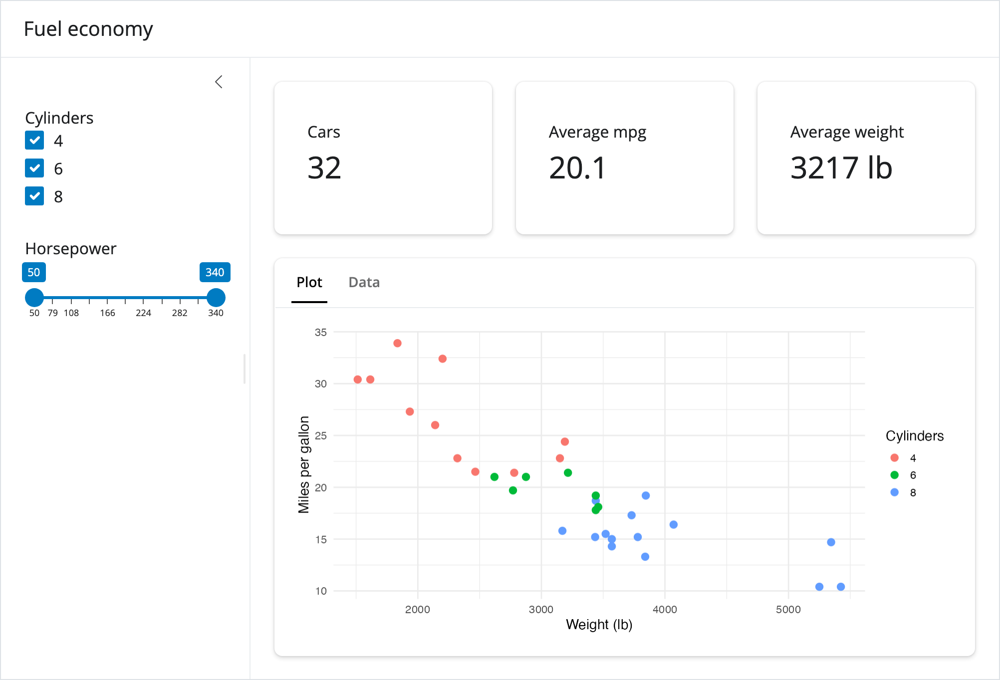
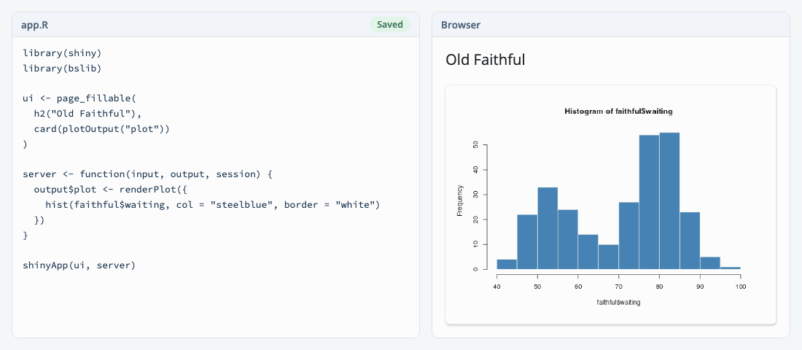

We're happy to announce that [Shiny for R v1.15](https://cran.r-project.org/package=shiny) is now on CRAN!

``` r
install.packages("shiny")
```

The highlights:

- a bundled [Agent Skill](#agent-skill) teaches coding agents how to write Shiny for R apps,
- [autoreload](#autoreload-out-of-the-box) no longer needs an extra package install, and
- sessions are [steadier when a page is refreshed or reconnected](#refresh-and-reconnect).

This is a small release: one new feature, and a round of fixes for things that came up after v1.14. Full details are in the [Shiny for R release notes](https://shiny.posit.co/r/reference/shiny/1.15.0/upgrade.html).

## Agent skill

When we [shipped agent skills in Shiny for Python v1.7](../../blog/2026-08-04_shiny-r-1-14-python-1-7/#agent-skills), we said they were coming to R soon. They're here.

Coding agents write a lot of Shiny apps, and they tend to make the same mistakes: nested `fluidRow()` and `column()` pyramids where a bslib layout would do, tabs faked with buttons and `conditionalPanel()`, slow work that blocks every session, and `print()` calls in place of a debugger. Shiny v1.15 ships a `shiny-for-r` skill that follows the [Agent Skills](https://agentskills.io) convention and steers agents toward what the framework already provides.

To show the difference, here is one small app written both ways. The data, inputs, and outputs are the same; only the choice of layout and navigation changes.

<div class="grid gap-12 items-start mt-12 md:grid-cols-2">
<div class="prose max-w-none">

<figure>

<figcaption aria-hidden="true">The habits above: a <code>fluidRow()</code> and <code>column()</code> grid, with two buttons and <code>conditionalPanel()</code> standing in for tabs.</figcaption>
</figure>

</div>
<div class="prose max-w-none">

<figure>

<figcaption aria-hidden="true">What the skill points to: a bslib page with a sidebar, value boxes, and a card with real tabs.</figcaption>
</figure>

</div>
</div>

The skill is an index. Its `SKILL.md` is a short table of topics, and each row points to one of 21 reference files. An agent reads the index, then opens only the one or two references its task touches:

| Area | References |
|------------------------------------|------------------------------------|
| Foundations | reactivity, modules, session lifecycle |
| Async | promises, `ExtendedTask` |
| Dashboards | dashboard design, bslib components, layouts |
| Navigation and dynamic UI | navigation, dynamic UI |
| Outputs | plots, tables, files |
| Feedback and state | notifications and validation, bookmarking |
| Theming and extending | theming and assets, custom components |
| Testing and observability | `testServer()`, debugging, OpenTelemetry, ecosystem |

The last one, ecosystem, helps an agent decide when a companion package such as DT, plotly, leaflet, shinychat, or shinytest2 already solves the problem.

### Using the skill

Agents that use [btw](https://posit-dev.github.io/btw/) find the skill on their own. btw looks for skills in every attached package, so once your session has run `library(shiny)`, the skill is available. There is nothing to install.

To use the skill with Claude Code or another skill-aware tool, copy it into your project:

``` r
btw::btw_skill_install_package("shiny")
```

By default this copies the skill into your project's `.btw/skills/` or `.agents/skills/` folder. Use `scope` to pick a different place, such as `scope = ".claude/skills"` for Claude Code or `scope = "user"` to make the skill available in all of your projects.

Because the skill ships inside the package, it matches the version of Shiny you have installed. It's also tested with the package: every code example must parse, and every Shiny function it names must still be exported, so a renamed function fails our checks instead of misleading your agent.

You can read the skill yourself, too. It lives at `system.file("skills", "shiny-for-r", package = "shiny")`.

## Autoreload out of the box

With `options(shiny.autoreload = TRUE)` (or [`devmode()`](https://shiny.posit.co/r/reference/shiny/latest/devmode.html)), Shiny reloads your app in the browser each time you save a file. Until now, Shiny used the [watcher](../../blog/2026-06-29_watcher-0-2-0/) package to do this only when it was installed, and fell back to an older, slower method that checked your files on a timer when it wasn't.

In v1.15, watcher is a required dependency and the fallback is gone. Autoreload now works the same way for everyone: the operating system tells Shiny when a file changes, so there is no polling and no extra package to install.

``` r
options(shiny.autoreload = TRUE)
shiny::runApp("myapp")
```

<figure>

<figcaption aria-hidden="true">Each save of <code>app.R</code> reloads the app in the browser.</figcaption>
</figure>

The `shiny.autoreload.interval` and `shiny.autoreload.pattern` options work as before.

## Refresh and reconnect

Shiny v1.14 added [`session$destroy()`](../../blog/2026-08-04_shiny-r-1-14-python-1-7/#module-cleanup) for cleaning up dynamic modules. That work had a side effect we didn't intend, and it led us to a second, older bug nearby. Both are fixed in v1.15.

### Async work that outlives the page

In v1.14, closing a session destroyed every reactive value and expression created in it. That sounds tidy, but async work often finishes *after* the browser has gone away. Refresh the page while an [`ExtendedTask`](https://shiny.posit.co/r/reference/shiny/latest/ExtendedTask.html) is running, and when the task settled you'd see an error like this in your R console:

``` text
Can't access reactive `Theme Counter`; its module session has been destroyed
```

The same thing happened with any promise or `later()` callback that read or set a reactive after the session closed. And there was little you could do about it, since the access was often inside Shiny, bslib, or shinychat instead of your own code.

In v1.15, closing a session and destroying one are two different things:

- When a session **closes**, its reactives stay readable at their last value, and R's garbage collector reclaims them later. Late async work finishes quietly. Observers are still destroyed, so a late write can't wake the session back up.
- When you call **`session$destroy()`** on a live session, everything is torn down as before, and reading a destroyed reactive is still an error. In that case, a stale read is a real bug that you want to hear about.

`onDestroy()` callbacks run in both cases, so your module cleanup code needs no changes.

### Outputs after a reconnect

If your app uses [`session$allowReconnect()`](https://shiny.posit.co/r/reference/shiny/latest/session.html), a browser that loses its connection can connect again to a new session. The browser kept its record of each output's state from the old session, though, so the first messages from the new session looked out of order. The browser console filled with errors like

``` text
the output is in an unexpected state of: 'value'
```

and, worse, the first value for each output was dropped. Outputs kept showing results from the old session until something made them update again.

The browser now resets its output state when it reconnects, so the new session's first values are drawn as they arrive.

## Other improvements

A few more changes worth a quick mention. The full list is in the [release notes](https://shiny.posit.co/r/reference/shiny/1.15.0/upgrade.html):

- [`dateInput()`](https://shiny.posit.co/r/reference/shiny/latest/dateInput.html)'s `datesdisabled` now works when `format` is not the default `yyyy-mm-dd`. For example, `dateInput("day", "Day", format = "mm/dd/yyyy", datesdisabled = "2026-11-26")` now disables November 26 as you'd expect.
- `dateInput(language =)` now loads its locale when `options(shiny.minified = FALSE)` is set, instead of falling back to English.
- `callModule()`, `moduleServer()`, `testServer()`, and `session$destroy()` work again with module ids that are character vectors. The parts are joined the same way `NS()` joins them, so `c("a", "b")` becomes `"a-b"`. Since v1.14 these failed with `` Invalid `namespace` ``.
- `invalidateLater()`, `reactivePoll()`, and `reactiveTimer()` work again with a custom session object that has no `onDestroy()` method. Since v1.14 they failed with `attempt to apply non-function`.
- `runApp()` now prints its `Listening on http://…` message only after the port is open, so tools that wait for that message can connect right away. (Thanks, [@nbenn](https://github.com/nbenn)!)
- A session whose outputs throw an unhandled error while being flushed is now closed, instead of the error escaping to the server loop.
- [`testServer()`](https://shiny.posit.co/r/reference/shiny/latest/testServer.html) gives clearer errors when a `downloadHandler()`'s `content` function writes no file, and when it is handed a function that is neither a server nor a module server. It also removes a module's outputs and downloads when `session$destroy(id)` is called.
- `ExtendedTask`'s OpenTelemetry output is more complete: the "add to queue" log now has its message, and invocations that waited behind a running one now get their own span.
- The server now rejects malformed websocket messages. A request for an unknown session method gets an `Unknown method` error response, and a message whose `method` is not a single string is refused.

## In closing

We're excited to see what you (and your agents) build with this release. As always, if you have questions or feedback, [join us on Discord](https://discord.gg/yMGCamUMnS) or open an issue on [rstudio/shiny](https://github.com/rstudio/shiny/issues/new). Happy Shiny-ing!

## Acknowledgements

A big thank you to all the folks who helped make this release happen by opening issues and contributing code:

[@000wahab000](https://github.com/000wahab000), [@BajczA475](https://github.com/BajczA475), [@christophsax](https://github.com/christophsax), [@cpsievert](https://github.com/cpsievert), [@djacob65](https://github.com/djacob65), [@gadenbuie](https://github.com/gadenbuie), [@JamesStewartRE](https://github.com/JamesStewartRE), [@jeis4wpi](https://github.com/jeis4wpi), [@josefelipe0036](https://github.com/josefelipe0036), [@JosiahParry](https://github.com/JosiahParry), [@karangattu](https://github.com/karangattu), [@LeonidasZhak](https://github.com/LeonidasZhak), [@ml-ebs-ext](https://github.com/ml-ebs-ext), [@nbenn](https://github.com/nbenn), [@roberson4627-cpu](https://github.com/roberson4627-cpu), [@schloerke](https://github.com/schloerke), [@shelbylevel](https://github.com/shelbylevel), [@shikokuchuo](https://github.com/shikokuchuo), [@taekop](https://github.com/taekop), and [@vedhav](https://github.com/vedhav).
